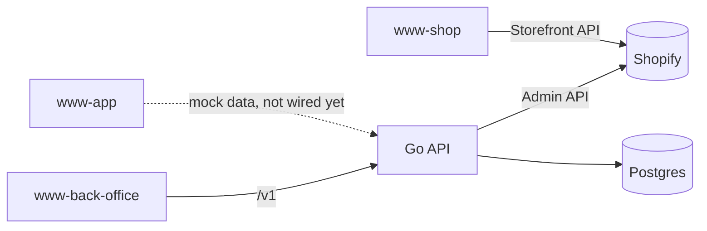

# Architecture

## Stack

- Go (`chi` router) for the API, compiled to two entry points sharing the same `app.New()` router: a local HTTP server and an AWS Lambda handler
- React 19 across all three frontends, state via `zustand` in each
- Shopify Hydrogen + React Router 7 for the storefront, Vite + React Router 7 for the back-office, Expo + Expo Router for the mobile app

## How it fits together

## Key decisions

- The Go API builds once per target: `cmd/server` runs it over plain HTTP for local dev, `cmd/api` wraps the same router for Lambda via `aws-lambda-go-api-proxy` (see `code/api/internal/app`).
- Auth is a single admin identity (`ADMIN_EMAIL`/`ADMIN_PASSWORD_HASH` env vars) issuing a JWT, not a user table — see [auth.md](auth.md).
- `www-shop` ships outside this repo's GitHub Actions pipeline (via Shopify's own Hydrogen/Oxygen tooling); the other two frontends and the API deploy through `.github/workflows/ci-cd.yml` — see [deployment.md](deployment.md).

## Gotchas

- `www-app` runs entirely on fixtures under `src/lib/mock/`; it does not yet call the Go API.
- The Terraform for the Lambda function, API Gateway, RDS instance, and the S3+CloudFront fronts is written but commented out in `infrastructure/terraform/`; provisioning them is a deliberate, separate step from running `terraform.py`.
