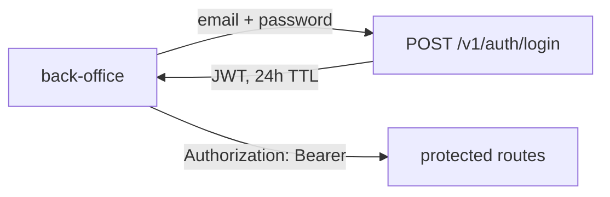

# Auth

## Authentication

- Single admin identity, not a user table: `POST /v1/auth/login` checks the email/password against `ADMIN_EMAIL` and a bcrypt `ADMIN_PASSWORD_HASH` env pair, then issues an HS256 JWT (`code/api/internal/jwt`, `golang-jwt/v5`) signed with `JWT_SECRET`

## Authorization

- No roles or scopes: any valid JWT is treated as the admin principal by `auth.Middleware` (`code/api/internal/auth/auth.go`), which exposes `Subject`/`Email` via request context

## Sessions

- Token TTL is 24h, no refresh endpoint; `www-back-office` persists the token client-side via `zustand/persist` (`src/stores/auth.ts`, localStorage key `back-office-auth`)
