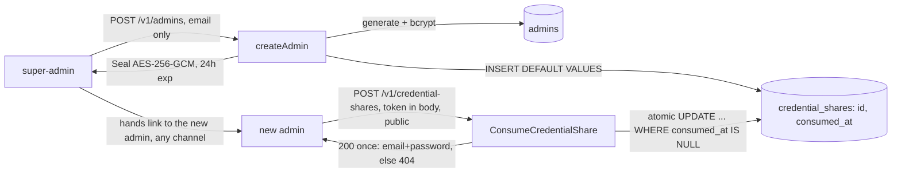

# Auth

## Authentication

- Real `admins` table (`code/database/migrations/002_create_admins.sql`: `id`, `email` unique, `password_hash` bcrypt, `is_super_admin`, `created_at`), not a single env-backed identity: `POST /v1/auth/login` checks email/password against that table (`code/api/internal/routes/auth.go`, `findAdminByEmail` + `bcrypt.CompareHashAndPassword`), then issues an HS256 JWT (`code/api/internal/jwt`, `golang-jwt/v5`) signed with `JWT_SECRET`, carrying the admin's real id as `sub`, an `isSuperAdmin` claim, and `aud: "backoffice"` (`jwt.AudienceBackoffice`)
- Every token carries an explicit `aud` claim, checked via `jwtlib.WithAudience` in `jwt.Verify`, which rejects a mismatched audience *and* a token with no `aud` claim at all: `auth.Middleware` only accepts `aud: "backoffice"` (admin tokens), a sibling `auth.AppMiddleware` only accepts `aud: "app"` (end-user tokens, exposing `AppPrincipal{UserID, Email}` via its own context key). Tokens signed before this separation (GitHub #61) carry no `aud` and are rejected by both, forcing a re-login
- `ADMIN_EMAIL`/`ADMIN_PASSWORD_HASH` are bootstrap-only: on every login attempt, `bootstrapFirstSuperAdmin` (`code/api/internal/routes/admins.go`) inserts one super-admin row from those env vars, but only while `admins` is still empty; once any row exists they are never read again. This exists so a fresh environment (local, stg, or a freshly migrated prod) always has a way to create its first admin, since the admin-management page itself requires being logged in as a super-admin already
- There is no password-reset or password-change endpoint. If every super-admin's password is lost, the only recovery is `DELETE FROM admins;` directly against the database — the next login attempt re-runs `bootstrapFirstSuperAdmin` against the then-empty table and re-seeds from `ADMIN_EMAIL`/`ADMIN_PASSWORD_HASH`. Create a second super-admin right after the first prod login specifically so this manual path stays a theoretical fallback, not the normal recovery route

```mermaid
flowchart LR
    client[back-office] -->|email + password| login[POST /v1/auth/login]
    login -->|bootstrap if admins empty| bootstrap[(admins table)]
    login -->|JWT: sub=id, isSuperAdmin, 24h TTL| client
    client -->|Authorization: Bearer| api[protected routes]
    client -->|Authorization: Bearer, super-admin only| admins[/v1/admins CRUD]
    admins --> bootstrap
```

## Authorization

- A valid JWT with `aud: "backoffice"` is treated as an admin principal by `auth.Middleware` (`code/api/internal/auth/auth.go`), which exposes `Subject`/`Email`/`IsSuperAdmin` via request context — every route mounted in `app.go`'s protected `/v1` group (`example`, `shopify`, `analytics`, `leads`) stays reachable by any valid admin, regardless of role. An `aud: "app"` token is rejected here with `401`, and never reaches this group at all
- A sibling, separately-mounted `/v1/app` group uses `auth.AppMiddleware` instead, which only accepts `aud: "app"` and exposes `AppPrincipal{UserID, Email}`; an admin's `aud: "backoffice"` token is rejected here with `401`. The only route mounted so far is `GET /v1/app/me` (`routes.App()`), a placeholder to exercise the middleware — the real app-user endpoints are built on top of this in GitHub #62
- One role, super-admin, gates admin management only: `auth.RequireSuperAdmin` is layered on top of `auth.Middleware` (not instead of it) around `POST/GET/DELETE /v1/admins` (`code/api/internal/routes/admins.go`); a non-super-admin gets `403 Forbidden` there and nowhere else
- Guardrails on `DELETE /v1/admins/{id}`: an admin can never delete itself (`400 Cannot delete yourself`), and the last remaining super-admin can never be deleted (`400 Cannot delete the last super admin`) — the admins table can never end up with zero super-admins through this endpoint
- `requireLiveSuperAdmin` (`code/api/internal/routes/admins.go`) re-checks the actor's row in the database on every `/v1/admins` request, on top of the JWT claim: a deleted or demoted super-admin's still-valid token is rejected there immediately, including an attempt to recreate itself as a super-admin. This is scoped to `/v1/admins` only (one extra query on 3 low-traffic endpoints) — the rest of `/v1` (`leads`, `shopify`, `analytics`) still trusts the JWT claim alone, so a role change or deletion only revokes *general* back-office access (not admin-management power) at that admin's next login, up to 24h later; this residual lag on the non-admin routes is an accepted tradeoff, not an oversight

## Credential sharing (admin creation)

- `POST /v1/admins` no longer accepts a client-supplied password: `createAdminBody` has no `Password` field at all, so a client that still sends one is simply ignored (not read, not rejected). The server generates one itself (`generateStrongPassword`, `code/api/internal/routes/admins.go`: 20 chars, `crypto/rand`, a charset excluding visually ambiguous characters), bcrypt-hashes it into `admins.password_hash` exactly as before, and the plaintext never touches any table — not even temporarily
- Instead, creation also inserts an empty row into `credential_shares` (`code/database/migrations/003_create_credential_shares.sql`: just `id`, `created_at`, `consumed_at` — no secret column exists to leak) and seals `{email, password, shareId, exp: now+24h}` into an opaque `shareToken` (`code/api/internal/credentialshare`, AES-256-GCM via `crypto/cipher.NewGCM`, random nonce prefixed to the ciphertext, `base64.RawURLEncoding`) returned alongside the created admin as `{"admin": ..., "shareToken": "..."}`
- `POST /v1/credential-shares` (token in the **JSON body**, not the URL path) is public (mounted in `app.go` next to `/auth` and `POST /leads`, outside `auth.Middleware`) and consumes the token atomically: `UPDATE credential_shares SET consumed_at = NOW() WHERE id = $1 AND consumed_at IS NULL`, checking `RowsAffected()` — exactly one concurrent caller ever sees the revealed `{email, password}`, every other caller (concurrent, already-consumed, expired, or tampered) gets the same generic `404`, never a 500 and never a hint which case it was. It was originally a `GET /{token}`; a post-ship review caught that `middleware.Logger` logs the full request URL on every call, so a path-based token was written verbatim to the access log (CloudWatch in prod) on *every* request — including the failure path where `db.Pool`/the `UPDATE` errors out before consumption, leaving a still-valid token logged. Moving the token into a POST body keeps it out of logs, browser history, and `Referer` headers at once, and is also the more honest HTTP verb for a handler whose whole point is a server-side mutation
- `ConsumeCredentialShare` (`code/api/internal/routes/credential_shares.go`) re-validates `CREDENTIAL_SHARE_SECRET` with `auth.ValidateShareSecret` before calling `Open`, mirroring `createAdmin`'s own check: boot-time validation makes a bad secret unreachable in practice, but without this a misconfiguration would collapse into `Open`'s generic error and read as "every link is invalid" instead of a loud `500`
- `credentialshare.Open` collapses every failure mode (bad base64, wrong key, tampered GCM tag, expired `Exp`) into the single exported `ErrInvalidOrExpired`, specifically so the HTTP layer can't accidentally leak which one applies — and has nothing else worth branching on, so the handler never inspects the error beyond `!= nil`
- Encryption key is `CREDENTIAL_SHARE_SECRET`, validated at boot by `auth.ValidateShareSecret` (both `cmd/api/main.go` and `cmd/server/main.go`, same `log.Fatalf` pattern as `JWT_SECRET`) — **exactly** 32 bytes, not a minimum like `JWT_SECRET`'s `MinSecretBytes`, because AES-256 needs a fixed-size key. It is deliberately a separate secret from `JWT_SECRET`: rotating one must never force rotating the other, and the two primitives (HMAC signing vs. AES-GCM encryption) stay decoupled
- `www-back-office`'s admin-creation form (`src/pages/admins.tsx`) is a `Sheet` drawer, not a Card: it collects only email + a super-admin checkbox, calls `createAdmin(email, isSuperAdmin)`, and on success swaps its own content to show `${origin}/credential/${shareToken}` in a read-only input with a copy button — the drawer stays open across that transition, it's the same component in a different state, not a second screen. The new admin is appended to the table immediately on creation success, independent of when the drawer is later closed
- `src/pages/credential-share.tsx` is the public reveal page at `/credential/:token`, mounted in `router.tsx` at the same level as `/login` (explicitly outside `ProtectedRoute`'s children) so it works with no back-office session. It calls `getCredentialShare(token)` from `src/lib/api.ts` — a plain `fetch` doing a `POST` with `{token}` in the body (not `apiFetch`, no path param), since this route carries no `Authorization` header and a 401 there must never trigger `apiFetch`'s logout-on-401 against an unrelated session. Any non-OK response (expired, already consumed, tampered, or just wrong) collapses to the same generic message client-side too, matching the server's single `404`
- The page's consuming effect holds a `useRef` sentinel (`consumedTokenRef`) so it fires **at most once per token**, even though `main.tsx` wraps the app in `<StrictMode>`, which double-invokes effects in development. This isn't cosmetic: the effect's side effect — spending the one-time token — is destructive and non-idempotent, so without the guard the component's own first (successful) call gets immediately followed by a second call the server now answers as "already consumed", stomping the revealed credentials with the generic error. The render itself is also a single discriminated `status: 'loading' | 'success' | 'error'` union rather than independent `data`/`error`/`loading` flags, so the two outcomes are structurally unable to paint at the same time regardless of the fetch guard



## Sessions

- Token TTL is 24h, no refresh endpoint; `www-back-office` persists the token client-side via `zustand/persist` (`src/stores/auth.ts`, localStorage key `back-office-auth`), at `version: 1`; a stored session below that version (pre-dating `isSuperAdmin`, and signed without that JWT claim) is cleared by its `migrate` function rather than patched in place, forcing a re-login that actually carries the claim
- The `aud` claim (GitHub #61) didn't get the same store-version treatment: any admin token signed before that change simply fails `jwt.Verify` server-side (no `aud` claim at all) and the back-office's `apiFetch` already logs out on any `401` (`src/lib/api.ts`), so the client-side effect is the same forced re-login without a `localStorage` version bump being needed
