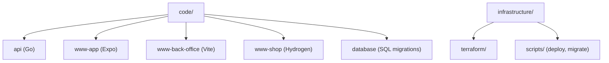

# Codebase Map

## Areas

- `code/api`: Go API, chi router, Shopify Admin integration, auth, Postgres access
- `code/www-app`: Expo Router mobile app, mock-data driven, zustand stores
- `code/www-back-office`: Vite + React admin for orders/products/customers/Shopify status
- `code/www-shop`: Shopify Hydrogen storefront, deploys independently of the other apps
- `code/database`: raw SQL migrations applied by `infrastructure/scripts/migrate.py`
- `infrastructure`: Terraform (fronts, database, api) and the Python deploy/terraform/migrate scripts the CI calls
- `environments`: per-environment (`loc`, `stg`, `prd`) Terraform and deploy variable files

## Entry points

- API: `code/api/cmd/server/main.go` (local HTTP), `code/api/cmd/api/main.go` (Lambda)
- www-app: `expo-router/entry` (file-based routes under `src/app`)
- www-back-office: `code/www-back-office/src/main.tsx`
- www-shop: React Router 7 file routes under `code/www-shop/app/routes`, built via the Hydrogen preset
