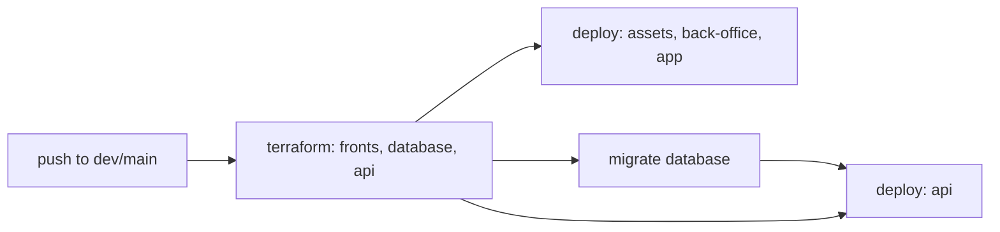

# Deployment

## Pipeline

- GitHub Actions (`.github/workflows/ci-cd.yml`), push-triggered only (the matching `pull_request` triggers exist but every job is gated `if: ... && github.event_name == 'push'`, so PR runs do nothing)
- Push to `dev` runs the `stg` jobs, push to `main` runs the `prd` jobs; no other branch deploys
- `www-shop` is not in this pipeline — it deploys to Vercel (its own Git integration or `vercel deploy`), not through Shopify Oxygen; see [architecture.md](architecture.md)

- `deploy-api-<env>` also needs `migrate-database-<env>` (not just `terraform-api-<env>`): the API now reads the `admins` table on every login (`bootstrapFirstSuperAdmin`), so it must never go live ahead of the migration that creates it — see [auth.md](auth.md)

- All AWS-side work (Terraform apply, S3/Lambda deploy, migrations) runs through Python scripts in `infrastructure/scripts/` using `boto3`, not Terraform Cloud or a PaaS

## Environments

- `loc`, `stg`, `prd`, each with its own Terraform/deploy variables under `environments/<env>/`
- `www-back-office` detects which one it's talking to by calling the public `GET /health` (which echoes `APP_ENV` as `env`) once at app load (`initEnv()` in `src/stores/env.ts`, called from `main.tsx`), never persisted and never a build-time Vite var — a stale/cached value could drift from the server actually being hit. A failed/unreachable call leaves `env` at `null`, treated as "not stg" by every gate (fail-closed). This is the same mechanism `src/components/layout/app-layout.tsx`'s `superAdminOnly` nav filter uses, extended with a `stgOnly` flag: currently only "Outils dev" (`/dev-tools`) carries it, since that page now seeds/cleans the `leads` table directly in Postgres (no Shopify involved) and only makes sense on the one shared environment nobody can just `psql` into — see [api.md](api.md). The server-side guard is the actual source of truth (`APP_ENV == "stg"` exactly, in `code/api/internal/routes/leads.go`'s `SeedLeads`/`CleanupSeedLeads`); the nav filter only hides the entry point, it is not the security boundary.

## Monitoring

- CloudWatch log groups and alarms are scaffolded per service (`infrastructure/terraform/*/cloudwatch.tf`) but commented out alongside the rest of the infra resources; alarms are designed console-only with no SNS/email action — see [infra.md](infra.md)
