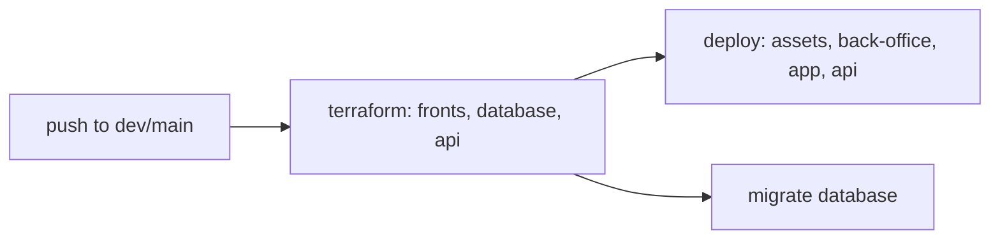

# Deployment

## Pipeline

- GitHub Actions (`.github/workflows/ci-cd.yml`), push-triggered only (the matching `pull_request` triggers exist but every job is gated `if: ... && github.event_name == 'push'`, so PR runs do nothing)
- Push to `dev` runs the `stg` jobs, push to `main` runs the `prd` jobs; no other branch deploys
- `www-shop` is not in this pipeline — it ships separately through Shopify's own Hydrogen/Oxygen tooling (`npm run deploy` via the Shopify CLI)

- All AWS-side work (Terraform apply, S3/Lambda deploy, migrations) runs through Python scripts in `infrastructure/scripts/` using `boto3`, not Terraform Cloud or a PaaS

## Environments

- `loc`, `stg`, `prd`, each with its own Terraform/deploy variables under `environments/<env>/`

## Monitoring

- CloudWatch log groups and alarms are scaffolded per service (`infrastructure/terraform/*/cloudwatch.tf`) but commented out alongside the rest of the infra resources; alarms are designed console-only with no SNS/email action — see [infra.md](infra.md)
