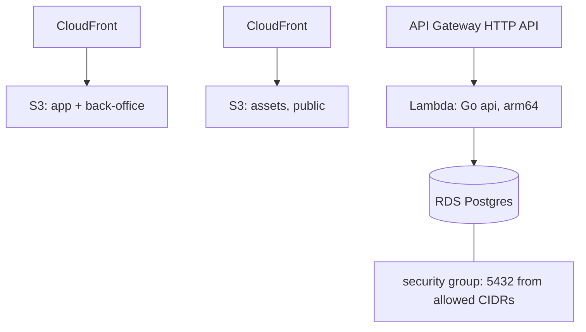

# Infrastructure

## Tooling

- Terraform, version pinned via `tfenv`, state in a shared S3 backend (`AWS__TFSTATE_BUCKET`/`AWS__TFSTATE_REGION`)
- Split into three independent modules under `infrastructure/terraform/`: `fronts`, `database`, `api`, each applied separately per environment by `infrastructure/scripts/terraform.py <module> <stg|prd>`

## Topology

## Conventions

- `www-shop` has no Terraform of its own; it deploys through Shopify Oxygen instead.

## Back-office custom domain

- `back-office.myhobbees.fr` (prd) and `back-office-stg.myhobbees.fr` (stg) are ACM-validated custom domains on `aws_cloudfront_distribution.BackOffice` (`infrastructure/terraform/fronts/s3_back-office.tf`/`acm.tf`), DNS-managed at OVH — not Route53, no OVH Terraform provider involved. The distribution's own `*.cloudfront.net` domain (`back_office_endpoint` output) keeps working unaffected: CloudFront serves the default cert there, the custom cert only via SNI for the configured alias.
- The certificate is requested in a dedicated `us-east-1`-aliased provider — CloudFront only accepts ACM certs from that region, regardless of `var.aws_app_region` (`eu-west-3`) used everywhere else.
- Two CNAMEs live at OVH per environment: the DNS *validation* record (keeps the cert renewable — AWS re-validates against it periodically; removing it after the cert first issues will let the certificate silently fail to auto-renew near its ~13-month expiry) and the *alias* record (the actual domain → CloudFront routing). Both must stay.

## Staging DB control exception (cross-env IAM)

- The prd Lambda's own IAM role (`aws_iam_role.LambdaApi`) holds a deliberate, narrow exception to the otherwise strict stg/prd isolation (separate credentials, separate Terraform state): `infrastructure/terraform/api/iam_staging_control.tf` grants it exactly 3 actions — `rds:StartDBInstance`, `rds:StopDBInstance`, `rds:DescribeDBInstances` — on exactly 1 resource ARN (`myhobbees-stg-database`), gated `count = var.env == "prd" ? 1 : 0`. Never `rds:*`, never a wildcard resource, and `rds:DeleteDBInstance` is never granted or called anywhere in this feature.
- This lets an admin start the stopped stg database from the prd back-office. Stopping an RDS instance never deletes data (EBS storage is preserved); AWS force-restarts a stopped instance after 7 consecutive days of being stopped — that's expected AWS behavior, not a bug.
- The stg database module runs its own auto-stop Lambda (`infrastructure/terraform/database/lambda_autostop.tf`, gated `count = var.env == "stg" ? 1 : 0`) on a 10-minute EventBridge schedule. It queries CloudWatch for `DatabaseConnections` `Maximum` at `Period=60` over the last 1800s (up to 30 datapoints) and only stops when coverage is near-complete (at least 28 of the expected 30 datapoints — tolerating a publish delay or two) AND every one of those datapoints is zero AND the instance is `available`. This datapoint-*coverage* check (not mere datapoint presence) is what proves 30 confirmed idle minutes: RDS reports a live `DatabaseConnections=0` within ~60s of reaching `available`, so a freshly started instance already has a few all-zero datapoints a few minutes in — far short of the ~30 required — and is correctly left running; only an instance with a full ~30 minutes of all-zero reporting history gets stopped. prd only ever starts stg; it never owns the stop logic.
- Starting stg from the back-office also triggers its migrations, once the instance is actually usable — this replaced the old push-triggered `migrate-database-stg` CI job (removed from `ci-cd.yml`; see [deployment.md](deployment.md)), which failed routinely because stg is normally stopped. The flow: `www-back-office`'s "Démarrer le staging" page polls `GET /v1/infra/staging/status` every ~5s after a successful start, and on the first `available` it sees, calls `POST /v1/infra/staging/migrate` exactly once (`code/www-back-office/src/pages/staging-db.tsx`).
- `POST /v1/infra/staging/migrate` (`code/api/internal/routes/staging.go`) never gives the Lambda stg's master DB credentials to run migrations itself — its own DB role only ever has SELECT/INSERT/UPDATE/DELETE, deliberately missing `CREATE TABLE`, since it's exposed publicly via API Gateway. Instead it holds a GitHub token (`GITHUB_ACTIONS_TOKEN`, `Actions: write` scope on this one repo) and re-dispatches `.github/workflows/migrate-stg-on-demand.yml` — a `workflow_dispatch`-only workflow containing just the migration job, scoped to `TF_STG__*` secrets only — via `internal/githubactions.TriggerWorkflow` (one HTTP call, no SDK). `GITHUB_ACTIONS_TOKEN` is wired in `lambda.tf` for prd only (same `var.env == "prd" ? ... : ""` guard as `STAGING_DB_IDENTIFIER`), and is optional in `infrastructure/scripts/terraform.py`'s `SERVICE_SECRETS`/`OPTIONAL_SECRETS` for both stg and prd until the `TF_PRD__GITHUB_ACTIONS_TOKEN` GitHub secret exists. Missing token -> `409`; GitHub failure -> `502` with a generic message (its response body and the token itself never leave the server log).
- `workflow_dispatch` can only fire a workflow file that lives on the repo's **default branch** (`main`); the `ref` passed in the dispatch call only picks which branch's code the triggered run checks out, not which branch's workflow definition GitHub reads to accept the dispatch in the first place. The normal flow works because `migrate-stg-on-demand.yml` and the Lambda that dispatches it land on `main` together via the usual `dev` -> `main` promotion — but a future change that moves or renames this file outside that promotion would silently break `/v1/infra/staging/migrate` (GitHub 404s the dispatch, which the API can't distinguish from a bad token, both becoming the same generic `502`).
- Threat model for a leaked `GITHUB_ACTIONS_TOKEN` (`Actions: write`, repo-wide — GitHub does not scope this permission per workflow file): the separate workflow file only bounds what is *dispatchable from scratch* (verified: `ci-cd.yml` has no `workflow_dispatch` trigger and no other workflow in this repo does either, so nothing else is remotely triggerable this way). It does **not** bound everything else `Actions: write` grants against *existing* runs — a leaked token can still rerun any past run (including a finished prd deploy), cancel an in-flight run, and delete a run's logs (erasing an audit trail). Rerunning an old run is not a harmless replay: GitHub checks out and re-applies *that run's own commit's* Terraform/code, so rerunning an old prd run can regress prd back to an older infra/code state, not just repeat the same deploy. What it still cannot do, which is what actually justifies this design over the rejected alternative (giving the Lambda stg's master DB credentials): read any secret, alter the code a rerun executes, or touch prd/stg data directly — unlike master DB credentials on a publicly exposed Lambda, which would allow direct read/write/DDL. Mitigations: rotate `GITHUB_ACTIONS_TOKEN` periodically, give it a short expiration (fine-grained PATs support an explicit expiry date — prefer the shortest practical one over "no expiration") so a leaked-but-unused token stops working on its own, and re-examine this reasoning if a second `workflow_dispatch`-triggered workflow is ever added to this repo (it would let a leaked token reach a second job it currently cannot dispatch).

## Media storage (video/image)

- Two buckets, provisioned in `fronts` (`infrastructure/terraform/fronts/s3_media_video.tf`/`s3_media_images.tf`): a private, CloudFront-signed video bucket, and an image bucket that's public-read but only via CloudFront (never a direct S3 ACL/policy). The `api` module (`iam_media.tf`/`lambda.tf`) scopes the Lambda's own IAM policy to exactly those two bucket ARNs and reads their names/domains as env vars (`internal/media/client.go`).
- Three new secrets: `cloudfront_video_public_key` is required on `fronts` (`aws_cloudfront_public_key.MediaVideo.encoded_key`); `cloudfront_video_private_key` is required on `api` (used at request time to sign video URLs); `cloudfront_video_key_id` is optional on `api` for both stg and prd — it's the AWS-assigned id of the `aws_cloudfront_public_key` resource `fronts` creates, so it cannot exist before `fronts`'s first apply. Making it optional is what breaks that circular dependency: the first `terraform.py api <env>` run after this merge can proceed with it empty, and once `fronts` has applied once, an operator pastes the real id into the `TF_{ENV}__CLOUDFRONT_VIDEO_KEY_ID` GitHub secret for it to take effect on the next `api` apply.
- `media_video_cdn_domain`/`media_image_cdn_domain` are default-empty Terraform variables, not secrets — same bootstrapping as `asset_endpoint`/`back_office_endpoint`: AWS only assigns the CloudFront domain name once the distribution exists, so an operator fills them in by hand in `environments/{env}/variables.{env}.tf` after `fronts`'s first apply, before the next `api` apply picks them up.
- `cloudfront_video_public_key`/`cloudfront_video_private_key` must be stored as raw multi-line PEM (real newlines, not an escaped `\n`) — they're the first multi-line secret value passed through `infrastructure/scripts/terraform.py`'s `tf_var`/`os.system` shell interpolation, which doesn't re-escape embedded newlines for the shell the way a single-line secret never had to be.
