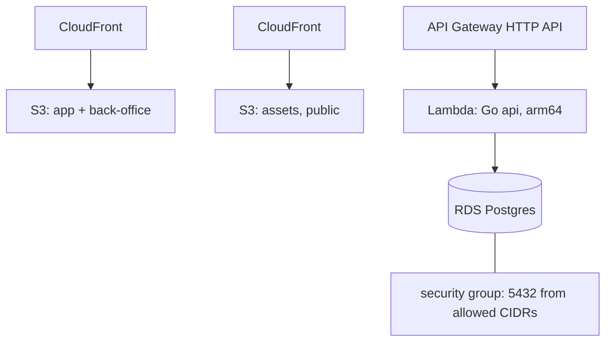

# Infrastructure

## Tooling

- Terraform, version pinned via `tfenv`, state in a shared S3 backend (`AWS__TFSTATE_BUCKET`/`AWS__TFSTATE_REGION`)
- Split into three independent modules under `infrastructure/terraform/`: `fronts`, `database`, `api`, each applied separately per environment by `infrastructure/scripts/terraform.py <module> <stg|prd>`

## Topology

## Conventions

- Most resources in `fronts` and `api` (the S3 buckets/CloudFront distributions, the Lambda function, the API Gateway) are written but commented out in the `.tf` files; only the `database` module's VPC lookup, security group, parameter group, and subnet group are live. Enabling a resource is a deliberate uncomment-and-apply step, not automatic.
- `www-shop` has no Terraform of its own; it deploys through Shopify Oxygen instead.
