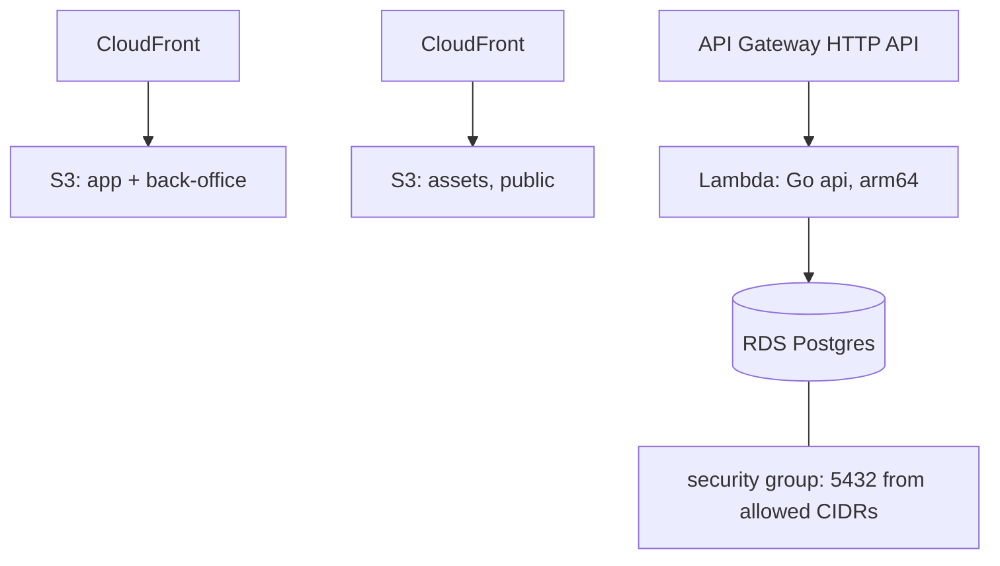

# Infrastructure

## Tooling

- Terraform, version pinned via `tfenv`, state in a shared S3 backend (`AWS__TFSTATE_BUCKET`/`AWS__TFSTATE_REGION`)
- Split into three independent modules under `infrastructure/terraform/`: `fronts`, `database`, `api`, each applied separately per environment by `infrastructure/scripts/terraform.py <module> <stg|prd>`

## Topology

## Conventions

- `www-shop` has no Terraform of its own; it deploys through Shopify Oxygen instead.

## Back-office custom domain

- `back-office.myhobbees.fr` (prd) and `back-office-stg.myhobbees.fr` (stg) are ACM-validated custom domains on `aws_cloudfront_distribution.BackOffice` (`infrastructure/terraform/fronts/s3_back-office.tf`/`acm.tf`), DNS-managed at OVH — not Route53, no OVH Terraform provider involved. The distribution's own `*.cloudfront.net` domain (`back_office_endpoint` output) keeps working unaffected: CloudFront serves the default cert there, the custom cert only via SNI for the configured alias.
- The certificate is requested in a dedicated `us-east-1`-aliased provider — CloudFront only accepts ACM certs from that region, regardless of `var.aws_app_region` (`eu-west-3`) used everywhere else.
- Two CNAMEs live at OVH per environment: the DNS *validation* record (keeps the cert renewable — AWS re-validates against it periodically; removing it after the cert first issues will let the certificate silently fail to auto-renew near its ~13-month expiry) and the *alias* record (the actual domain → CloudFront routing). Both must stay.

## Staging DB control exception (cross-env IAM)

- The prd Lambda's own IAM role (`aws_iam_role.LambdaApi`) holds a deliberate, narrow exception to the otherwise strict stg/prd isolation (separate credentials, separate Terraform state): `infrastructure/terraform/api/iam_staging_control.tf` grants it exactly 3 actions — `rds:StartDBInstance`, `rds:StopDBInstance`, `rds:DescribeDBInstances` — on exactly 1 resource ARN (`myhobbees-stg-database`), gated `count = var.env == "prd" ? 1 : 0`. Never `rds:*`, never a wildcard resource, and `rds:DeleteDBInstance` is never granted or called anywhere in this feature.
- This lets an admin start the stopped stg database from the prd back-office. Stopping an RDS instance never deletes data (EBS storage is preserved); AWS force-restarts a stopped instance after 7 consecutive days of being stopped — that's expected AWS behavior, not a bug.
- The stg database module runs its own auto-stop Lambda (`infrastructure/terraform/database/lambda_autostop.tf`, gated `count = var.env == "stg" ? 1 : 0`) on a 10-minute EventBridge schedule. It queries CloudWatch for `DatabaseConnections` `Maximum` at `Period=60` over the last 1800s (up to 30 datapoints) and only stops when coverage is near-complete (at least 28 of the expected 30 datapoints — tolerating a publish delay or two) AND every one of those datapoints is zero AND the instance is `available`. This datapoint-*coverage* check (not mere datapoint presence) is what proves 30 confirmed idle minutes: RDS reports a live `DatabaseConnections=0` within ~60s of reaching `available`, so a freshly started instance already has a few all-zero datapoints a few minutes in — far short of the ~30 required — and is correctly left running; only an instance with a full ~30 minutes of all-zero reporting history gets stopped. prd only ever starts stg; it never owns the stop logic.
