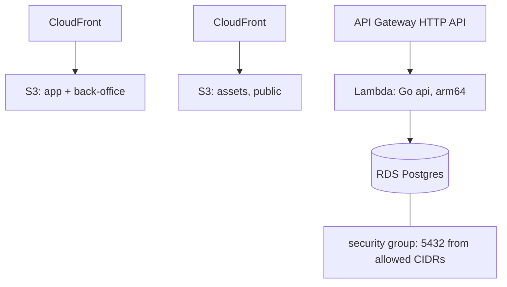

# Infrastructure

## Tooling

- Terraform, version pinned via `tfenv`, state in a shared S3 backend (`AWS__TFSTATE_BUCKET`/`AWS__TFSTATE_REGION`)
- Split into three independent modules under `infrastructure/terraform/`: `fronts`, `database`, `api`, each applied separately per environment by `infrastructure/scripts/terraform.py <module> <stg|prd>`

## Topology

## Conventions

- Most resources in `fronts` and `api` (the S3 buckets/CloudFront distributions, the Lambda function, the API Gateway) are written but commented out in the `.tf` files; only the `database` module's VPC lookup, security group, parameter group, and subnet group are live. Enabling a resource is a deliberate uncomment-and-apply step, not automatic.
- `www-shop` has no Terraform of its own; it deploys through Shopify Oxygen instead.

## Staging DB control exception (cross-env IAM)

- The prd Lambda's own IAM role (`aws_iam_role.LambdaApi`) holds a deliberate, narrow exception to the otherwise strict stg/prd isolation (separate credentials, separate Terraform state): `infrastructure/terraform/api/iam_staging_control.tf` grants it exactly 3 actions — `rds:StartDBInstance`, `rds:StopDBInstance`, `rds:DescribeDBInstances` — on exactly 1 resource ARN (`myhobbees-stg-database`), gated `count = var.env == "prd" ? 1 : 0`. Never `rds:*`, never a wildcard resource, and `rds:DeleteDBInstance` is never granted or called anywhere in this feature.
- This lets an admin start the stopped stg database from the prd back-office. Stopping an RDS instance never deletes data (EBS storage is preserved); AWS force-restarts a stopped instance after 7 consecutive days of being stopped — that's expected AWS behavior, not a bug.
- The stg database module runs its own auto-stop Lambda (`infrastructure/terraform/database/lambda_autostop.tf`, gated `count = var.env == "stg" ? 1 : 0`) on a 10-minute EventBridge schedule: it stops the instance only when CloudWatch's `DatabaseConnections` `Maximum` statistic over the full last 30 minutes shows zero connections (or no datapoints at all) and the instance is `available`. prd only ever starts stg; it never owns the stop logic.
