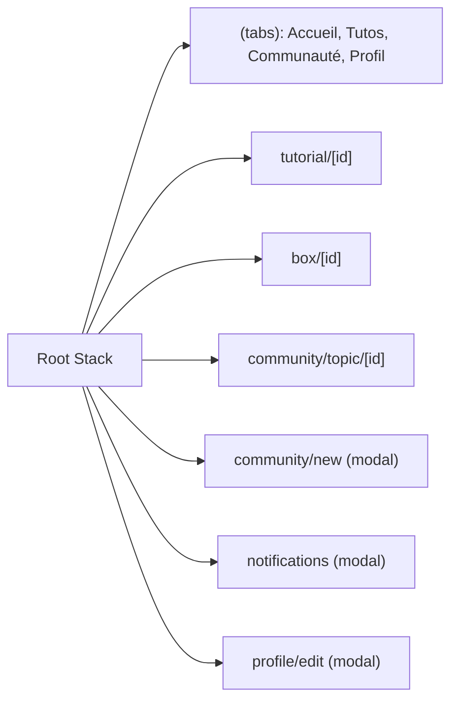

# Mobile

## Platform

- Cross-platform via Expo + React Native, file-based routing with Expo Router (`src/app`)

## Navigation

- Tabs use `expo-router/unstable-native-tabs` (`src/components/app-tabs.tsx`, with a `.web.tsx` fallback for the web target)

## Native access

- `expo-image-picker` for the avatar/post photos (photos permission declared in `app.json`)
- `expo-video` for tutorial media

## State and storage

- `zustand` stores (`src/stores/use-profile-store.ts`, `use-progression-store.ts`) hold profile and progression (XP, badges, downloads, ratings) in memory only, with no `persist` middleware — state resets on app restart
- All data comes from static fixtures in `src/lib/mock/`; the app does not call the Go API yet

## Build and release

- No EAS config (no `eas.json`): the app is exported as a static web bundle (`app.json`'s `web.output: "static"`) and pushed to S3 + CloudFront by `infrastructure/scripts/deploy.react-native.py`, the same path as the back-office — not a native App Store/Play Store build
