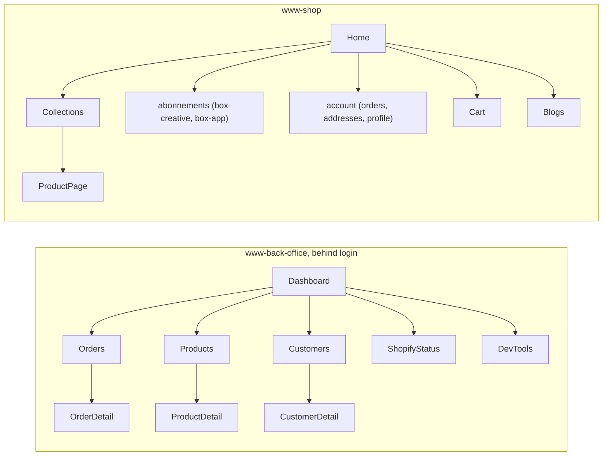

# Navigation

## Routing

- `www-back-office`: `react-router`'s `createBrowserRouter`, routes declared explicitly in one place (`src/router.tsx`); every route but `/login` is nested under `ProtectedRoute`, which redirects to `/login` when `useAuthStore` has no token
- `www-shop`: React Router 7 file-based routes under `app/routes` (`@react-router/fs-routes` + the Hydrogen preset), dot-segment nesting (`account.orders.$id.tsx`), trailing-underscore to opt out of parent layout (`abonnements_.box-creative.tsx`), `$.tsx` as the catch-all

## Structure

