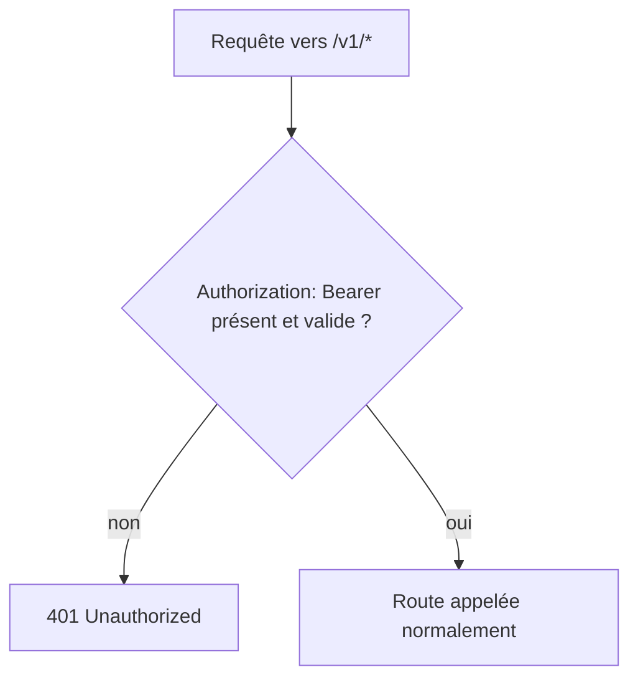
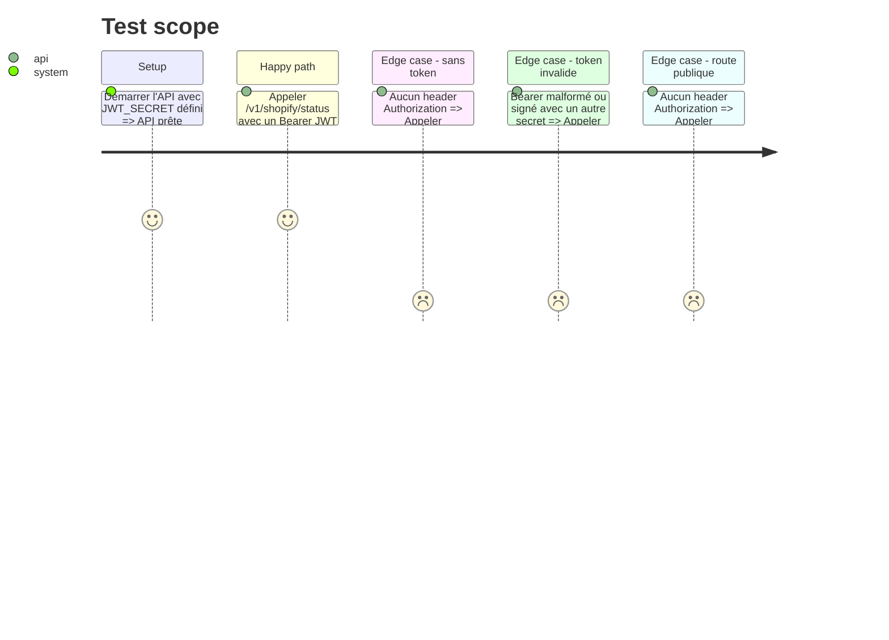

# Instruction: Middleware d'auth JWT côté API

## Architecture projection

> Tree of the final files. ✅ create · ✏️ modify · ❌ delete

```txt
code/api
├── internal
│   ├── app
│   │   └── app.go          ✏️ monte le middleware sur le groupe /v1, sauf /auth/login
│   └── middleware
│       └── auth.go         ✅ vérifie le Bearer JWT, injecte les claims dans le contexte, 401 sinon
└── internal/middleware
    └── auth_test.go        ✅ cas valides/invalides du middleware
```

## User Journey



## Test Scope



## Tasks to do

### `1)` Créer le middleware

> Un middleware chi qui vérifie le Bearer JWT avec `internal/jwt.Verify` et répond 401 sinon.

1. Lire `Authorization` header, extraire le `Bearer <token>`.
2. Absent ou malformé => `httpjson.Error(w, 401, "Unauthorized")`, ne pas appeler `next`.
3. `jwt.Verify(os.Getenv("JWT_SECRET"), token)` échoue => même 401.
4. Succès => poser les claims dans le `context.Context` de la requête (utile si un handler futur veut l'email admin), appeler `next.ServeHTTP`.

### `2)` Monter le middleware sans casser les routes publiques

> `/v1/auth/login` et `/health` restent accessibles sans token ; tout le reste sous `/v1` l'exige.

1. Dans `app.go`, garder `r.Mount("/auth", routes.Auth())` hors du groupe protégé.
2. Grouper `shopify`, `leads` (et la future route `analytics`) sous un `r.Group` qui applique le nouveau middleware.
3. Garder `middleware.Logger`/`middleware.Recoverer` tels quels, le nouveau middleware vient après.

### `3)` Tests

> Couvrir les 4 cas du Test Scope avec `net/http/httptest`.

1. Token valide → `next` appelé, statut inchangé.
2. Pas de token → 401, `next` jamais appelé.
3. Token signé avec un autre secret ou expiré → 401.
4. `/v1/auth/login` et `/health` ignorent le middleware.

## Test acceptance criteria

| Task | Acceptance criteria |
| ---- | -------------------- |
| 1... | `go test ./internal/middleware/...` couvre token valide, absent, invalide, expiré |
| 2... | `curl -i localhost:PORT/v1/shopify/status` sans header → 401 ; `curl -i localhost:PORT/v1/auth/login` et `/health` → jamais 401 |
| 3... | `go vet ./...` et `go test ./...` passent sur tout le module `code/api` |
