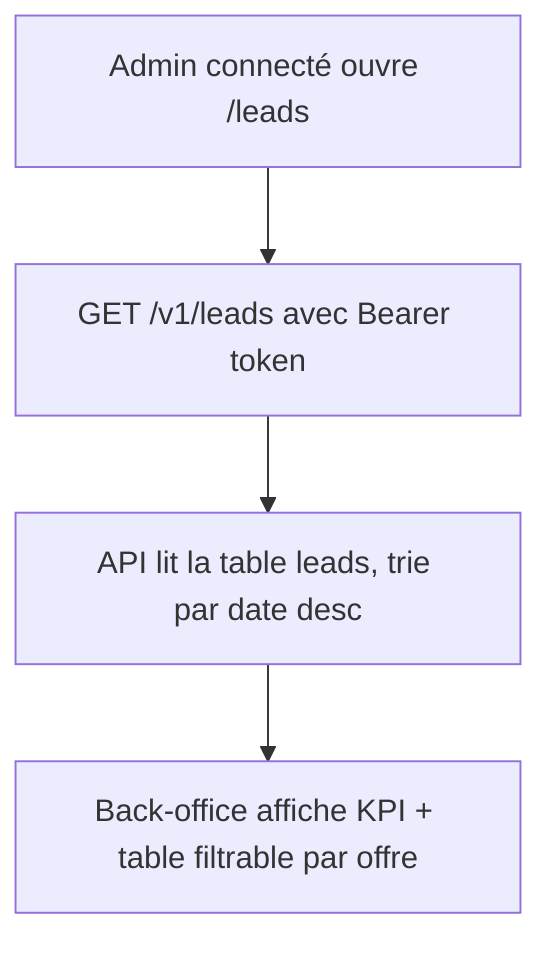
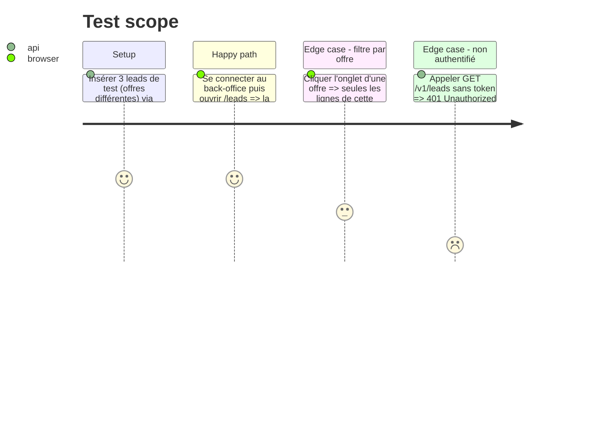

# Instruction: Endpoint + page back-office des leads

## Architecture projection

> Tree of the final files. ✅ create · ✏️ modify · ❌ delete

```txt
code/api
└── internal/routes/leads.go        ✏️ ajoute GET / (liste paginée, triée par created_at desc)

code/www-back-office/src
├── lib/api.ts                      ✏️ ajoute getLeads() + types Lead/LeadsPage
├── pages/leads.tsx                 ✅ page liste avec KPI, onglets par offre, recherche, table
├── router.tsx                      ✏️ route 'leads'
└── components/layout/app-layout.tsx ✏️ nouvelle entrée de nav "Inscriptions"
```

## User Journey



## Test Scope



## Wireframe

```txt
┌──────────────────────────────────────────────────────────┐
│ (1) Titre "Inscriptions" + recherche email                │
├──────────────────────────────────────────────────────────┤
│ (2) KPI: Total inscrits | Nouveaux (7j) | Offre la + demandée │
├──────────────────────────────────────────────────────────┤
│ (3) Onglets: Toutes · Box créative · Box + app · App seule │
├──────────────────────────────────────────────────────────┤
│ (4) Table: Email | Activités | Canal | Offre | Source | Date │
└──────────────────────────────────────────────────────────┘
```

1. Titre de page + champ recherche (filtre côté client sur l'email, même pattern que `customers.tsx`).
2. KPI cards réutilisant `Card`/`CardContent`, mêmes classes que `dashboard.tsx`/`customers.tsx`.
3. Onglets (`@/components/ui/tabs`, déjà présent) pour filtrer par `subscription_interest` sans ajouter de nouveau composant.
4. Table (`@/components/ui/table`, déjà utilisée dans `customers.tsx`), une ligne par lead.

## Tasks to do

### `1)` Endpoint `GET /v1/leads`

> Liste les leads, les plus récents d'abord, protégée par le middleware de la phase 1.

1. Dans `internal/routes/leads.go`, ajouter `r.Get("/", ...)` à côté du `Post("/", ...)` existant.
2. Requête `SELECT id, email, activities, acquisition_channel, subscription_interest, utm_source, utm_medium, utm_campaign, referrer, created_at FROM leads ORDER BY created_at DESC` (paginer avec `LIMIT`/`OFFSET` si > 200 lignes attendu, sinon simple liste suffit vu le volume de lancement).
3. Répondre `httpjson.OK(w, 200, leads)` avec un type Go clair pour le JSON (`email`, `activities[]`, `acquisitionChannel`, `subscriptionInterest`, `utmSource`, `utmMedium`, `utmCampaign`, `referrer`, `createdAt`).

### `2)` Client API back-office

> `getLeads()` dans `src/lib/api.ts`, même convention que `getCustomers()`.

1. Ajouter le type `Lead` (champs ci-dessus, camelCase).
2. `export function getLeads() { return apiFetch<Lead[]>('/v1/leads') }`.

### `3)` Page `/leads`

> Suivre `customers.tsx` : state + `useEffect` + KPI + recherche + table, plus les onglets par offre.

1. Charger les leads au montage, gérer l'état d'erreur comme les autres pages.
2. KPI : total, nouveaux sur 7 jours, offre avec le plus de `subscription_interest` (mode).
3. Onglets : "Toutes" + une par valeur distincte de `subscription_interest` présente dans les données.
4. Recherche : filtre client sur l'email (insensible à la casse), combiné à l'onglet actif.
5. Table triée par date décroissante (déjà trié côté API, ne pas re-trier à l'envers).

### `4)` Navigation

1. Ajouter `{ path: 'leads', element: <LeadsPage /> }` dans `router.tsx`.
2. Ajouter une entrée "Inscriptions" (icône `Mail` ou `UserPlus` de `lucide-react`) dans `navGroups` de `app-layout.tsx`, dans le groupe le plus pertinent (créer un groupe "Lancement" si aucun groupe existant ne convient).

## Test acceptance criteria

| Task | Acceptance criteria |
| ---- | -------------------- |
| 1... | `curl` avec un Bearer valide sur `GET /v1/leads` renvoie un tableau JSON trié par date décroissante ; sans token → 401 |
| 2... | `npm run build` (tsc) passe côté back-office, `getLeads()` typé sans `any` |
| 3... | Ouvrir `/leads` dans le navigateur affiche les leads existants, la recherche et les onglets filtrent correctement |
| 4... | Le lien "Inscriptions" apparaît dans la sidebar et navigue vers `/leads` |
