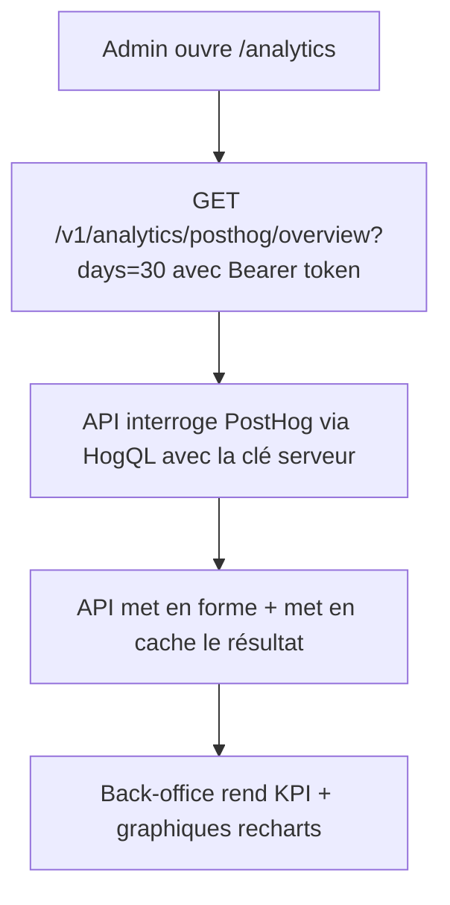
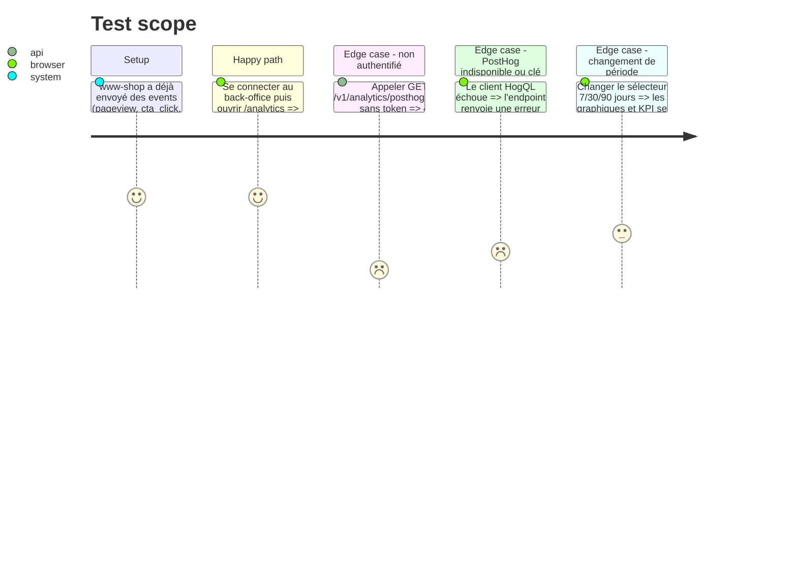

# Instruction: Proxy + dashboard PostHog

## Architecture projection

> Tree of the final files. ✅ create · ✏️ modify · ❌ delete

```txt
code/api
├── internal/posthog/client.go       ✅ client HogQL (POST /api/projects/{id}/query/), lit POSTHOG_PERSONAL_API_KEY/POSTHOG_PROJECT_ID/POSTHOG_HOST
├── internal/routes/analytics.go     ✅ GET /v1/analytics/posthog/overview?days=7|30|90, met en forme les résultats, cache en mémoire courte durée
└── internal/app/app.go              ✏️ monte /analytics sous le groupe protégé (phase 1)

code/www-back-office/src
├── lib/api.ts                       ✏️ ajoute getPostHogOverview(days) + types
├── pages/analytics.tsx              ✅ page dashboard recharts (KPI, courbe, barres)
├── router.tsx                       ✏️ route 'analytics'
└── components/layout/app-layout.tsx ✏️ nouvelle entrée de nav "Analytics"
```

## User Journey



## Test Scope



## Wireframe

```txt
┌────────────────────────────────────────────────────────────┐
│ (1) Titre "Analytics" + sélecteur de période (7/30/90 jours) │
├────────────────────────────────────────────────────────────┤
│ (2) KPI: Visiteurs | Clics CTA | Clics offre | Inscriptions | Taux visiteur→email │
├────────────────────────────────────────────────────────────┤
│ (3) Courbe: pageviews par jour sur la période                │
├─────────────────────────────┬────────────────────────────────┤
│ (4) Barres: events par type  │ (5) Barres: clics par offre (3)│
└─────────────────────────────┴────────────────────────────────┘
```

1. Titre + sélecteur de période, même pattern que `dashboard.tsx` (`periods` 7/30/90).
2. KPI cards, même pattern que `dashboard.tsx`/`customers.tsx` ; le taux visiteur→email reprend les seuils du brief (2-5 % froid, >8 % signal fort) en sous-texte si pertinent.
3. Courbe de tendance (`ChartContainer` + `LineChart`/`BarChart` recharts, cohérent avec `chart.tsx`).
4. Barres comparant `cta_click`/`offer_click`/`waitlist_signup`/`app_click`.
5. Barres des 3 offres (`box-creative`/`box-app`/`app-only`) sur `offer_click`.

## Tasks to do

### `1)` Client HogQL côté API

> Un petit client Go qui exécute une requête HogQL et retourne les lignes.

1. `internal/posthog/client.go` : fonction qui `POST` sur `{POSTHOG_HOST}/api/projects/{POSTHOG_PROJECT_ID}/query/` avec `Authorization: Bearer {POSTHOG_PERSONAL_API_KEY}` et le body `{"query": {"kind": "HogQLQuery", "query": "..."}}`.
2. `POSTHOG_HOST` par défaut `https://eu.posthog.com` (EU Cloud), surchargeable par env var ; `POSTHOG_PROJECT_ID=337481`.
3. Timeout HTTP raisonnable (même ordre que le client Shopify existant), erreurs réseau/HTTP remontées à l'appelant sans paniquer.

### `2)` Endpoint `/v1/analytics/posthog/overview`

> Agrège plusieurs requêtes HogQL en une réponse déjà prête à afficher, mise en cache pour rester sous la limite PostHog (120 requêtes/heure).

1. Requêtes HogQL à exécuter pour la période demandée (`days` = 7, 30 ou 90) :
   - pageviews par jour (`event = '$pageview'`, group by jour) → pour la courbe
   - visiteurs distincts sur la période (`count(distinct distinct_id)` où `event = '$pageview'`) — en notant que le mode cookieless surcompte au-delà d'un jour (même limite que documentée dans le brief RGPD)
   - comptage par event (`cta_click`, `offer_click`, `waitlist_signup`, `app_click`)
   - `offer_click` groupé par la propriété `offer` (les 3 slugs d'offre)
2. Calculer les taux dérivés (visiteur→email, CTA→email) à partir de ces comptages.
3. Mettre en cache le résultat en mémoire process (clé = `days`) pendant quelques minutes, pour que plusieurs rafraîchissements d'admins ne multiplient pas les appels PostHog.
4. Monter la route sous le groupe protégé par le middleware de la phase 1.
5. Erreur PostHog (clé invalide, réseau, timeout) → répondre une erreur JSON propre (502), jamais un 500 qui casse silencieusement le front.

### `3)` Client API back-office + page `/analytics`

> Même structure que `dashboard.tsx` : sélecteur de période, KPI, graphiques recharts.

1. `getPostHogOverview(days)` dans `src/lib/api.ts`, type de retour reflétant exactement la forme JSON de l'étape précédente.
2. Page `analytics.tsx` : état + `useEffect` sur le changement de période, réutiliser `ChartContainer`/`ChartConfig` de `@/components/ui/chart` comme dans `dashboard.tsx`.
3. Gérer l'état de chargement et d'erreur comme les autres pages (`Skeleton`, `Alert`).

### `4)` Navigation

1. Ajouter `{ path: 'analytics', element: <AnalyticsPage /> }` dans `router.tsx`.
2. Ajouter une entrée "Analytics" (icône `TrendingUp` ou `BarChart3` de `lucide-react`) dans `navGroups`, dans le même groupe "Lancement" que la page leads si ce groupe a été créé en phase 2.

## Test acceptance criteria

| Task | Acceptance criteria |
| ---- | -------------------- |
| 1... | Le client HogQL exécute une requête de test et retourne des lignes exploitables (vérifié par un test Go avec un serveur HTTP de test, pas un vrai appel PostHog) |
| 2... | `curl` avec Bearer valide sur `GET /v1/analytics/posthog/overview?days=30` renvoie un JSON structuré ; sans token → 401 ; appels répétés ne dépassent pas la limite PostHog grâce au cache |
| 3... | `/analytics` affiche des KPI et des graphiques recharts cohérents avec les events réellement envoyés par www-shop, pour les 3 périodes |
| 4... | Le lien "Analytics" apparaît dans la sidebar et navigue vers `/analytics` |
