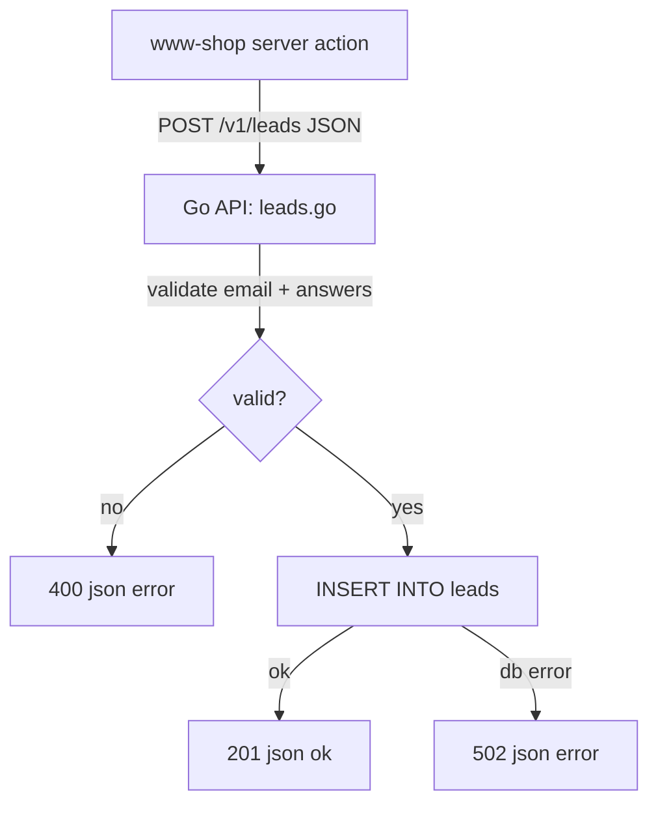
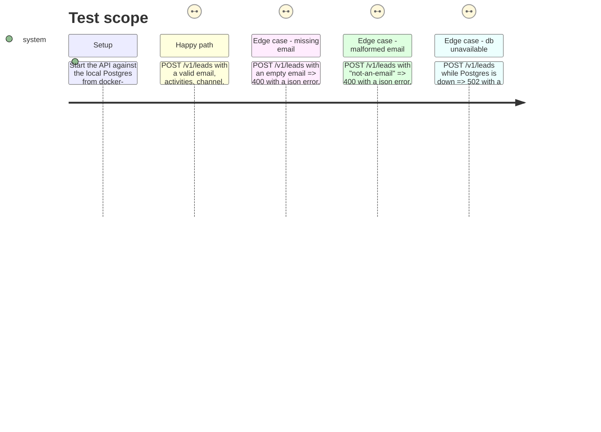

# Instruction: Leads storage (migration + Go API)

## Architecture projection

```txt
.
├── code/database/migrations/
│   └── 001_create_leads.sql                  ✅ create
└── code/api/internal/
    ├── routes/
    │   └── leads.go                          ✅ create
    └── app/
        └── app.go                            ✏️ modify (mount /v1/leads, no auth)
```

## User Journey



## Test Scope



## Tasks to do

### `1)` Write the migration

> Create the `leads` table the form will write to.

1. Add `code/database/migrations/001_create_leads.sql` following the project's migration convention (`NNN_description.sql`, plain SQL, no ORM — see `aidd_docs/memory/database.md`).
2. Columns: `id` (serial or uuid primary key), `email` (text, not null), `activities` (text array, not null, default `{}`), `acquisition_channel` (text, not null), `subscription_interest` (text, not null), `utm_source`/`utm_medium`/`utm_campaign` (text, nullable), `referrer` (text, nullable), `created_at` (timestamptz, not null, default `now()`).
3. Add an index on `created_at` (leads will be read back ordered by recency).

### `2)` Add the `leads` Go route

> A public endpoint that validates and persists one submission.

1. Create `code/api/internal/routes/leads.go` with a `Leads() chi.Router` exposing `POST /`, following the shape of `routes/auth.go` and `routes/shopify.go` (JSON body decode, `httpjson.OK`/`httpjson.Error`).
2. Validate: `email` non-empty and matches a basic email pattern; `activities` is a non-empty string slice; `acquisition_channel` and `subscription_interest` are non-empty strings. Reject anything else with `400`.
3. Insert the row via `db.Pool(ctx)` (same pattern as `routes/example.go`'s `/db-check`). Any DB error returns `502` via `httpjson.Error`, matching the rest of the API.
4. On success, return `201` with `{"ok": true}`.

### `3)` Mount the route

> Expose it publicly, unlike the admin-only Shopify routes.

1. In `code/api/internal/app/app.go`, add `r.Mount("/leads", routes.Leads())` inside the existing `/v1` group, without wrapping it in `auth.Middleware`.

## Test acceptance criteria

| Task | Acceptance criteria |
| --- | --- |
| 1 | `code/database/migrations/001_create_leads.sql` exists and running `infrastructure/scripts/migrate.py` against a local database creates a queryable `leads` table with the columns above |
| 2 | `POST /v1/leads` with a complete, valid body returns `201` and the row is present in `leads`; an incomplete or malformed body returns `400` and inserts nothing |
| 3 | `POST /v1/leads` succeeds without an `Authorization` header (the route is public) |
