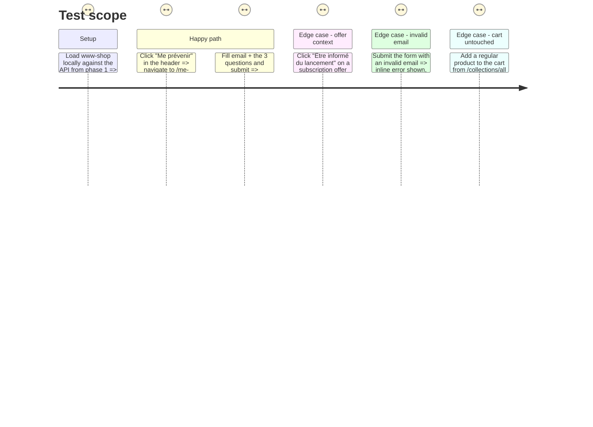

# Instruction: Fake-door UI, form, and PostHog events

## Architecture projection

```txt
.
└── code/www-shop/
    ├── app/
    │   ├── root.tsx                          ✏️ modify (drop isLoggedIn plumbing)
    │   ├── components/
    │   │   ├── Header.tsx                    ✏️ modify (swap login CTA for "Me prévenir")
    │   │   ├── PageLayout.tsx                ✏️ modify (drop isLoggedIn prop)
    │   │   └── SubscriptionOfferPage.tsx     ✏️ modify (fake-door CTA → /me-prevenir, click event)
    │   ├── lib/
    │   │   └── posthog.ts                    ✏️ modify (add `capture` helper)
    │   └── routes/
    │       └── me-prevenir.tsx               ✅ create (page + form + action)
    ├── .env.example                          ✏️ modify (add API_BASE_URL)
    └── env.d.ts / app/lib/context.ts         ✏️ modify (Env gains API_BASE_URL, server-only)
```

## User Journey

```mermaid
flowchart TD
  A[Visitor] -->|clicks "Me prévenir" in header or on an offer| B[fake_door_click captured]
  B --> C[/me-prevenir page]
  C -->|reads intro + fills form| D[Submit]
  D -->|action: POST to Go API /v1/leads| E{API ok?}
  E -- yes --> F[lead_form_submitted captured + confirmation shown]
  E -- no --> G[inline error, form data kept]
```

## Test Scope



## Wireframe

```txt
┌─────────────────────────────────────────────────────┐
│ (1) Header: logo · nav · "Me prévenir" · Panier      │
├─────────────────────────────────────────────────────┤
│ (2) Intro: box en préparation + aperçu abonnements   │
├─────────────────────────────────────────────────────┤
│ (3) Formulaire                                       │
│  ┌─────────────────────────────────────────────┐    │
│  │ (4) Email                                    │    │
│  │ (5) Quelles activités t'intéressent ? (cases)│    │
│  │ (6) Comment nous as-tu connu ? (choix)       │    │
│  │ (7) Quel abonnement t'intéresse le plus ?    │    │
│  │ (8) Bouton "Être informé·e"                  │    │
│  └─────────────────────────────────────────────┘    │
├─────────────────────────────────────────────────────┤
│ (9) Footer                                           │
└─────────────────────────────────────────────────────┘
```

1. Header: the former login `NavLink` is replaced in place by a "Me prévenir" CTA; the cart action is untouched.
2. Intro: static copy stating the boxes are launching soon and summarizing the three subscription offers (titles + one line each), linking to `/abonnements`.
3. Form container: one `Form` (React Router `action`), styled with existing `www-shop` form/button classes.
4. Email: a single required `email` input.
5. Activities: checkboxes — Crochet, Couture, Peinture, Autre.
6. Acquisition channel: a single-choice control — Instagram, TikTok, Recherche Google, Bouche-à-oreille, Autre.
7. Subscription interest: a single-choice control listing the three `SUBSCRIPTION_OFFERS` titles plus "Je ne sais pas encore"; pre-selected when the page was reached via `?offer=<slug>`.
8. Submit button, using the existing `button button-primary` style.
9. Footer: unchanged.

## Tasks to do

### `1)` Add the PostHog `capture` helper

> One small, reusable event-capture function, guarded like `initPostHog` already is.

1. In `app/lib/posthog.ts`, add an exported `capture(event: string, properties?: Record<string, unknown>)` that no-ops when PostHog has not been initialized or `window` is undefined, otherwise calls `posthog.capture(event, properties)`.

### `2)` Add the server-only API base URL

> The route `action` needs to know where the Go API lives; this must never reach the browser.

1. Add `API_BASE_URL` to the `Env` interface and to `createHydrogenRouterContext`'s env construction in `app/lib/context.ts`, read from `process.env.API_BASE_URL` (no `PUBLIC_` prefix).
2. Add `API_BASE_URL=""` to `.env.example` with a one-line comment pointing at the local API (`http://localhost:3001`).

### `3)` Replace the header login CTA

> Swap the account entry point for the fake door, drop what is no longer needed.

1. In `Header.tsx`, replace the `NavLink` to `/account` (icon + "Connexion"/"Mon compte") with a `Link` to `/me-prevenir` labeled "Me prévenir", firing `capture('fake_door_click', {placement: 'header'})` on click. Drop the `isLoggedIn` prop from `HeaderProps`/`HeaderCtas` since nothing reads it anymore.
2. Remove the now-unused `isLoggedIn` prop from `PageLayout.tsx` and from `root.tsx`'s `loadDeferredData` (drop `customerAccount.isLoggedIn()` entirely).

### `4)` Wire the existing fake-door CTA on subscription offers

> `OfferCta`'s "not purchasable yet" branch already behaves like a fake door; point it at the real one and track it.

1. In `SubscriptionOfferPage.tsx`, change `OfferCta`'s no-`purchase` branch from `<Link to="/pages/contact">` to `<Link to={\`/me-prevenir?offer=${offer.slug}\`}>`, firing `capture('fake_door_click', {placement: 'offer', offer: offer.slug, price: offer.price?.amount ?? null})` on click.

### `5)` Build the `/me-prevenir` page

> The landing + form + action, per the wireframe above.

1. Create `app/routes/me-prevenir.tsx` with a `meta` export (title + description), a `loader` reading the `offer` search param (to preselect the subscription-interest field) and the three `SUBSCRIPTION_OFFERS` for the intro summary, and an `action` that reads the submitted `FormData`, validates it has an email and all three answers, then `fetch`es `` `${context.env.API_BASE_URL}/v1/leads` `` with the data plus `utm_source`/`utm_medium`/`utm_campaign` (from the request URL's search params) and `referrer` (from the `Referer` header). Return `data({ok: true})` on success or `data({ok: false, error})` on failure, mirroring `account.profile.tsx`'s `ActionResponse` pattern.
2. Render the intro copy, the form (`Form` + the five fields from the wireframe), and a confirmation state when `useActionData()` reports success. On success, call `capture('lead_form_submitted', {activities, acquisition_channel, subscription_interest, offer})` once via a `useEffect` keyed on the action result.
3. Style the page with the existing `www-shop` editorial/page classes (the same ones `SubscriptionOfferPage`/`qui-sommes-nous.tsx` already use) — no new one-off CSS beyond what the design system's existing form/button classes cover.

## Test acceptance criteria

| Task | Acceptance criteria |
| --- | --- |
| 1 | Calling `capture(...)` before `initPostHog` ran does not throw and sends nothing |
| 2 | `API_BASE_URL` is readable in the `me-prevenir.tsx` action via `context.env` and never appears in any client bundle output |
| 3 | The header shows "Me prévenir" instead of a login/account link, in both logged-out and any other state; `npm run typecheck` has no new error from the removed `isLoggedIn` prop |
| 4 | Clicking "Être informé du lancement" on any of the three subscription-offer pages lands on `/me-prevenir?offer=<that-slug>` |
| 5 | Submitting the form with a valid email and all three answers shows a confirmation and results in a `201` from `/v1/leads`; submitting with a missing field shows an inline error and fires no `lead_form_submitted` event |
