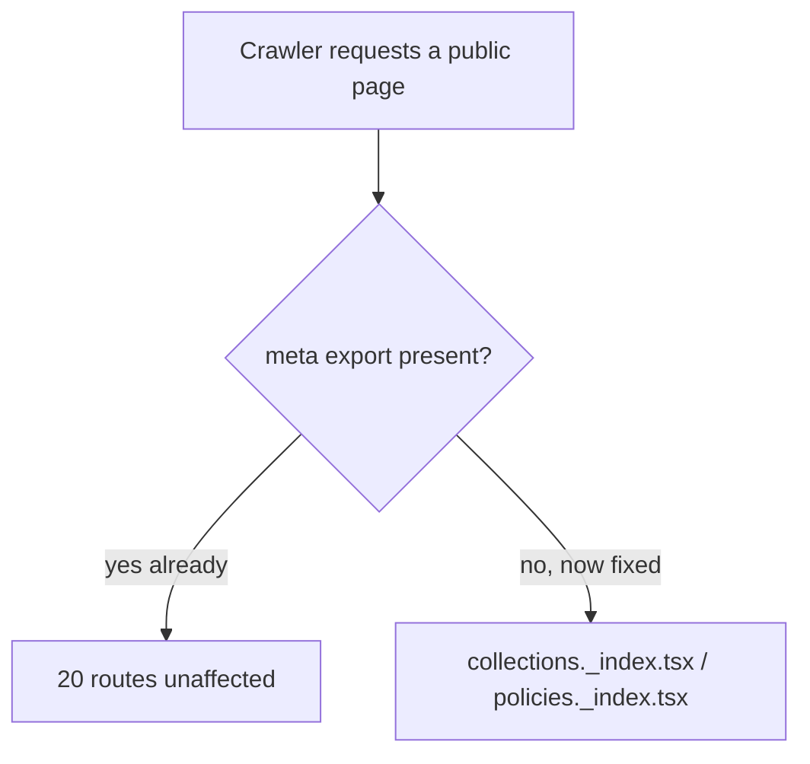
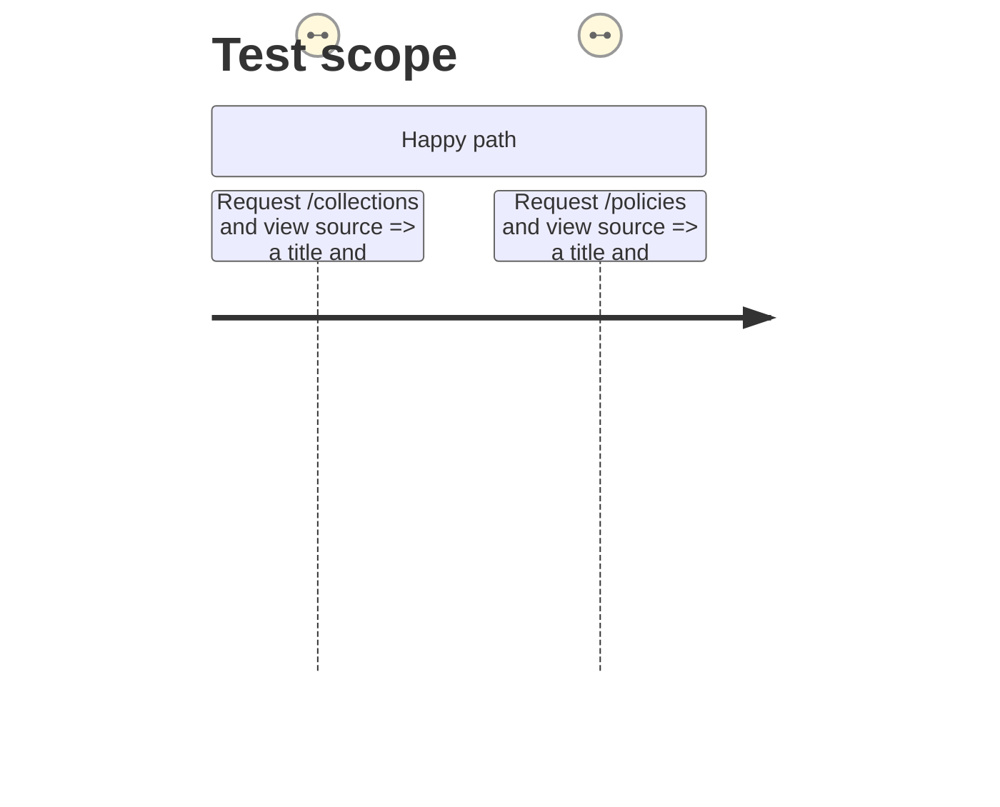

# Instruction: SEO meta gaps

## Architecture projection

```txt
.
└── code/www-shop/app/routes/
    ├── collections._index.tsx  ✏️ modify (add meta)
    └── policies._index.tsx     ✏️ modify (add meta)
```

## User Journey



## Test Scope



## Tasks to do

### `1)` Fill the two missing `meta` exports

> Every other public route in `app/routes` already exports `meta` (e.g. `collections.$handle.tsx`, `policies.$handle.tsx`); these two listing pages do not.

1. Add an `export const meta: Route.MetaFunction = () => [...]` to `collections._index.tsx`, matching the title/description shape used in `collections.$handle.tsx`.
2. Add the same to `policies._index.tsx`, matching `policies.$handle.tsx`.

## Test acceptance criteria

| Task | Acceptance criteria |
| --- | --- |
| 1 | `/collections` renders a non-empty `<title>` and a `meta[name=description]` tag |
| 1 | `/policies` renders a non-empty `<title>` and a `meta[name=description]` tag |
