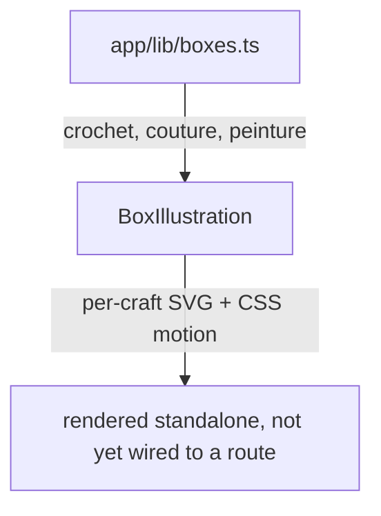
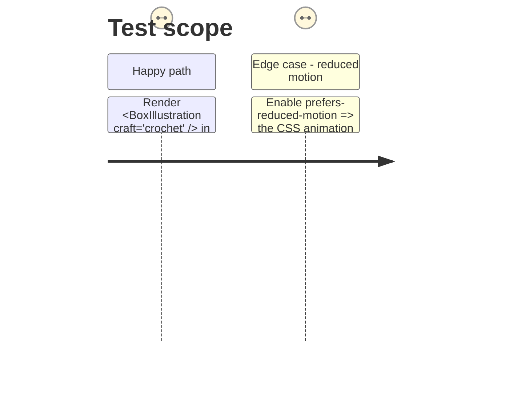

# Instruction: Local box data and SVG illustrations

## Architecture projection

```txt
.
└── code/www-shop/app/
    ├── lib/
    │   └── boxes.ts                         ✅ create
    ├── components/
    │   └── BoxIllustration.tsx              ✅ create
    └── styles/
        └── app.css                          ✏️ modify (illustration + card styles)
```

## User Journey



## Test Scope



## Tasks to do

### `1)` Define the local box data

> One small, typed source of truth for the 3 boxes — no Shopify fields.

1. Create `app/lib/boxes.ts` exporting a `BoxSlug` union (`'crochet' | 'couture' | 'peinture'`) and a `BOXES: Record<BoxSlug, Box>` map, each entry holding at least `slug`, `title`, `tagline`, and the list of `included` items — same shape of fields `subscriptionOffers.ts` uses for its own offers, trimmed to what a box card needs.

### `2)` Build the SVG illustrations

> One original, hand-authored motif per craft, lightly animated.

1. Create `app/components/BoxIllustration.tsx`, a component taking a `craft: BoxSlug` prop and rendering an inline SVG specific to that craft (e.g. a looping yarn stroke for crochet, a stitched-seam dashed line for couture, a brush/paint-swatch shape for peinture) — same hand-drawn-path technique as `--pattern-waves-warm`/`--pattern-waves-cool` in `app.css`, not an imported image file.
2. Give the SVG (or one of its paths) a subtle CSS animation (e.g. a slow stroke-dash offset or gentle float), defined in `app.css` next to the existing `.product-media-fallback` rules, and wrap it in `@media (prefers-reduced-motion: reduce) { animation: none; }`.

## Test acceptance criteria

| Task | Acceptance criteria |
| --- | --- |
| 1 | `BOXES.crochet`, `BOXES.couture`, `BOXES.peinture` each exist and type-check against `Box` |
| 2 | `<BoxIllustration craft="crochet" />`, `"couture"`, and `"peinture"` each render a visibly different SVG; with `prefers-reduced-motion: reduce` simulated, the element carries no running animation |
