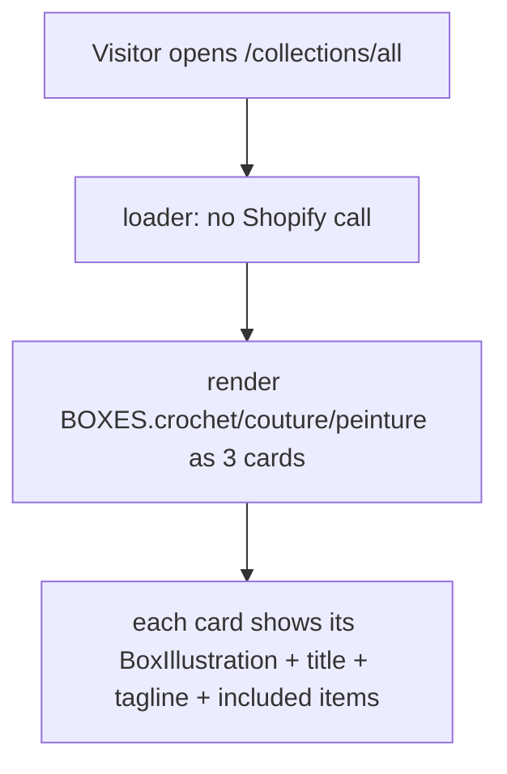
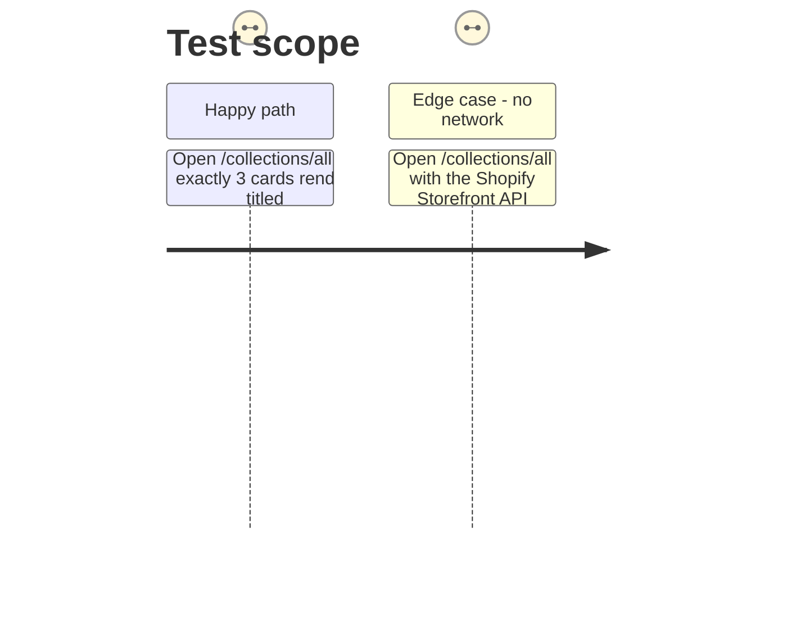

# Instruction: Rewire "Nos boxs" off Shopify

## Architecture projection

```txt
.
└── code/www-shop/app/routes/
    └── collections.all.tsx                  ✏️ modify (drop Shopify loader/query, render BOXES)
```

## User Journey



## Test Scope



## Wireframe

```txt
┌─────────────────────────────────────────────────────┐
│ (1) EditorialHero: "Nos boxes" + description + note  │
├───────────────┬───────────────┬─────────────────────┤
│ (2) Crochet    │ (3) Couture    │ (4) Peinture        │
│  illustration  │  illustration  │  illustration       │
│  titre + tagline + ce qui est inclus (3 cartes égales)│
├─────────────────────────────────────────────────────┤
│ (5) FaqSection (inchangée)                            │
└─────────────────────────────────────────────────────┘
```

1. Hero: unchanged copy/component (`EditorialHero`), still introduces the page.
2–4. Three box cards, same visual family (card, title, tagline, included list), each driven by one `BOXES` entry and its own `BoxIllustration`.
5. FAQ section: unchanged, kept as-is below the grid.

## Tasks to do

### `1)` Drop the Shopify data dependency

> The route no longer needs a loader, a GraphQL query, or pagination for exactly 3 fixed items.

1. In `collections.all.tsx`, remove `loader`, `loadCriticalData`, `loadDeferredData`, `CATALOG_QUERY`, `COLLECTION_ITEM_FRAGMENT`, and the `useLoaderData`/`PaginatedResourceSection`/`ProductItem` usage.
2. Keep the `meta` export as-is (title/description already fit a static boxes page).

### `2)` Render the 3 local boxes

> A simple, non-paginated grid driven by `BOXES`.

1. Import `BOXES` from `~/lib/boxes` and `BoxIllustration` from `~/components/BoxIllustration`.
2. Render one card per `BOXES` entry (in a fixed `crochet, couture, peinture` order) inside the existing `page-width collection boxes-page-grid` section, each showing its `BoxIllustration`, `title`, `tagline`, and `included` list — reusing the page's existing CSS classes (`product-item`-family or a small new class if the shape genuinely differs) rather than introducing a new grid system.

## Test acceptance criteria

| Task | Acceptance criteria |
| --- | --- |
| 1 | `collections.all.tsx` contains no import of `storefront`, `CATALOG_QUERY`, or `@shopify/hydrogen`'s pagination helpers; `npm run build` succeeds |
| 2 | Loading `/collections/all` shows exactly 3 cards, in the order crochet, couture, peinture, each with a distinct illustration, title, and tagline |
