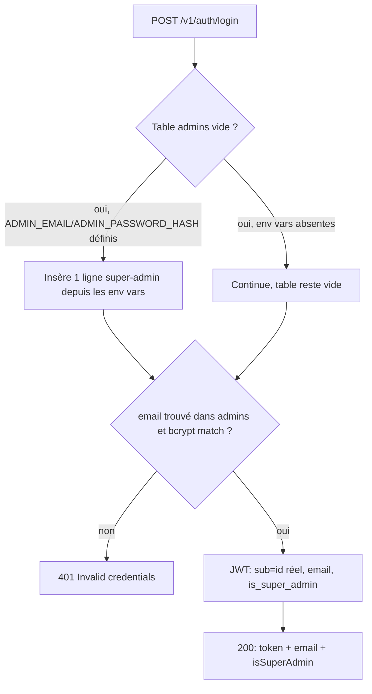
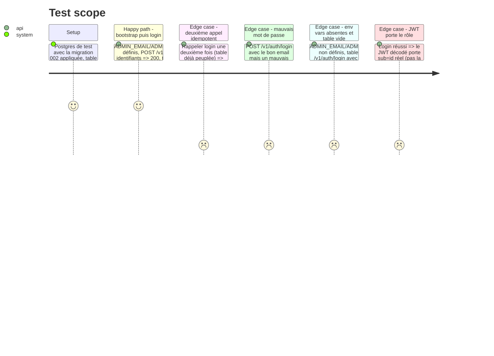

# Instruction: Table admins, login migré, bootstrap du super-admin

## Architecture projection

> Tree of the final files. ✅ create · ✏️ modify · ❌ delete

```txt
code/database/migrations
└── 002_create_admins.sql        ✅ table admins vide (id, email unique, password_hash, is_super_admin, created_at) — pas de seed

code/api/internal/jwt
├── jwt.go                        ✏️ Claims gagne IsSuperAdmin bool ; Sign prend isSuperAdmin en paramètre
└── jwt_test.go                   ✏️ met à jour les appels à Sign, vérifie IsSuperAdmin au round-trip

code/api/internal/auth
├── auth.go                       ✏️ Principal gagne IsSuperAdmin bool, peuplé depuis les claims
└── auth_test.go                  ✏️ met à jour les appels à Sign (nouveau paramètre)

code/api/internal/routes
├── admins.go                     ✅ modèle Admin + requêtes SQL partagées (findAdminByEmail, countSuperAdmins) + bootstrapFirstSuperAdmin(ctx, pool)
├── admins_test.go                ✅ tests du bootstrap (table vide + env définis -> 1 ligne créée ; table non vide -> no-op ; env absents -> no-op)
├── auth.go                       ✏️ /v1/auth/login : appelle bootstrapFirstSuperAdmin, vérifie email/password contre la table admins (bcrypt), signe le JWT avec l'id réel + is_super_admin ; réponse inclut isSuperAdmin
└── auth_test.go                  ✏️ remplace les tests basés sur ADMIN_EMAIL/ADMIN_PASSWORD_HASH par des tests contre une vraie table admins (nécessite Postgres, voir analytics_db_test.go pour le pattern de setup/skip)
```

## User Journey



## Test Scope



## Tasks to do

### `1)` Migration SQL

> Table `admins` vide, pas de donnée de seed (voir Decisions du plan).

1. `code/database/migrations/002_create_admins.sql` :
   ```sql
   CREATE TABLE admins (
       id             SERIAL PRIMARY KEY,
       email          TEXT NOT NULL UNIQUE,
       password_hash  TEXT NOT NULL,
       is_super_admin BOOLEAN NOT NULL DEFAULT FALSE,
       created_at     TIMESTAMPTZ NOT NULL DEFAULT NOW()
   );
   ```
2. Respecter le pattern de nommage déjà en place (`001_create_leads.sql`) : `NNN_description.sql`, validé par `infrastructure/scripts/migrate.py`.

### `2)` Étendre le JWT et le Principal

> Porter l'identité réelle (id) et le rôle, pas la string `"admin"` en dur.

1. `code/api/internal/jwt/jwt.go` : `Claims` gagne `IsSuperAdmin bool \`json:"isSuperAdmin,omitempty"\``. `Sign(secret, subject, email string, isSuperAdmin bool, ttl time.Duration)`.
2. `code/api/internal/jwt/jwt_test.go` : adapter tous les appels à `Sign` (nouveau paramètre), ajouter une assertion sur `IsSuperAdmin` dans le round-trip.
3. `code/api/internal/auth/auth.go` : `Principal` gagne `IsSuperAdmin bool`, peuplé depuis `claims.IsSuperAdmin` dans `Middleware`.
4. `code/api/internal/auth/auth_test.go`, `code/api/internal/routes/analytics_test.go` : adapter les appels à `jwt.Sign` existants (nouveau paramètre, `false` ou `true` selon le cas testé).

### `3)` Modèle Admin + bootstrap

> `code/api/internal/routes/admins.go`, utilisé par ce phase pour le login, et par la phase 2 pour les endpoints CRUD.

1. Struct `admin` : `ID int64`, `Email string`, `PasswordHash string`, `IsSuperAdmin bool`, `CreatedAt time.Time`.
2. `findAdminByEmail(ctx, pool, email) (*admin, error)` : `SELECT id, email, password_hash, is_super_admin, created_at FROM admins WHERE email = $1`, `pgx.ErrNoRows` -> `(nil, nil)` (pas une erreur, juste "non trouvé").
3. `countSuperAdmins(ctx, pool) (int, error)` : `SELECT COUNT(*) FROM admins WHERE is_super_admin`.
4. `bootstrapFirstSuperAdmin(ctx, pool) error` :
   - `SELECT COUNT(*) FROM admins` ; si > 0, retourne `nil` immédiatement (no-op).
   - Sinon, lit `ADMIN_EMAIL`/`ADMIN_PASSWORD_HASH` depuis l'env ; si l'un des deux est vide, retourne `nil` (rien à amorcer, pas une erreur).
   - Sinon, `INSERT INTO admins (email, password_hash, is_super_admin) VALUES ($1, $2, true)` avec le hash déjà bcrypt (il est copié tel quel depuis l'env, jamais re-hashé).

### `4)` Migrer le login

> `code/api/internal/routes/auth.go` : vérifie contre la table, plus les env vars.

1. Au tout début du handler `POST /login`, appeler `bootstrapFirstSuperAdmin(req.Context(), pool)` ; erreur -> `log.Printf` + `httpjson.Error(w, 502, "Could not verify credentials")` (même style que `leads.go`, jamais l'erreur brute au client).
2. `findAdminByEmail` ; `nil` (non trouvé) ou `bcrypt.CompareHashAndPassword` échoue -> `401 Invalid credentials` (même message qu'avant, ne pas révéler si l'email existe).
3. Succès : `jwt.Sign(secret, strconv.FormatInt(admin.ID, 10), admin.Email, admin.IsSuperAdmin, 24*time.Hour)`.
4. Réponse : `{"token": ..., "email": ..., "isSuperAdmin": bool}` (camelCase, cohérent avec le reste de l'API back-office, voir `leads.go`'s `lead` struct).
5. Retirer la lecture directe de `os.Getenv("ADMIN_EMAIL")`/`"ADMIN_PASSWORD_HASH")` du handler de login lui-même (elle vit maintenant uniquement dans `bootstrapFirstSuperAdmin`).

### `5)` Tests

> Les tests de login existants reposaient sur les env vars ; ils doivent maintenant piloter une vraie table. Suivre le pattern `analytics_db_test.go` (connexion Postgres de test, skip si indisponible) plutôt que des mocks.

1. `admins_test.go` : bootstrap sur table vide + env définis insère 1 ligne super-admin ; rappel avec table déjà peuplée ne change rien (toujours 1 ligne) ; env absentes + table vide ne fait rien et ne panique pas.
2. `auth_test.go` : login réussi après bootstrap (200, token valide, `isSuperAdmin` correct) ; mauvais mot de passe (401) ; email inconnu (401) ; vérifier que le JWT émis porte bien l'id réel en `sub`, pas `"admin"`.

## Test acceptance criteria

| Task | Acceptance criteria |
| ---- | -------------------- |
| 1... | `python3 infrastructure/scripts/migrate.py` (ou l'équivalent local) applique `002_create_admins.sql` sans erreur sur une base vierge |
| 2... | `go test ./internal/jwt/...` passe, le round-trip vérifie `IsSuperAdmin` |
| 3... | `go test ./internal/routes/... -run Bootstrap` couvre les 3 cas du Test Scope (bootstrap, idempotence, env absentes) contre une vraie base de test |
| 4... | `curl -X POST localhost:PORT/v1/auth/login` avec les vraies credentials (email+mot de passe en clair) sur une base fraîchement migrée répond 200 avec un JWT dont le payload décodé porte `sub` = l'id réel et `isSuperAdmin: true` |
| 5... | `go vet ./...` et `go test ./...` passent sur tout `code/api` |
