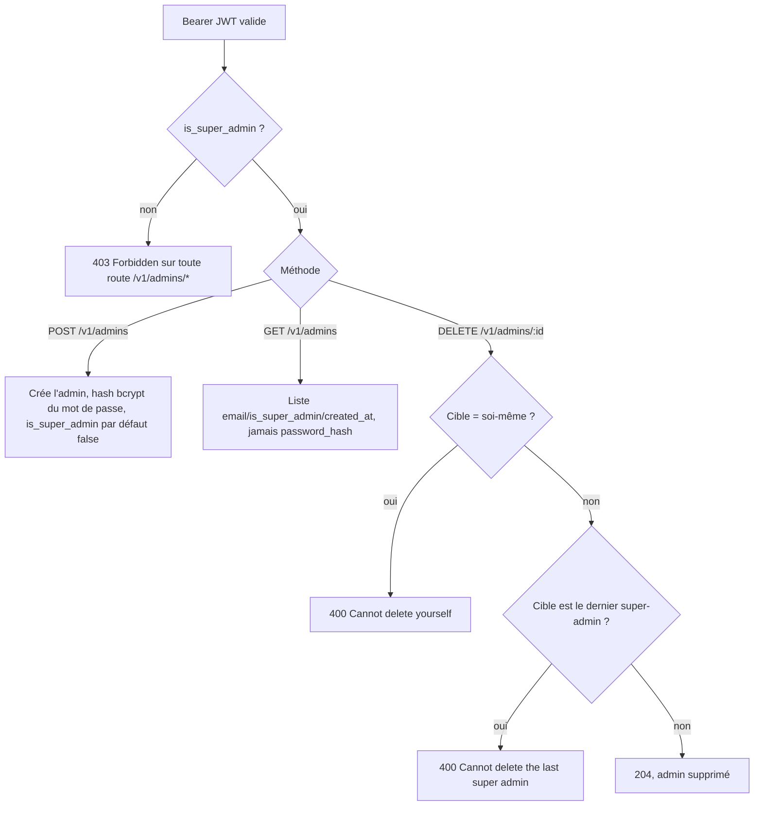
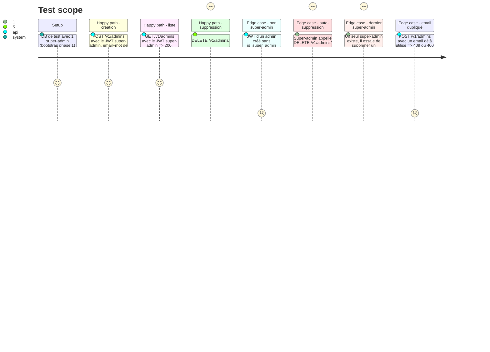

# Instruction: API de gestion des admins (super-admin only)

## Architecture projection

> Tree of the final files. ✅ create · ✏️ modify · ❌ delete

```txt
code/api/internal/auth
├── auth.go                       ✏️ ajoute RequireSuperAdmin, middleware chi : 403 si Principal.IsSuperAdmin est faux
└── auth_test.go                  ✏️ tests de RequireSuperAdmin (laisse passer un super-admin, 403 sinon)

code/api/internal/routes
├── admins.go                      ✏️ ajoute Admins() chi.Router : POST/GET/DELETE, réutilise le modèle de la phase 1
└── admins_test.go                 ✏️ tests des 3 endpoints + des 2 garde-fous de suppression

code/api/internal/app
└── app.go                         ✏️ monte Mount("/admins", routes.Admins()) dans le groupe protégé, avec RequireSuperAdmin en plus de auth.Middleware
```

## User Journey



## Test Scope



## Tasks to do

### `1)` Middleware RequireSuperAdmin

> `code/api/internal/auth/auth.go`, appliqué en plus de `Middleware` (qui tourne avant et peuple déjà le `Principal`).

1. `func RequireSuperAdmin(next http.Handler) http.Handler` : lit `PrincipalFrom(ctx)` (doit déjà être posé par `Middleware`, qui tourne avant dans la chaîne) ; si absent ou `!principal.IsSuperAdmin`, `httpjson.Error(w, 403, "Forbidden")` et ne pas appeler `next`.
2. Tests : un `Principal` super-admin dans le contexte laisse passer ; un `Principal` normal ou l'absence de `Principal` renvoie 403.

### `2)` Endpoints admins

> `code/api/internal/routes/admins.go`, réutilise `admin`/`findAdminByEmail`/`countSuperAdmins` de la phase 1.

1. `type createAdminBody struct { Email string; Password string; IsSuperAdmin bool \`json:"isSuperAdmin"\` }`.
2. `POST /` : décode le body, email non vide + regex basique (réutiliser le pattern de `leads.go`), mot de passe non vide ; email déjà utilisé -> vérifier via `findAdminByEmail` avant insert, `400 "Email already in use"` si trouvé (pas un 500 sur la contrainte unique) ; sinon `bcrypt.GenerateFromPassword(DefaultCost)`, `INSERT ... RETURNING id, created_at`, répond `201` avec l'admin créé (sans password_hash).
3. `GET /` : `SELECT id, email, is_super_admin, created_at FROM admins ORDER BY created_at` (jamais password_hash dans le `SELECT`, pas juste omis du JSON), répond `200` avec un tableau (jamais `null`).
4. `DELETE /{id}` : parser l'id du path ; comparer à `PrincipalFrom(ctx).Subject` (l'id du JWT) -> si égal, `400 "Cannot delete yourself"` ; charger l'admin ciblé, s'il est super-admin, `countSuperAdmins` -> si == 1, `400 "Cannot delete the last super admin"` ; sinon `DELETE FROM admins WHERE id = $1`, `204 No Content`.

### `3)` Montage des routes

> `code/api/internal/app/app.go`.

1. Dans le groupe déjà protégé par `auth.Middleware`, ajouter un sous-groupe avec `RequireSuperAdmin` en plus, monter `Admins()` dedans — ne pas affaiblir la protection des routes déjà existantes (`example`, `shopify`, `analytics`, `leads`) qui doivent rester accessibles à tout admin, pas seulement aux super-admins.

### `4)` Tests

1. `admins_test.go` : les 3 endpoints (succès) + les 4 cas limites du Test Scope (403 non-super-admin, auto-suppression, dernier super-admin, email dupliqué).
2. `auth_test.go` : `RequireSuperAdmin` (2 cas : laisse passer / 403).

## Test acceptance criteria

| Task | Acceptance criteria |
| ---- | -------------------- |
| 1... | `go test ./internal/auth/... -run RequireSuperAdmin` passe |
| 2... | `go test ./internal/routes/... -run Admins` couvre les 7 scénarios du Test Scope |
| 3... | Un admin non super-admin reçoit 403 sur `/v1/admins` mais garde l'accès normal à `/v1/leads`, `/v1/analytics/*` |
| 4... | `go vet ./...` et `go test ./...` passent sur tout `code/api` |
