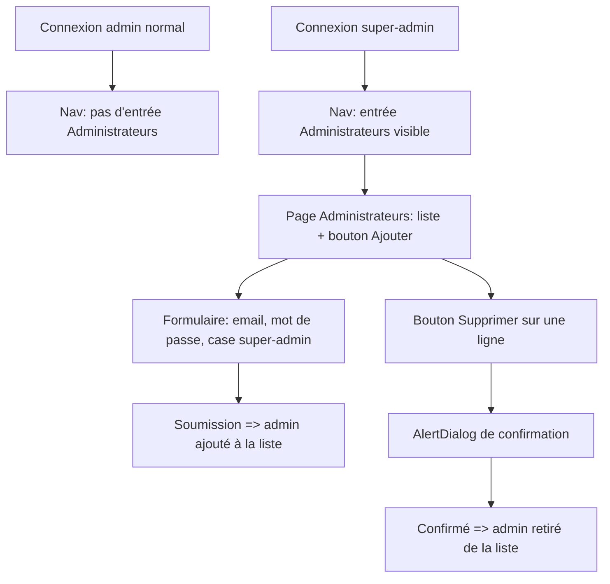
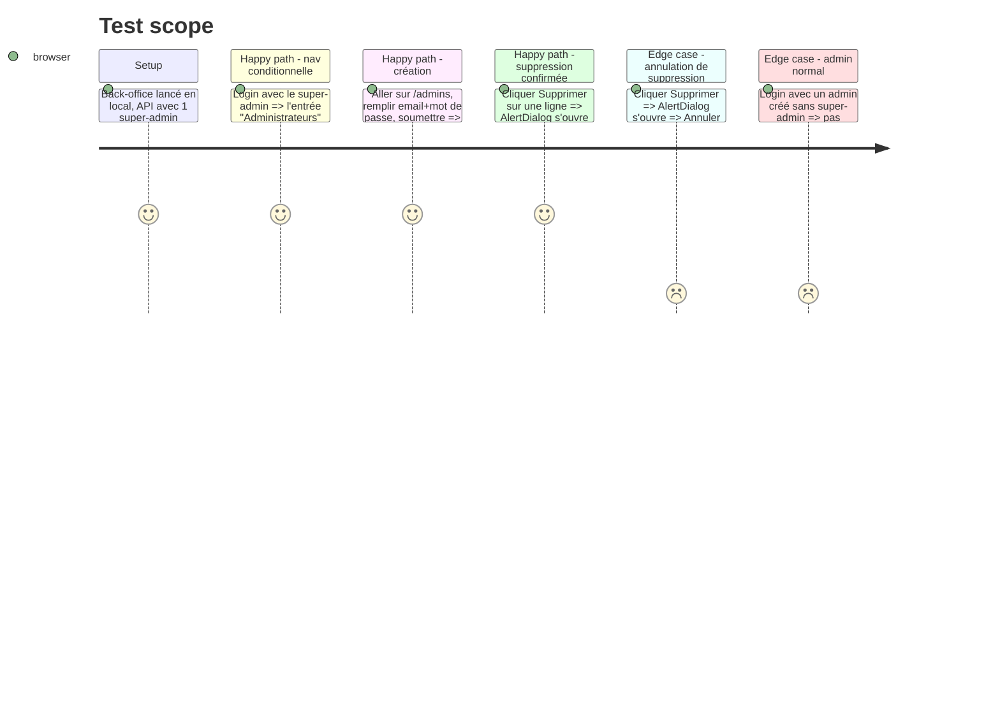

# Instruction: Page back-office « Administrateurs »

## Architecture projection

> Tree of the final files. ✅ create · ✏️ modify · ❌ delete

```txt
code/www-back-office
├── src/stores/auth.ts                     ✏️ AuthState gagne isSuperAdmin, login(token, email, isSuperAdmin)
├── src/pages/login.tsx                    ✏️ storeLogin(res.token, res.email, res.isSuperAdmin)
├── src/lib/api.ts                         ✏️ login() renvoie isSuperAdmin ; + type Admin, getAdmins, createAdmin(email, password, isSuperAdmin), deleteAdmin(id)
├── src/pages/admins.tsx                   ✅ liste + formulaire de création + suppression avec confirmation
├── src/router.tsx                         ✏️ route 'admins' -> AdminsPage, dans les enfants de ProtectedRoute
├── src/components/layout/app-layout.tsx   ✏️ entrée nav « Administrateurs » dans le groupe Système, visible seulement si isSuperAdmin
└── src/components/ui/alert-dialog.tsx     ✅ via `npx shadcn@latest add alert-dialog` (confirmation de suppression)
```

## User Journey



## Test Scope



## Wireframe

```
┌───────────────────────────────────────────────────┐
│ (1) Sidebar          │ (2) Header: "Administrateurs"│
│  Boutique             │                              │
│  Lancement             │ (3) [+ Ajouter un admin]     │
│  Système               ├──────────────────────────── │
│   Shopify               │ (4) Tableau                 │
│   Outils dev             │  Email │ Rôle │ Créé le │ │
│   Administrateurs ★      │  ────────────────────────│ │
│                          │  a@..  │ Super│ 12/11   │🗑│
│                          │  b@..  │ Admin│ 15/11   │🗑│
└───────────────────────────────────────────────────┘

(5) Dialog de création (ouvert via le bouton (3))
┌──────────────────────────┐
│ Ajouter un administrateur │
│ Email      [__________]   │
│ Mot de passe [________]   │
│ ☐ Super-admin              │
│         [Annuler] [Créer]  │
└──────────────────────────┘
```

1. Sidebar : entrée « Administrateurs » (★) ajoutée au groupe Système, uniquement rendue si `isSuperAdmin`.
2. Header de page : titre, cohérent avec `leads.tsx`/`analytics.tsx`.
3. Bouton d'ajout : ouvre le formulaire de création (dialog ou card en ligne, au choix de l'exécutant — un `Dialog`/`Card` shadcn déjà dispo, pas besoin d'une page séparée).
4. Tableau : email, badge de rôle (Super-admin / Admin), date de création, bouton supprimer (icône poubelle) par ligne.
5. Formulaire de création : email, mot de passe, case à cocher super-admin, actions Annuler/Créer.

## Tasks to do

### `1)` Étendre l'auth store et le login

> `src/stores/auth.ts`, `src/pages/login.tsx`, `src/lib/api.ts`.

1. `AuthState.isSuperAdmin: boolean | null`, `login(token, email, isSuperAdmin)`.
2. `login()` dans `api.ts` : le type de retour gagne `isSuperAdmin: boolean`.
3. `login.tsx` : `storeLogin(res.token, res.email, res.isSuperAdmin)`.

### `2)` Client API admins

> `src/lib/api.ts`, même style que `getLeads`/`getAnalytics`.

1. `type Admin = { id: number; email: string; isSuperAdmin: boolean; createdAt: string }`.
2. `getAdmins()`, `createAdmin(email, password, isSuperAdmin)`, `deleteAdmin(id)` — `apiFetch` existant gère déjà le Bearer token et le 401.

### `3)` Composant shadcn manquant

1. `npx shadcn@latest add alert-dialog` depuis `code/www-back-office` (même convention que les composants déjà installés, voir `components.json`).

### `4)` Page Administrateurs

> `src/pages/admins.tsx`, calque de `leads.tsx` pour le tableau/skeleton/erreur.

1. `useEffect` charge `getAdmins()` au montage, état `loading`/`error` comme `leads.tsx`.
2. Tableau : email, `Badge` « Super-admin » (variant par défaut) ou « Admin » (variant secondary), date formatée via `formatDateTime` (déjà utilisé par `leads.tsx`).
3. Bouton d'ajout ouvrant un formulaire (email, mot de passe type="password", checkbox super-admin) ; soumission appelle `createAdmin`, ajoute l'admin retourné à l'état local sans refetch complet.
4. Bouton supprimer par ligne -> `AlertDialog` de confirmation -> `deleteAdmin(id)` -> retire la ligne de l'état local au succès ; erreur affichée via `Alert` comme les autres pages.

### `5)` Navigation conditionnelle et route

1. `router.tsx` : ajouter `{ path: 'admins', element: <AdminsPage /> }` dans les enfants de `ProtectedRoute`.
2. `app-layout.tsx` : lire `isSuperAdmin` depuis `useAuthStore`, filtrer l'entrée « Administrateurs » du groupe Système si faux (garder `navGroups` statique, filtrer au rendu plutôt que dupliquer la structure).

## Test acceptance criteria

| Task | Acceptance criteria |
| ---- | -------------------- |
| 1... | Après login, `localStorage['back-office-auth']` contient `isSuperAdmin` |
| 2... | `npm run typecheck` ne signale aucune erreur sur les nouveaux types |
| 3... | `src/components/ui/alert-dialog.tsx` existe et exporte les primitives utilisées |
| 4... | Scénario manuel : créer un admin via le formulaire, le voir apparaître ; le supprimer via le dialog, le voir disparaître |
| 5... | Login avec un compte non super-admin : l'entrée « Administrateurs » est absente de la sidebar ; `npm run lint` et `npm run build` passent |
