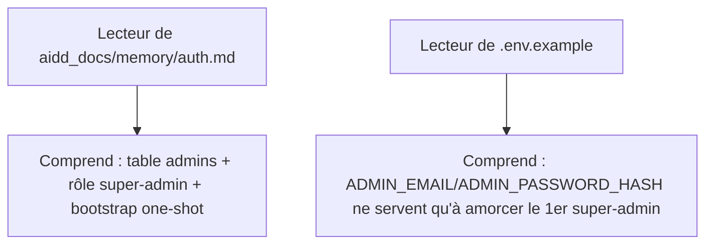
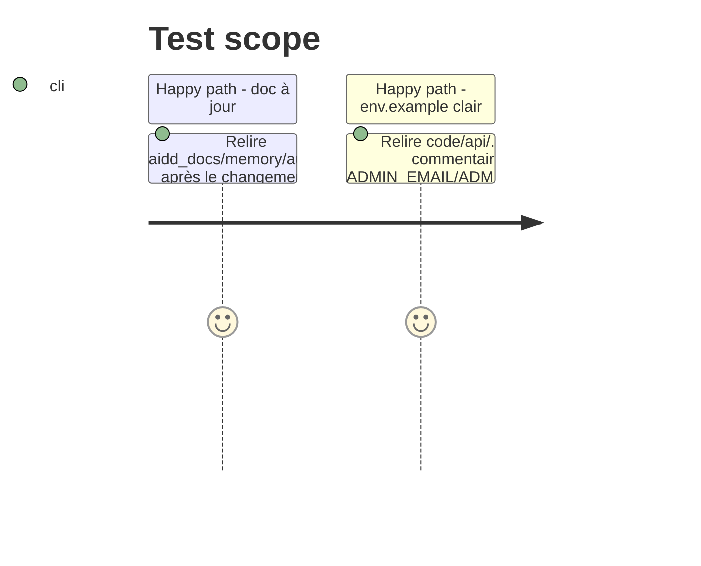

# Instruction: Nettoyage des variables d'env et de la mémoire projet

## Architecture projection

> Tree of the final files. ✅ create · ✏️ modify · ❌ delete

```txt
code/api/.env.example            ✏️ commentaire sur ADMIN_EMAIL/ADMIN_PASSWORD_HASH : rôle de bootstrap uniquement, plus de vérification de login
aidd_docs/memory/auth.md         ✏️ documente la table admins, le rôle super-admin, le bootstrap, retire la mention "single admin identity, not a user table"
```

## User Journey



## Test Scope



## Tasks to do

### `1)` Commenter .env.example

1. Au-dessus de `ADMIN_EMAIL`/`ADMIN_PASSWORD_HASH` dans `code/api/.env.example`, ajouter un commentaire : ces variables ne sont lues qu'une seule fois (tant que la table `admins` est vide) pour créer le premier super-admin ; elles ne sont plus jamais comparées à un login une fois au moins un admin en base.

### `2)` Mettre à jour aidd_docs/memory/auth.md

1. Remplacer « Single admin identity, not a user table » par la description de la table `admins` (email unique, password_hash bcrypt, is_super_admin) et du bootstrap (voir Decisions du plan).
2. Section Authorization : documenter le rôle super-admin, `auth.RequireSuperAdmin`, et que `/v1/admins/*` y est réservé alors que le reste de `/v1` reste ouvert à tout admin valide.
3. Garder le diagramme mermaid existant, l'étendre si besoin pour montrer le flux de gestion des admins (POST/GET/DELETE /v1/admins).
4. Ne pas toucher à la section Sessions (JWT 24h, zustand/persist) : inchangée par cette livraison.

## Test acceptance criteria

| Task | Acceptance criteria |
| ---- | -------------------- |
| 1... | `code/api/.env.example` ne laisse pas croire que ces variables servent encore à un login direct |
| 2... | `aidd_docs/memory/auth.md` décrit fidèlement le comportement implémenté dans les phases 1-3, sans mention obsolète de l'admin unique |
