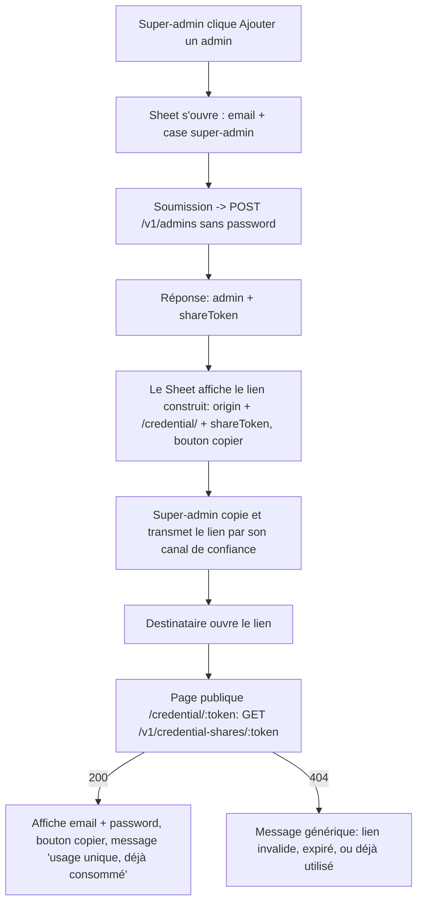
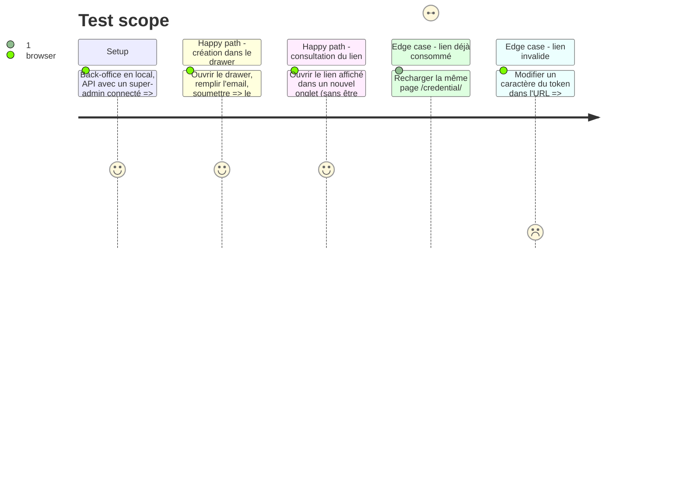

# Instruction: Back-office : drawer de création, page publique de partage

## Architecture projection

> Tree of the final files. ✅ create · ✏️ modify · ❌ delete

```txt
code/www-back-office
├── src/lib/api.ts                         ✏️ createAdmin ne prend plus de password, renvoie {admin, shareToken} ; + getCredentialShare(token) en fetch public (pas apiFetch, pas de Bearer)
├── src/pages/admins.tsx                   ✏️ Card inline -> Sheet (drawer), formulaire = email + case super-admin seulement, affiche le lien de partage après création
├── src/pages/admins.test.tsx              ✏️ adapte les tests existants au nouveau flux (plus de champ password, nouvelle étape "lien affiché")
├── src/pages/credential-share.tsx         ✅ page publique /credential/:token : appelle getCredentialShare, affiche email+password avec bouton copier, ou message d'erreur générique
├── src/pages/credential-share.test.tsx    ✅ succès, lien invalide/déjà consommé
└── src/router.tsx                         ✏️ route { path: 'credential/:token', element: <CredentialSharePage /> } HORS des enfants de ProtectedRoute, au même niveau que /login
```

## User Journey



## Test Scope



## Wireframe

```
(1) Drawer de création (ouvert depuis le bouton "Ajouter un admin")
┌──────────────────────────────┐
│ Ajouter un administrateur     │
│ Email        [____________]   │
│ ☐ Super-admin                 │
│                [Annuler][Créer]│
└──────────────────────────────┘

(2) Même drawer, après création réussie
┌──────────────────────────────┐
│ Administrateur créé            │
│ Lien à usage unique :          │
│ [ https://.../credential/xyz ] [Copier]│
│ Expire sous 24h, ne pourra plus │
│ être affiché une fois ouvert.  │
│                      [Fermer]  │
└──────────────────────────────┘

(3) Page publique /credential/:token
┌──────────────────────────────┐
│ MyHobbees — Identifiants       │
│ Email      a@b.fr    [Copier]  │
│ Mot de passe  ********  [Copier]│
│ Ce lien ne fonctionnera plus.  │
└──────────────────────────────┘
```

1. Drawer étape 1 : formulaire minimal, plus de champ mot de passe.
2. Drawer étape 2 (même composant, état différent) : le lien généré, pas un deuxième écran séparé.
3. Page publique, style proche de `login.tsx` (carte centrée, pas de sidebar) mais sans formulaire — juste la révélation une fois.

## Tasks to do

### `1)` Client API

> `src/lib/api.ts`.

1. `createAdmin(email: string, isSuperAdmin: boolean)` (signature change, plus de `password`), type de retour `{ admin: Admin; shareToken: string }`.
2. `type CredentialShare = { email: string; password: string }`. `getCredentialShare(token: string): Promise<CredentialShare>` : `fetch` direct (pas `apiFetch`, pas de header `Authorization` — c'est une route publique), gère le `404` en levant une erreur avec un message générique ("Ce lien est invalide, expiré ou a déjà été utilisé").

### `2)` Drawer de création

> `src/pages/admins.tsx` : remplace la `Card` conditionnelle par `Sheet`/`SheetContent`/`SheetHeader`/etc.

1. Retirer l'état et le champ `password` ; `onCreate` appelle `createAdmin(email, isSuperAdmin)`.
2. Après succès : garder le `Sheet` ouvert, basculer son contenu vers l'affichage du lien (`${window.location.origin}/credential/${shareToken}`) dans un `Input readOnly` + un `Button` copier (`navigator.clipboard.writeText`), avec le texte d'avertissement (usage unique, 24h).
3. Fermer le `Sheet` (bouton "Fermer") réinitialise l'état pour une prochaine création ; ajoute quand même l'admin à la liste locale dès la réussite de la création (pas seulement à la fermeture).

### `3)` Page publique de partage

> `src/pages/credential-share.tsx`, calque de `login.tsx` pour la mise en page (carte centrée, pas de layout protégé).

1. Lire `token` via `useParams` (route non protégée, pas de `AppLayout`/`ProtectedRoute`).
2. `useEffect` appelle `getCredentialShare(token)` une seule fois au montage ; états `loading`/`error`/`data`.
3. Succès : afficher email et mot de passe avec un bouton copier chacun, message "ce lien ne fonctionnera plus". Erreur : `Alert destructive` avec le message générique, pas de distinction technique.

### `4)` Route

1. `src/router.tsx` : ajouter `{ path: 'credential/:token', element: <CredentialSharePage /> }` au même niveau que `{ path: '/login', ... }` — explicitement PAS dans les enfants de `ProtectedRoute` (cette page doit rester accessible sans session back-office).

### `5)` Tests

1. `admins.test.tsx` : adapter le test de création existant (plus de saisie de mot de passe), ajouter une assertion que le lien de partage s'affiche après soumission.
2. `credential-share.test.tsx` : succès (affiche email/password), échec (affiche le message générique, ne plante pas).

## Test acceptance criteria

| Task | Acceptance criteria |
| ---- | -------------------- |
| 1... | `npm run typecheck`/`npm run build` ne signale aucune erreur sur les nouveaux types |
| 2... | Scénario manuel : créer un admin dans le drawer, voir le lien, le copier |
| 3... | Scénario manuel : ouvrir le lien copié dans un onglet sans session back-office, voir email+mot de passe ; recharger, voir le message d'erreur générique |
| 4... | Naviguer vers `/credential/un-token-invalide` sans être connecté ne redirige pas vers `/login` |
| 5... | `npm run test` passe, `npm run lint` et `npm run build` verts |
