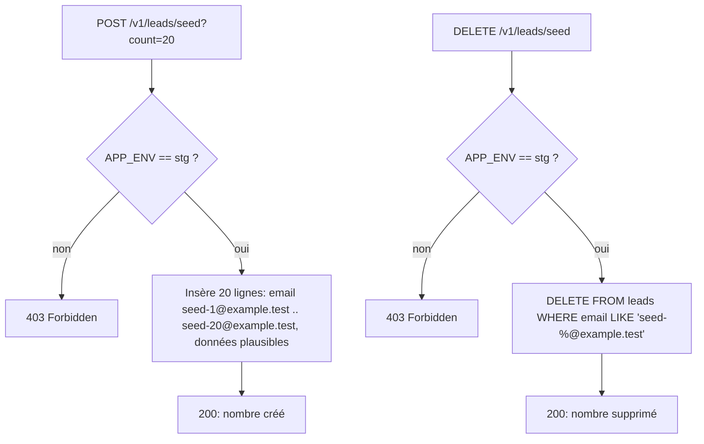

# Instruction: API : retrait du seed Shopify, seed/cleanup leads stg-only

## Architecture projection

> Tree of the final files. ✅ create · ✏️ modify · ❌ delete

```txt
code/api/internal/shopify
└── seed.go                     ❌ supprimé en entier (708 lignes, aucun autre consommateur)

code/api/internal/routes
├── shopify.go                  ✏️ retire les 3 routes /seed, /seed/orders, /seed/cleanup et seedClient()
├── leads.go                    ✏️ ajoute SeedLeads (POST) et CleanupSeedLeads (DELETE), stg-only
└── leads_test.go                ✏️ tests des 2 nouveaux handlers (ou leads_seed_test.go séparé, au choix de l'exécutant)

code/api/internal/app
└── app.go                      ✏️ monte les 2 nouvelles routes dans le groupe protégé existant (même niveau que GET /leads), retire tout montage lié aux anciennes routes seed si explicite
```

## User Journey



## Test Scope

```mermaid
---
title: Test scope
---
journey
  section Setup
    DB de test avec quelques vraies leads existantes => prête: 5: system
  section Happy path - seed puis cleanup
    APP_ENV=stg, POST /v1/leads/seed (count=5) => 200, 5 lignes insérées avec le motif seed- ; DELETE /v1/leads/seed => 200, exactement ces 5 lignes disparues, les vraies leads intactes: 5: api
  section Edge case - mauvais environnement
    APP_ENV=loc puis APP_ENV=prd, POST /v1/leads/seed et DELETE /v1/leads/seed => 403 dans les 4 cas, aucune ligne touchée: 1: api
  section Edge case - count hors bornes
    count=0, count=101, count absent => soit une valeur par défaut raisonnable, soit 400 explicite (au choix de l'exécutant, jamais un seed de 0 ou de taille déraisonnable silencieux): 1: api
  section Edge case - suppression de l'ancien seed Shopify
    go build ./... après suppression de internal/shopify/seed.go et des 3 routes => compile sans erreur, aucune référence résiduelle: 1: system
```

## Tasks to do

### `1)` Retirer le seed Shopify

1. Supprimer `code/api/internal/shopify/seed.go` en entier.
2. `code/api/internal/routes/shopify.go` : retirer les handlers `POST /seed`, `POST /seed/orders`, `POST /seed/cleanup`, et la fonction `seedClient()`. Garder `/status`, `/products`, `/orders`, `/customers` et tout le reste intact.
3. `go build ./...` et `go vet ./...` sur tout `code/api` pour confirmer qu'aucune référence résiduelle ne subsiste (import mort, fonction non utilisée, etc.).

### `2)` Endpoint de seed des leads

> `code/api/internal/routes/leads.go`, même style que `CreateLead`/`ListLeads` déjà dans ce fichier.

1. `POST /leads/seed` : query param `count` (entier, défaut raisonnable si absent — ex. 10 —, borné entre 1 et 100 ; hors bornes ou non numérique = `400`).
2. Garde stg-only en tout premier : `if os.Getenv("APP_ENV") != "stg" { httpjson.Error(w, 403, "Only available on stg"); return }` — avant toute autre validation, avant tout accès DB.
3. Génère `count` lignes avec des valeurs plausibles et variées (piocher aléatoirement parmi les activités/canaux/offres déjà utilisés ailleurs dans le projet — `ACTIVITIES`/`ACQUISITION_CHANNELS` de `code/www-shop/app/routes/me-prevenir.tsx` sont une bonne source d'inspiration pour des valeurs réalistes côté Go, pas besoin de les importer, juste s'en inspirer) ; email au format `seed-<n>@example.test` où `<n>` est unique (ex. un timestamp ou un compteur suffixé, pour permettre plusieurs seeds successifs sans collision sur la contrainte d'unicité si une existe — vérifier si `leads.email` a une contrainte unique avant de décider).
4. Insère via `pool.Exec`/un batch, répond `200` avec `{"created": count}`.

### `3)` Endpoint de nettoyage

1. `DELETE /leads/seed` : même garde stg-only en premier.
2. `DELETE FROM leads WHERE email LIKE 'seed-%@example.test'`, répond `200` avec `{"deleted": <rowsAffected>}`.
3. Aucun paramètre nécessaire — nettoie tout ce qui porte le motif, pas une sélection partielle.

### `4)` Montage et tests

1. `code/api/internal/app/app.go` : monter les 2 nouvelles routes dans le groupe déjà protégé par `auth.Middleware` (même niveau que `GET /leads` existant) — accessible à tout admin authentifié, pas réservé aux super-admins (la garde qui compte ici est l'environnement, pas le rôle).
2. Tests couvrant les 4 scénarios du Test Scope, contre une vraie base (pattern `admins_test.go`), en manipulant `APP_ENV` via `t.Setenv`.

## Test acceptance criteria

| Task | Acceptance criteria |
| ---- | -------------------- |
| 1... | `go build ./...` et `go vet ./...` passent sur tout `code/api`, zéro référence à `seedClient`/`SeedBase`/`SeedOrders`/`Cleanup` restante |
| 2... | `curl -X POST ".../v1/leads/seed?count=5"` avec `APP_ENV=stg` et un JWT valide répond 200, 5 lignes `seed-*@example.test` apparaissent dans `leads` |
| 3... | `curl -X DELETE ".../v1/leads/seed"` avec `APP_ENV=stg` ne supprime que les lignes au motif seed, vérifié par un `COUNT` avant/après sur les vraies leads |
| 4... | `go test ./internal/routes/... -run Seed` couvre succès + 403 (loc/prd) + bornes de `count` ; `go test ./...` vert sur tout `code/api` |
