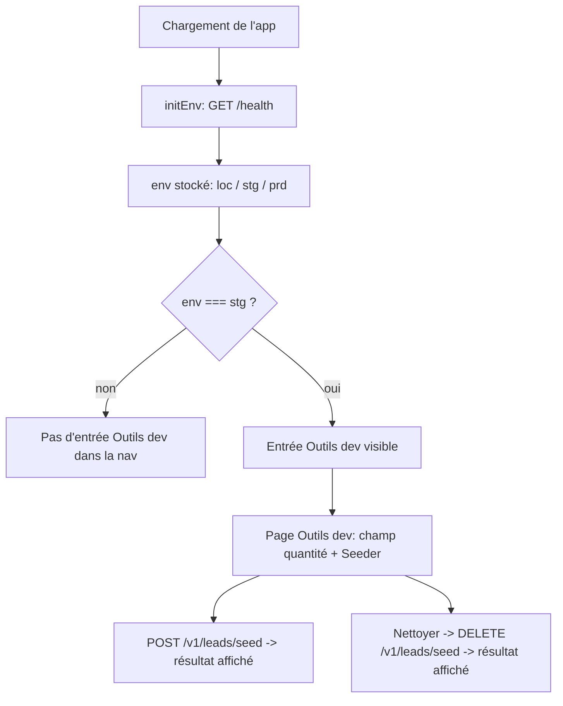
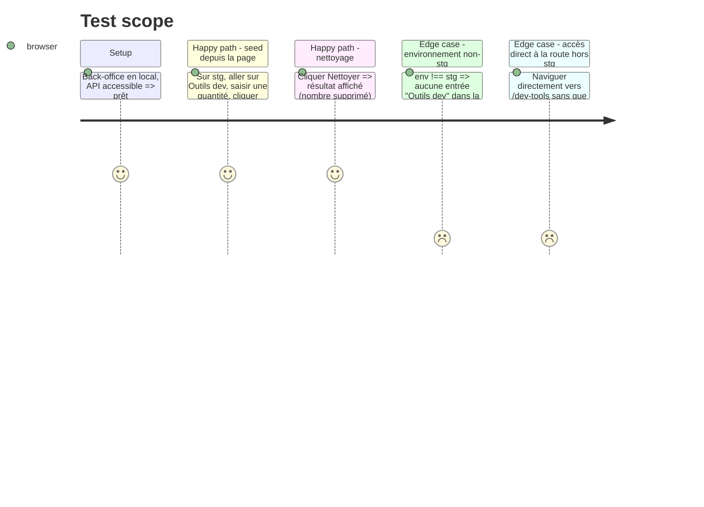

# Instruction: Back-office : détection d'environnement, page Outils dev

## Architecture projection

> Tree of the final files. ✅ create · ✏️ modify · ❌ delete

```txt
code/www-back-office
├── src/stores/env.ts                          ✅ store minimal : env: 'loc'|'stg'|'prd'|null, initEnv() qui fetch GET /health une fois
├── src/main.tsx                               ✏️ appelle initEnv() à côté de initTheme()
├── src/lib/api.ts                             ✏️ retire seedBase/seedOrders/seedCleanup et leurs types ; ajoute seedLeads(count)/cleanupSeedLeads()
├── src/pages/dev-tools.tsx                    ✏️ remplace tout le contenu Shopify par un seed/cleanup de leads
├── src/pages/dev-tools.test.tsx               ✏️ adapte les tests existants au nouveau contenu
└── src/components/layout/app-layout.tsx       ✏️ navGroups : "Outils dev" gagne un flag d'affichage conditionnel sur env === 'stg' (même mécanique que superAdminOnly)
```

## User Journey



## Test Scope



## Wireframe

```
┌──────────────────────────────┐
│ Outils dev                    │
│ Peupler la base de données     │
│ de staging avec des leads de  │
│ test (sans dépendance Shopify)│
│                                │
│ Quantité  [ 10 ]  [Seeder]     │
│                                │
│ ✓ 10 leads de test créées      │
│                                │
│ ───────────────────────────── │
│ [Nettoyer les leads de test]   │
│ ✓ 10 leads de test supprimées  │
└──────────────────────────────┘
```

1. Titre + description expliquant explicitement que ça seed la DB, pas Shopify.
2. Champ numérique (quantité) + bouton d'action, calque du style `Button`/`Input` déjà utilisé ailleurs (`admins.tsx`).
3. Résultat de la dernière action (création), affiché sous le bouton.
4. Séparateur puis action de nettoyage symétrique, avec son propre résultat.

## Tasks to do

### `1)` Store d'environnement

> `src/stores/env.ts`, calque minimal de `src/stores/theme.ts` pour le pattern d'init, PAS de `persist` (l'environnement doit être relu à chaque chargement, jamais mis en cache côté client).

1. `create<EnvState>()` avec `env: 'loc' | 'stg' | 'prd' | null` (null = pas encore connu, traité comme "pas stg" par tous les filtres — fail-closed) et un setter interne.
2. `export async function initEnv()` : `fetch` direct vers l'API (même base URL que `apiFetch`, mais `/health` est public donc un `fetch` nu suffit, pas de Bearer), lit le champ `env` de la réponse, l'écrit dans le store ; toute erreur réseau laisse `env` à `null` sans jamais throw (ne doit jamais empêcher l'app de charger).

### `2)` Déclenchement et nav conditionnelle

1. `src/main.tsx` : `initEnv()` à côté de `initTheme()`.
2. `src/components/layout/app-layout.tsx` : `navGroups`'s "Outils dev" gagne un champ (ex. `stgOnly: true`), le filtre `.filter((item) => !item.superAdminOnly || isSuperAdmin)` devient aussi conditionné par `(!item.stgOnly || env === 'stg')` (lire `env` via le nouveau store).

### `3)` Client API

> `src/lib/api.ts`.

1. Retirer `seedBase`, `seedOrders`, `seedCleanup` et les types qui n'existent que pour eux (`SeedBase`, `OrderSpec`, `SeedOrdersResult`, `CleanupResult` — vérifier qu'aucun n'est réutilisé ailleurs avant de les retirer).
2. `seedLeads(count: number)`: `apiFetch<{created: number}>('/v1/leads/seed?count=' + count, {method: 'POST'})`.
3. `cleanupSeedLeads()`: `apiFetch<{deleted: number}>('/v1/leads/seed', {method: 'DELETE'})`.

### `4)` Page Outils dev

> `src/pages/dev-tools.tsx`, réécriture complète du contenu (structure de fichier/style à conserver : `Card`, gestion `loading`/`error`/résultat comme les autres pages).

1. Retirer tout l'état et la logique Shopify (`THROTTLE_WAIT_MS`, `wait()`, `SeedSummary`, `CleanupSummary`, `onSeed`/`onCleanup` actuels).
2. Nouvel état : quantité (input contrôlé, défaut 10), résultat de seed (`{created: number} | null`), résultat de cleanup (`{deleted: number} | null`), erreur, `loading`.
3. Bouton Seeder -> `seedLeads(quantité)` -> affiche le résultat. Bouton Nettoyer -> `cleanupSeedLeads()` -> affiche le résultat. Erreurs affichées via `Alert destructive` comme le reste du back-office.
4. Mettre à jour `dev-tools.test.tsx` en conséquence (plus de test sur le flux Shopify/débit, nouveaux tests sur seed/cleanup de leads).

### `5)` Mémoire projet

1. `aidd_docs/memory/architecture.md` et/ou `deployment.md` : documenter la nouvelle notion d'environnement côté back-office (`GET /health` + store non persisté) et que « Outils dev » est maintenant stg-only et sans dépendance Shopify.
2. Retirer toute mention du seed Shopify dans la mémoire si elle y est décrite ailleurs.

## Test acceptance criteria

| Task | Acceptance criteria |
| ---- | -------------------- |
| 1... | `initEnv()` ne lève jamais, même si l'API est injoignable |
| 2... | Sur un environnement stg réel (ou simulé en test), "Outils dev" apparaît dans la sidebar ; sinon absent |
| 3... | `npm run build`/`typecheck` ne signale aucune référence résiduelle à `seedBase`/`seedOrders`/`seedCleanup` |
| 4... | Scénario manuel : seeder puis nettoyer depuis la page, résultats affichés, pas de plantage |
| 5... | `npm run lint`, `npm run test`, `npm run build` verts ; aucune mémoire ne mentionne plus le seed Shopify comme fonctionnalité active |
