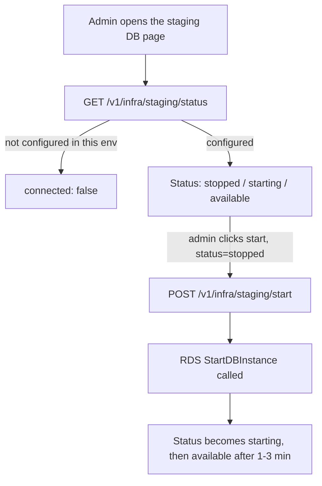
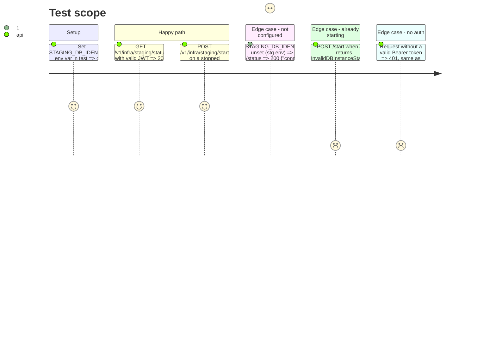

<!-- Fill or omit these sections; never add, rename, or reorder one. -->

# Instruction: Go API — staging DB control

## Architecture projection

> Tree of the final files. ✅ create · ✏️ modify · ❌ delete

```txt
code/api
├── go.mod                              ✏️ aws-sdk-go-v2/config, service/rds move to direct require (go mod tidy)
├── go.sum                              ✏️ regenerated by go mod tidy
└── internal
    ├── awsrds
    │   └── client.go                   ✏️ fix struct alignment, add Stop(ctx) mirroring Start(ctx)
    ├── routes
    │   └── staging.go                  ✅ GET /status, POST /start handlers
    └── app
        └── app.go                      ✏️ mount routes.Staging() in the existing protected /v1 group
```

## User Journey



## Test Scope

<!-- Required for every phase. Keep Setup, Happy path, any qualifying Edge cases, and any required Teardown in this one journey. -->



## Tasks to do

### `1)` Finish the `awsrds` client

> Make the hand-written client complete and correctly formatted.

1. Run `gofmt -w` on `code/api/internal/awsrds/client.go` to fix the `Client` struct field alignment.
2. Add `Stop(ctx context.Context) error`, mirroring `Start`: call `StopDBInstanceInput{DBInstanceIdentifier: ...}`, swallow `*types.InvalidDBInstanceStateFault` the same way `Start` does.
3. Leave `Status` and `FromEnv` as already written — they match the project's `shopify.ErrNotConfigured` idiom.

### `2)` Add the route

> Mirror `code/api/internal/routes/shopify.go`'s structure — no re-applied auth middleware, same `httpjson.OK`/`Error` helpers.

1. Create `code/api/internal/routes/staging.go` exporting `func Staging() chi.Router`.
2. `GET /status`: call `awsrds.FromEnv(ctx)`; on `ErrNotConfigured`, respond `200 {"connected": false}` (same pattern as `shopify.Status`); otherwise call `.Status(ctx)` and respond `200 {"connected": true, "status": "<available|stopped|starting|...>"}`; on any other error, `502`.
3. `POST /start`: same `FromEnv` gate; on configured, call `.Start(ctx)`; respond `202 {"status": "starting"}` on success (not `200` — the action is accepted but not complete), `502` on error.
4. Add the doc-comment warning against re-applying auth middleware, copied from `shopify.go`'s existing one.

### `3)` Wire the route

> One line in the existing single point of truth for `/v1` auth.

1. In `code/api/internal/app/app.go`, inside the existing `r.Group(func(r chi.Router) { r.Use(auth.Middleware); ... })` block, add `r.Mount("/infra", routes.Staging())` next to the `/shopify` and `/analytics` mounts — not inside the inner `RequireSuperAdmin` group.

### `4)` Tidy modules

> Make go.mod/go.sum consistent with the new direct imports.

1. Run `go mod tidy` inside `code/api`.
2. Confirm `aws-sdk-go-v2/config` and `aws-sdk-go-v2/service/rds` move out of the `// indirect` block.

## Test acceptance criteria

<!-- Each criterion is an observable behavior, not a command. -->

| Task | Acceptance criteria                                                                 |
| ---- | ------------------------------------------------------------------------------------ |
| 1    | `go build ./...` succeeds; `Stop` exists with the same fault-swallowing behavior as `Start`. |
| 2    | `GET /v1/infra/staging/status` returns `connected:false` when `STAGING_DB_IDENTIFIER` is unset, and a real status string when set (mockable via an interface or integration test against a real stg instance). |
| 3    | A request to `/v1/infra/staging/status` without a Bearer token returns 401, matching every other `/v1` route (`TestProtectedRoutesRequireAuth`-style coverage). |
| 4    | `go.mod` lists `aws-sdk-go-v2/config` and `aws-sdk-go-v2/service/rds` as direct requires; `go vet ./...` is clean. |
