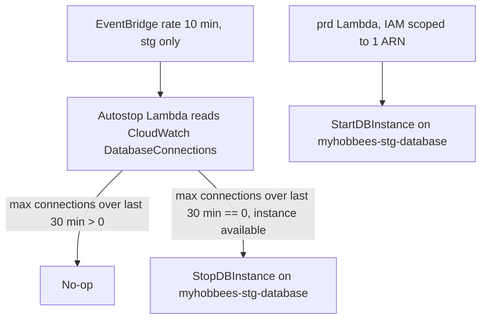
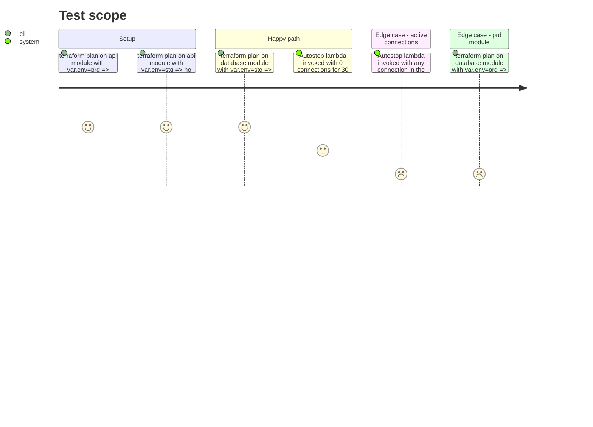

<!-- Fill or omit these sections; never add, rename, or reorder one. -->

# Instruction: Terraform — scoped IAM + stg auto-stop Lambda

## Architecture projection

> Tree of the final files. ✅ create · ✏️ modify · ❌ delete

```txt
infrastructure/terraform
├── api
│   ├── lambda.tf                       ✏️ add STAGING_DB_IDENTIFIER env var (prd only)
│   └── iam_staging_control.tf          ✅ scoped IAM policy, count = var.env == "prd" ? 1 : 0
└── database
    └── lambda_autostop.tf              ✅ IAM role + log group + archive_file + lambda + EventBridge rule/target/permission, count = var.env == "stg" ? 1 : 0

aidd_docs/memory
└── infra.md                            ✏️ document the cross-env IAM exception + the 7-day AWS auto-restart behavior
```

## User Journey



## Test Scope



## Tasks to do

### `1)` Scope the prd Lambda's IAM

> Exactly 3 actions, exactly 1 resource, only for prd.

1. In `infrastructure/terraform/api/iam_staging_control.tf`, add `data "aws_caller_identity" "current" {}`.
2. Add `resource "aws_iam_role_policy" "StagingControl"` with `count = var.env == "prd" ? 1 : 0`, `role = aws_iam_role.LambdaApi.id`, a policy document allowing only `rds:StartDBInstance`, `rds:StopDBInstance`, `rds:DescribeDBInstances` on `Resource = "arn:aws:rds:eu-west-3:${data.aws_caller_identity.current.account_id}:db:${var.app}-stg-database"`.
3. In `infrastructure/terraform/api/lambda.tf`, add to the Lambda's `environment.variables`: `STAGING_DB_IDENTIFIER = var.env == "prd" ? "${var.app}-stg-database" : ""`.

### `2)` Build the stg auto-stop Lambda

> First scheduled utility Lambda in the repo — mirror `api/lambda.tf`'s idiom (own role, own log group, placeholder zip, `ignore_changes`), gated to stg only.

1. In `infrastructure/terraform/database/lambda_autostop.tf`, everything behind `count = var.env == "stg" ? 1 : 0`:
   - `aws_iam_role` (`${var.app}-${var.env}-autostop-lambda`) assumable by `lambda.amazonaws.com`.
   - Inline policy on that role allowing only `rds:DescribeDBInstances`, `rds:StopDBInstance` on `aws_db_instance.Database.arn`, and `cloudwatch:GetMetricStatistics` (CloudWatch metric reads are not resource-scopable, so this one action stays unscoped by necessity — document why in a one-line comment) plus the AWS-managed `AWSLambdaBasicExecutionRole` attachment.
   - `aws_cloudwatch_log_group` (`/aws/lambda/${var.app}-${var.env}-autostop`, 7-day retention, matching the API Lambda's convention).
   - `data "archive_file" "AutostopPlaceholder"` zipping an inline Python handler (`lambda_function.py`, `boto3`) that: reads `DB_INSTANCE_ID` env var, calls `cloudwatch.get_metric_statistics` for `AWS/RDS`/`DatabaseConnections` dimensioned by that instance over the last 30 minutes with `Statistics=['Maximum']`, and if every datapoint's `Maximum` is `0` (or no datapoints at all, meaning no activity was recorded) **and** the instance's current status is `available`, calls `rds.stop_db_instance`.
   - `aws_lambda_function` (`${var.app}-${var.env}-autostop`), Python 3.14 runtime, `handler.lambda_handler`, env var `DB_INSTANCE_ID = aws_db_instance.Database.identifier`, `lifecycle { ignore_changes = [filename, source_code_hash] }` only if this Lambda is expected to be redeployed by a script later — otherwise omit `ignore_changes` since this one ships its real code directly via Terraform (no separate deploy step planned), unlike the API Lambda.
   - `aws_cloudwatch_event_rule` (`schedule_expression = "rate(10 minutes)"`).
   - `aws_cloudwatch_event_target` pointing the rule at the Lambda.
   - `aws_lambda_permission` allowing `events.amazonaws.com` to invoke the Lambda, `source_arn` scoped to the event rule's ARN.

### `3)` Document the exception

> One memory file, so the stg/prd isolation break doesn't read as an oversight later.

1. In `aidd_docs/memory/infra.md`, add a short note: the prd Lambda holds a narrow, scoped exception to cross-env isolation (3 RDS actions, 1 instance ARN) to let an admin start stg from the prd back-office; stopping an RDS instance never deletes data; AWS force-restarts a stopped instance after 7 consecutive days, which is expected, not a bug.

## Test acceptance criteria

| Task | Acceptance criteria                                                                                       |
| ---- | ----------------------------------------------------------------------------------------------------------- |
| 1    | `terraform plan` for `api` with `var.env=prd` shows the new policy; with `var.env=stg` it shows nothing for `StagingControl` (count=0). |
| 2    | `terraform plan` for `database` with `var.env=stg` shows the new Lambda, role, log group, and event rule; with `var.env=prd` it shows nothing for them (count=0). |
| 3    | `infra.md` names the exact 3 actions, the 1 ARN, the no-data-loss guarantee, and the 7-day auto-restart behavior. |
