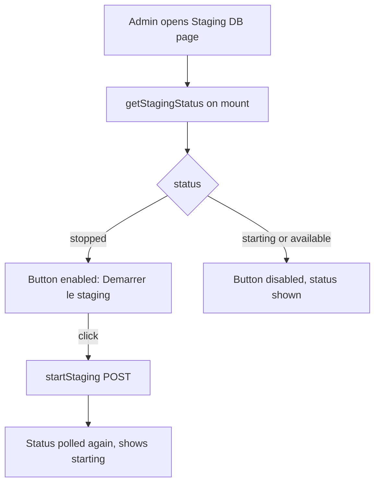
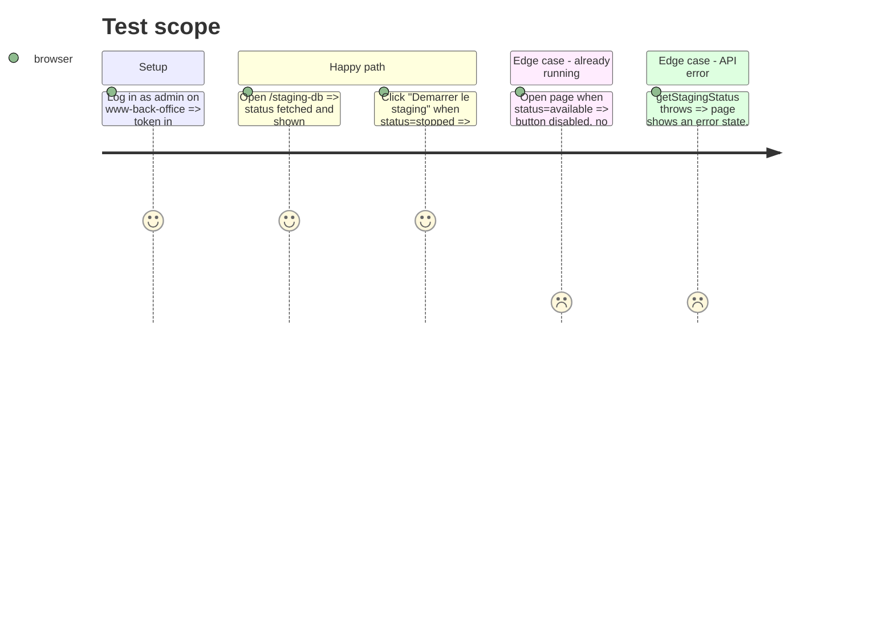

<!-- Fill or omit these sections; never add, rename, or reorder one. -->

# Instruction: Back-office — staging DB page

## Architecture projection

> Tree of the final files. ✅ create · ✏️ modify · ❌ delete

```txt
code/www-back-office/src
├── lib
│   └── api.ts                          ✏️ add getStagingStatus(), startStaging()
├── pages
│   └── staging-db.tsx                  ✅ status + start button, pattern of shopify-status.tsx
└── router.tsx                          ✏️ add the protected route entry + nav link
```

## User Journey



## Test Scope



## Wireframe

<!-- UI phase only. No UI => omit the section, don't invent one. -->

```txt
┌──────────────────────────────────────────────────┐
│ (1) Header back-office (nav existante)            │
├──────────┬─────────────────────────────────────────┤
│ (2) Nav  │ (3) Titre : "Base de donnees staging"    │
│  admin   │ ┌─────────────────────────────────────┐ │
│          │ │ (4) Statut : stopped / starting /     │ │
│          │ │              available                │ │
│          │ └─────────────────────────────────────┘ │
│          │ (5) [ Demarrer le staging ] (bouton)     │
│          │ (6) Note : redemarre seul apres 7j,      │
│          │     s'arrete seul apres 30 min inactif   │
└──────────┴─────────────────────────────────────────┘
```

1. Header: existing back-office nav, unchanged.
2. Side nav: existing admin menu, new "Staging DB" entry.
3. Page title.
4. Current status (polled from `GET /status`), one of `stopped` / `starting` / `available`, French label.
5. Action button, disabled unless status is `stopped`.
6. Static explanatory text (no behavior) — restates the 7-day and 30-minute rules from the contract.

## Tasks to do

### `1)` API client functions

> Mirror `getShopifyStatus()` exactly.

1. In `code/www-back-office/src/lib/api.ts`, add `type StagingStatus = { connected: boolean; status?: string }`.
2. Add `getStagingStatus(): Promise<StagingStatus>` calling `apiFetch('/infra/staging/status')`.
3. Add `startStaging(): Promise<{ status: string }>` calling `apiFetch('/infra/staging/start', { method: 'POST' })`.

### `2)` Page component

> `useState` + `useEffect`, no new zustand store — status is ephemeral, same choice as `shopify-status.tsx`.

1. Create `code/www-back-office/src/pages/staging-db.tsx`.
2. On mount, call `getStagingStatus()`, store in state; show a loading state until it resolves.
3. Render the status label (French: "Arretee" / "Demarrage..." / "Disponible").
4. Render the button, `onClick` calls `startStaging()` then re-fetches status; disabled when `status !== 'stopped'` or while a start/fetch is in flight.
5. Render the static note from the wireframe's region 6.
6. On fetch error, show an inline error message instead of leaving a blank page.

### `3)` Route + nav entry

> One entry, following the existing `shopify` / `dev-tools` / `admins` pattern.

1. In `code/www-back-office/src/router.tsx`, import `StagingDbPage` and add `{ path: 'staging-db', element: <StagingDbPage /> }` under the existing `ProtectedRoute` children.
2. Add the corresponding nav link in whichever component renders the admin side nav (follow the existing entries' pattern for label + path).

## Test acceptance criteria

| Task | Acceptance criteria                                                                                     |
| ---- | ---------------------------------------------------------------------------------------------------------- |
| 1    | `getStagingStatus()` and `startStaging()` both resolve/throw through the same `apiFetch` error handling as `getShopifyStatus()` (401 → logout, non-OK → thrown `Error`). |
| 2    | Loading, stopped, starting, available, and error states are all visually distinct when manually toggled in dev. |
| 3    | Navigating to `/staging-db` while logged out redirects to login, same as every other protected page. |
