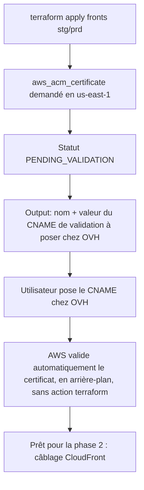
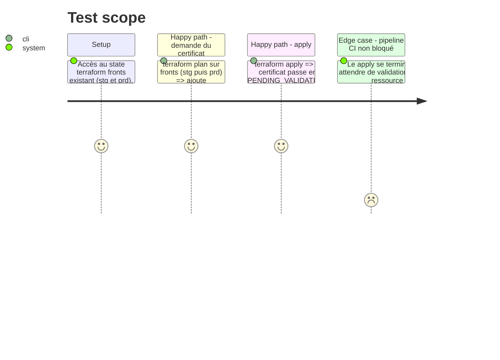

# Instruction: Demande des certificats ACM (sans câblage CloudFront)

## Architecture projection

> Tree of the final files. ✅ create · ✏️ modify · ❌ delete

```txt
infrastructure/terraform/fronts
├── providers.tf                 ✏️ ajoute un provider aws aliasé "us_east_1" (mêmes clés, region fixe "us-east-1") — requis par CloudFront pour tout certificat ACM
├── acm.tf                       ✅ aws_acm_certificate.BackOffice (validation_method = "DNS", provider = aws.us_east_1), output des enregistrements de validation
└── variables.tf                 ✅ nouvelle variable back_office_domain (pas de défaut — une valeur différente par environnement, voir ci-dessous)

environments/stg
└── variables.stg.tf             ✏️ ajoute `variable "back_office_domain" { default = "back-office-stg.myhobbees.fr" }`

environments/prd
└── variables.prd.tf             ✏️ ajoute `variable "back_office_domain" { default = "back-office.myhobbees.fr" }`
```

## User Journey



## Test Scope



## Tasks to do

### `1)` Provider us-east-1

> `infrastructure/terraform/fronts/providers.tf`.

1. Ajouter, à côté du provider `aws` par défaut déjà présent :
   ```hcl
   provider "aws" {
     alias      = "us_east_1"
     access_key = var.aws_access_key
     secret_key = var.aws_secret_key
     region     = "us-east-1"
   }
   ```

### `2)` Certificat ACM

> `infrastructure/terraform/fronts/acm.tf`, nouveau fichier.

1. `resource "aws_acm_certificate" "BackOffice"` : `domain_name = var.back_office_domain`, `validation_method = "DNS"`, `provider = aws.us_east_1`, `lifecycle { create_before_destroy = true }`.
2. `output "back_office_cert_validation_name"` et `output "back_office_cert_validation_value"` (ou un seul output structuré) : extraits de `aws_acm_certificate.BackOffice.domain_validation_options[0]` (`resource_record_name`, `resource_record_value`, `resource_record_type`) — c'est l'enregistrement exact que l'utilisateur devra poser chez OVH.
3. `output "back_office_cert_arn"` : `aws_acm_certificate.BackOffice.arn` (nécessaire pour la phase 2, pas d'usage immédiat).
4. NE PAS ajouter `aws_acm_certificate_validation` dans cette phase (voir Decisions du plan — ressource bloquante tant que le DNS n'est pas posé).
5. NE PAS toucher à `aws_cloudfront_distribution.BackOffice` dans `s3_back-office.tf` (ni `aliases`, ni `viewer_certificate`) — strictement hors périmètre de cette phase.

### `3)` Variable par environnement

1. `infrastructure/terraform/fronts/variables.tf` (nouveau fichier si absent — le module n'en a pas aujourd'hui, les variables viennent toutes de `environments/<env>/variables.<env>.tf` copié par `infrastructure/scripts/terraform.py`) : déclarer `variable "back_office_domain" { type = string }` sans défaut ici, pour forcer chaque environnement à fournir le sien.
2. `environments/stg/variables.stg.tf` : ajouter `variable "back_office_domain" { default = "back-office-stg.myhobbees.fr" }`.
3. `environments/prd/variables.prd.tf` : ajouter `variable "back_office_domain" { default = "back-office.myhobbees.fr" }`.

### `4)` Vérification

1. Lire `infrastructure/scripts/terraform.py` pour confirmer que `terraform plan`/`apply` est bien invocable localement ou via une simulation sans accès AWS réel (probable : non, les credentials AWS réelles sont nécessaires) — si aucun accès AWS n'est disponible dans cet environnement, se limiter à `terraform validate`/`terraform fmt -check` en local (après avoir copié un `variables.stg.tf` factice pour que les variables résolvent) et documenter explicitement que le `plan`/`apply` réel n'a pas pu être exécuté faute de credentials, plutôt que de prétendre l'avoir fait.
2. Vérifier par lecture que le diff ne touche à aucune ressource `aws_cloudfront_distribution`, `aws_s3_bucket*` existante (aucune ligne de modification/destruction sur ces blocs).

## Test acceptance criteria

| Task | Acceptance criteria |
| ---- | -------------------- |
| 1... | `terraform validate` passe sur le module `fronts` avec les nouvelles variables fournies |
| 2... | Les 2 nouveaux outputs de validation existent et référencent bien `aws_acm_certificate.BackOffice.domain_validation_options[0]` |
| 3... | `environments/stg/variables.stg.tf` et `environments/prd/variables.prd.tf` portent chacun la bonne valeur de domaine |
| 4... | Aucune ressource existante (`aws_cloudfront_distribution.BackOffice`, `aws_s3_bucket.BackOffice`, et les ressources `App`/`Assets` du même module) n'apparaît modifiée dans un `terraform plan` — si le `plan` réel n'a pas pu être exécuté faute de credentials AWS, le rapport final le dit explicitement |
