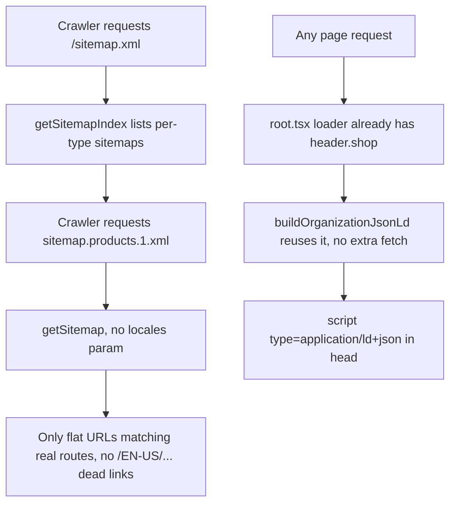
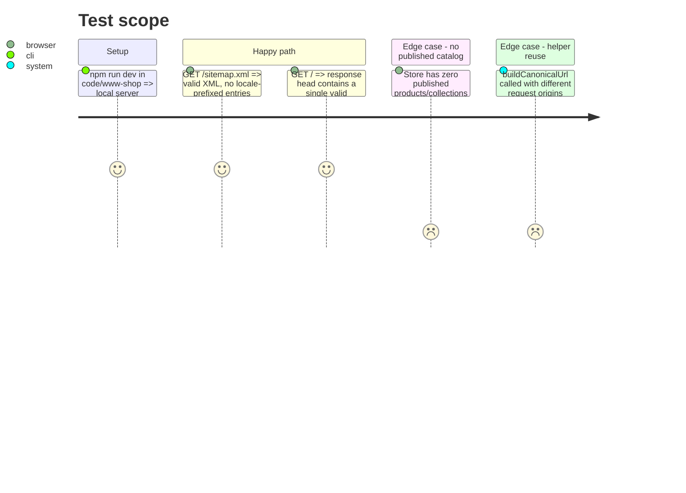

<!-- Fill or omit these sections; never add, rename, or reorder one. -->

# Instruction: Sitemap fix + shared SEO helper + root JSON-LD

## Architecture projection

> Tree of the final files. ✅ create · ✏️ modify · ❌ delete

```txt
code/www-shop/app
├── lib
│   └── seo.ts                              ✅ shared canonical/OG/Twitter/JSON-LD builder
├── root.tsx                                 ✏️ inject Organization/WebSite JSON-LD via the helper
└── routes
    └── sitemap.$type.$page[.xml].tsx        ✏️ remove the invalid `locales` array
```

## User Journey



## Test Scope

<!-- Required for every phase. Keep Setup, Happy path, any qualifying Edge cases, and any required Teardown in this one journey. -->



## Tasks to do

### `1)` Shared SEO helper

> One small, dependency-free module other routes import from — not a rewrite of existing per-route meta.

1. Create `code/www-shop/app/lib/seo.ts` exporting:
   - `canonicalUrl(request: Request, path?: string): string` — builds an absolute URL from `new URL(request.url).origin` plus the given path (or the request's own pathname when omitted). Never reads `shop.primaryDomain.url`.
   - `buildOpenGraphTags(opts: {title: string; description: string; url: string; image?: string; type?: 'website' | 'product' | 'article'}): Array<{property?: string; name?: string; content: string}>` — returns a flat array of `og:*` and matching `twitter:*` meta entries (`twitter:card` = `summary_large_image` when an image is present, else `summary`), ready to spread into a route's `meta` return array.
   - `organizationJsonLd(shop: {name: string; description?: string; url: string; logo?: string}): string` — returns a serialized `application/ld+json` string for a schema.org `Organization` (+ `WebSite` with `url`), given the exact shape already available from `header.shop` in `root.tsx`'s loader data (`name`, `description`, `primaryDomain.url` used only as a fallback display value, never as the canonical `url` field — that still comes from `canonicalUrl(request)`).
2. Keep it framework-agnostic (plain functions, no React) so both `root.tsx` and route files can use it from a loader or a `meta` function.

### `2)` Root JSON-LD

> Inject once, reused by every page since it renders in the document `<head>` regardless of route.

1. In `app/root.tsx`'s loader, call `organizationJsonLd` with the already-fetched `header.shop` data and the current `request`.
2. Render the resulting JSON-LD as a `<script type="application/ld+json" dangerouslySetInnerHTML={{__html: ...}} />` inside `Layout()`, next to the existing `<Meta />`/`<Links />` calls.
3. Leave the existing static root `meta` export (title/description) untouched — phase 2 handles per-route overrides, this phase is infra only.

### `3)` Fix the sitemap locale bug

> Remove the feature that doesn't apply to this app, don't "correct" its values.

1. In `app/routes/sitemap.$type.$page[.xml].tsx`, delete the `locales: [...]` line entirely.
2. Simplify `getLink` since it is now always called with `locale: undefined`: collapse the `if (!locale) ... else ...` branches to the single `${baseUrl}/${type}/${handle}` return (no behavior change, just removing now-dead code).

## Test acceptance criteria

<!-- Each criterion is an observable behavior, not a command. -->

| Task | Acceptance criteria                                                                 |
| ---- | ------------------------------------------------------------------------------------ |
| 1    | `canonicalUrl` returns an absolute URL whose origin matches the `Request` passed in, not a fixed constant; `organizationJsonLd` output parses as valid JSON and matches the `Organization` + `WebSite` shape. |
| 2    | Viewing any page's rendered HTML source shows exactly one `application/ld+json` `Organization` script tag, populated from real `header.shop` data (not hardcoded placeholder text). |
| 3    | `GET /sitemap.xml` and a per-type sitemap page both return `200` with well-formed XML; no URL in the output contains an `EN-US`/`EN-CA`/`FR-CA` segment. |
