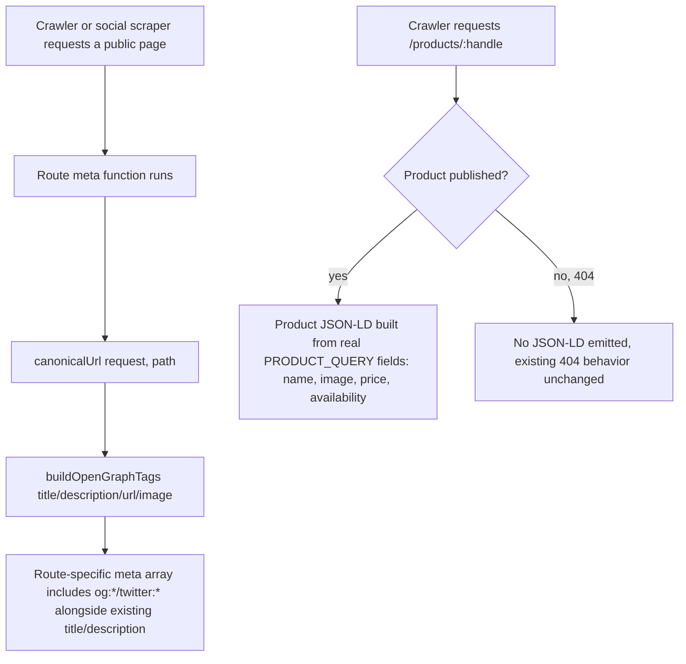
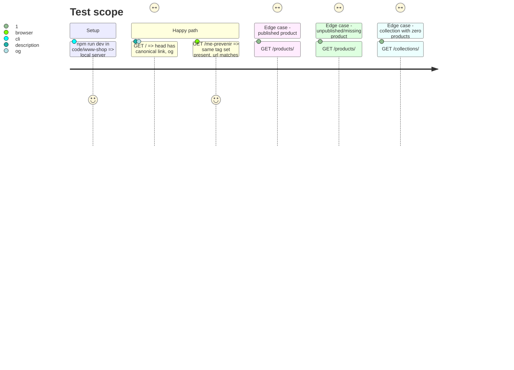

<!-- Fill or omit these sections; never add, rename, or reorder one. -->

# Instruction: Canonical/OG/Twitter/JSON-LD on the live public pages

## Architecture projection

> Tree of the final files. ✅ create · ✏️ modify · ❌ delete

```txt
code/www-shop/app/routes
├── _index.tsx                 ✏️ canonical + OG/Twitter via app/lib/seo.ts
├── me-prevenir.tsx            ✏️ canonical + OG/Twitter (current real pre-launch page)
├── qui-sommes-nous.tsx        ✏️ canonical + OG/Twitter
├── abonnements.tsx            ✏️ canonical + OG/Twitter
├── abonnements_.app-only.tsx   ✏️ canonical + OG/Twitter
├── abonnements_.box-app.tsx    ✏️ canonical + OG/Twitter
├── abonnements_.box-creative.tsx ✏️ canonical + OG/Twitter
├── products.$handle.tsx        ✏️ fix relative→absolute canonical, add OG/Twitter + Product JSON-LD from real Storefront data
├── collections._index.tsx      ✏️ canonical + OG/Twitter
├── collections.$handle.tsx     ✏️ canonical + OG/Twitter
└── collections.all.tsx         ✏️ canonical + OG/Twitter
```

## User Journey



## Test Scope



## Tasks to do

### `1)` Marketing / pre-launch pages

> These are the pages actually live and indexable today — highest priority.

1. For each of `_index.tsx`, `me-prevenir.tsx`, `qui-sommes-nous.tsx`, `abonnements.tsx`, `abonnements_.app-only.tsx`, `abonnements_.box-app.tsx`, `abonnements_.box-creative.tsx`: extend the existing `meta` export to also return `canonicalUrl(request, '<this route's own path>')` as a `{tagName: 'link', rel: 'canonical', href: ...}` entry, plus `buildOpenGraphTags({title, description, url, type: 'website'})` spread into the array — reuse each route's own existing title/description values, don't invent new copy.
2. `meta` functions receive `{data, params, location}` in React Router but not the raw `Request` directly in every version — check the actual `Route.MetaFunctionArgs` shape for this React Router version (`7.16.0`) to see whether `request`/an absolute URL is available there, or whether canonical construction needs to happen in each route's `loader` instead (computing it from `request.url` there and passing it through `data`). Use whichever approach the actual type signature supports — don't guess the shape.

### `2)` Product detail page

> The only page type with real structured product data available.

1. In `products.$handle.tsx`, replace the existing relative `{rel: 'canonical', href: '/products/${handle}'}` with an absolute one built via the Phase 1 helper.
2. Add `buildOpenGraphTags({..., type: 'product', image: product.featuredImage?.url})` using the already-queried `PRODUCT_QUERY` fields — no new Storefront query.
3. Add a `Product` JSON-LD block (name, image, description, `offers` with price/currency/availability) built only from fields the existing query already returns; if a field is missing (e.g. no image), omit that JSON-LD property rather than inventing a placeholder.

### `3)` Collections pages

1. `collections._index.tsx`, `collections.$handle.tsx`, `collections.all.tsx`: same canonical + OG/Twitter treatment as task 1, using each page's own already-fetched collection/title data. No Product-level JSON-LD here (that belongs on the PDP only) — an `ItemList` JSON-LD is optional and only worth adding if it's a small addition; skip it if it would require restructuring the existing query.

## Test acceptance criteria

| Task | Acceptance criteria                                                                                       |
| ---- | ----------------------------------------------------------------------------------------------------------- |
| 1    | Every listed marketing route's rendered `<head>` contains a canonical `<link>` whose `href` is absolute and matches that route's real path, plus `og:title`/`og:description`/`og:url`/`twitter:card`. |
| 2    | A real published product's page source contains valid `Product` JSON-LD with that product's actual name/price; the canonical link is absolute, not the old relative `/products/...` string. |
| 3    | Collection pages carry the same canonical/OG tag set; an empty collection renders without a server error. |
