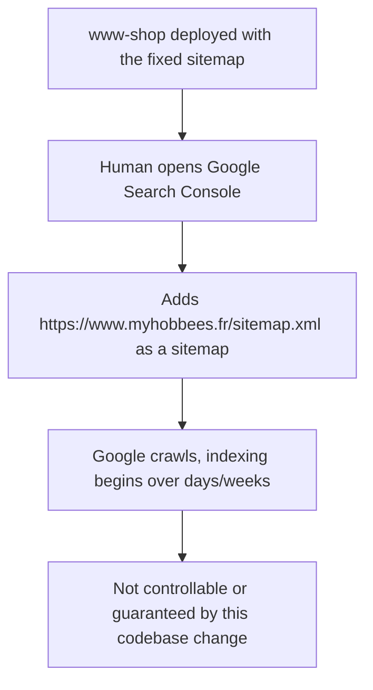
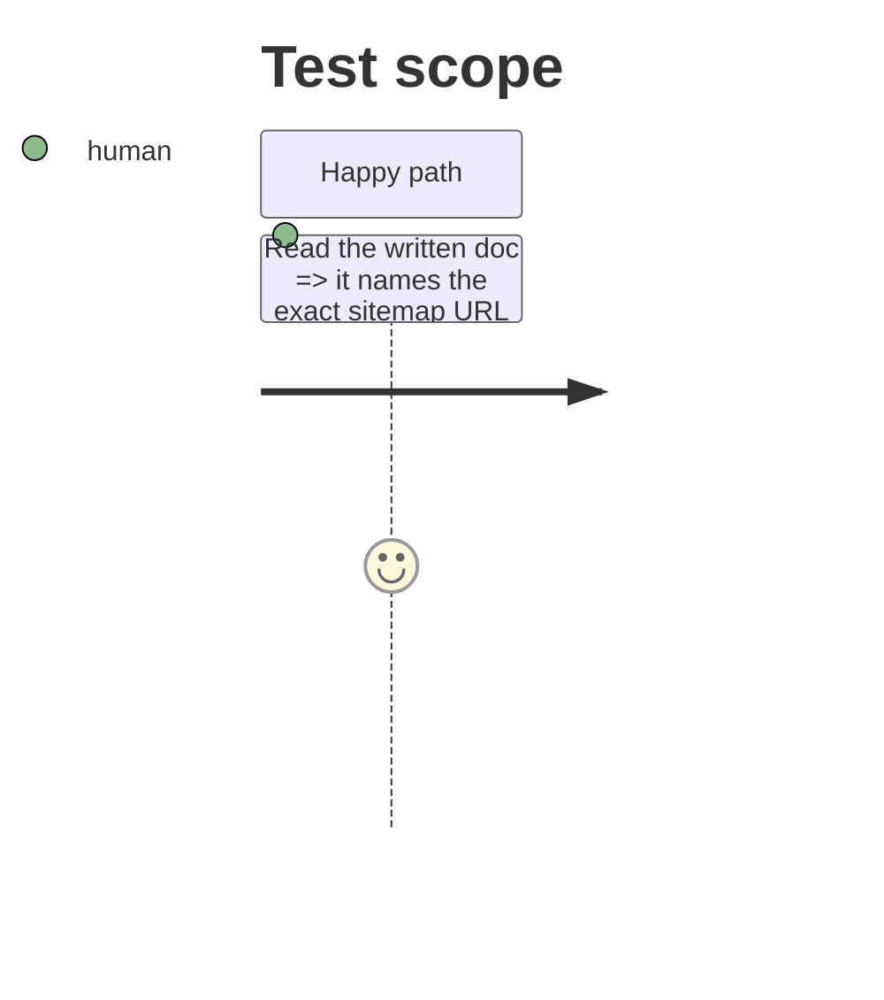

<!-- Fill or omit these sections; never add, rename, or reorder one. -->

# Instruction: Search Console submission doc + memory update

## Architecture projection

> Tree of the final files. ✅ create · ✏️ modify · ❌ delete

```txt
aidd_docs/memory
└── integration.md or a new seo.md         ✏️/✅ document the sitemap/robots.txt URLs and the manual Search Console steps
```

## User Journey



## Test Scope



## Tasks to do

### `1)` Document, don't execute

> No Search Console account access exists in this environment — this is instructions for a human, not an automation.

1. Add a short section (new `aidd_docs/memory/seo.md`, or appended to an existing relevant memory file if one already covers `www-shop`'s external-facing config) stating:
   - The sitemap entry point is `https://<prod-domain>/sitemap.xml` (index) once deployed.
   - Manual steps: open Google Search Console → Sitemaps → submit that exact URL; optionally also submit the bare domain for indexing via URL Inspection.
   - Indexing/ranking timelines are external to this codebase and not something any code change here controls or guarantees.
2. Note the sitemap's locale-prefix bug fix (phase 1) and the canonical/OG/JSON-LD additions (phase 2) in the same doc, one line each, so a future reader knows what technical SEO already exists without re-auditing the codebase.

## Test acceptance criteria

| Task | Acceptance criteria                                                                 |
| ---- | ------------------------------------------------------------------------------------ |
| 1    | The doc names an exact, copy-pasteable sitemap URL and exact Search Console menu steps; it does not claim indexing/ranking as guaranteed or already done. |
