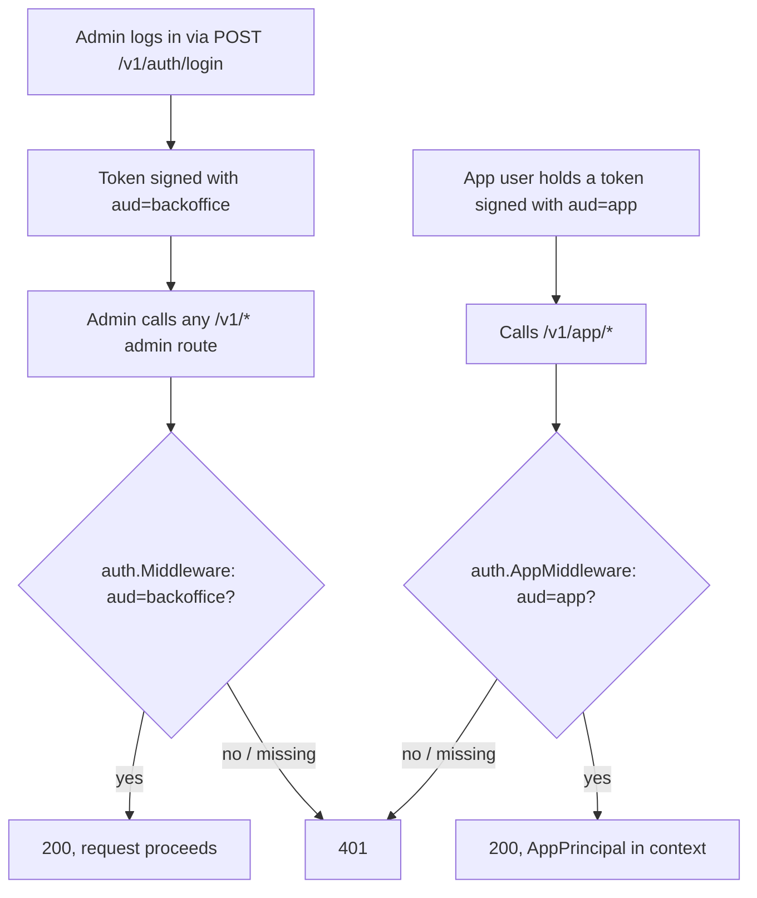
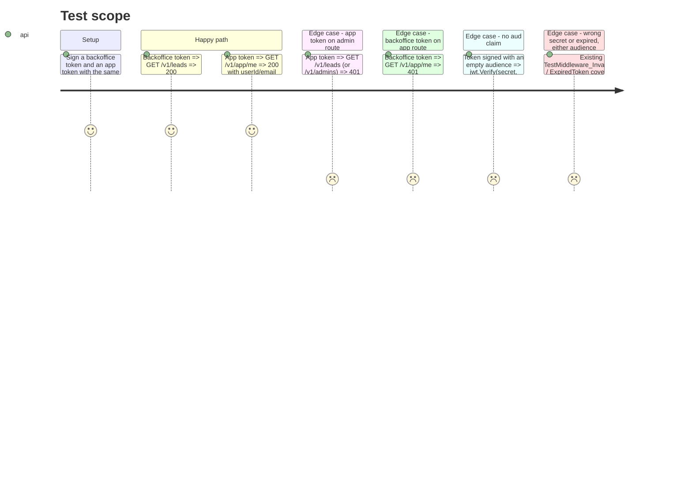

<!-- Fill or omit these sections; never add, rename, or reorder one. -->

# Instruction: JWT audience claim + AppMiddleware + /v1/app mount

## Architecture projection

> Tree of the final files. ✅ create · ✏️ modify · ❌ delete

```txt
code/api
└── internal
    ├── jwt
    │   ├── jwt.go                  ✏️ add AudienceBackoffice/AudienceApp consts; Sign/Verify take an audience param
    │   └── jwt_test.go             ✏️ update existing calls; add cross-audience + missing-aud cases
    ├── auth
    │   ├── auth.go                 ✏️ Middleware verifies AudienceBackoffice; add AppPrincipal, AppMiddleware, AppPrincipalFrom
    │   └── auth_test.go            ✏️ update existing calls; add cross-audience cases for both middlewares
    ├── routes
    │   ├── auth.go                 ✏️ login signs with AudienceBackoffice
    │   ├── auth_test.go            ✏️ update jwt.Sign call
    │   ├── analytics_test.go       ✏️ update jwt.Sign call
    │   ├── staging_test.go         ✏️ update jwt.Sign calls (x4)
    │   ├── admins_test.go          ✏️ update jwt.Sign call
    │   ├── app_user.go             ✅ routes.App(): GET /me returns the AppPrincipal (mirrors routes.Example())
    │   └── app_user_test.go        ✅ unit test for the handler alone
    └── app
        ├── app.go                 ✏️ mount /v1/app in its own r.Group wrapped by auth.AppMiddleware, sibling to the admin group
        └── app_test.go            ✏️ update existing jwt.Sign calls; add router-level cross-audience cases
```

## User Journey



## Test Scope

<!-- Required for every phase. Keep Setup, Happy path, any qualifying Edge cases, and any required Teardown in this one journey. -->



## Tasks to do

### `1)` JWT: explicit audience on Sign/Verify

> `jwt.Sign`/`jwt.Verify` state which audience a token is for and reject any other, using the parser's own validator.

1. In `code/api/internal/jwt/jwt.go`, add `const AudienceBackoffice = "backoffice"` and `const AudienceApp = "app"`.
2. Change `Sign(secret, subject, email string, isSuperAdmin bool, ttl time.Duration)` to `Sign(secret, subject, email string, isSuperAdmin bool, audience string, ttl time.Duration)`, setting `RegisteredClaims.Audience: jwtlib.ClaimStrings{audience}`.
3. Change `Verify(secret, token string)` to `Verify(secret, token, audience string)`, passing `jwtlib.WithAudience(audience)` to `jwtlib.ParseWithClaims`. Leave the HS256-method check as-is.
4. Update `jwt_test.go`'s three existing calls to pass an audience (use `AudienceBackoffice` throughout, since none of them test audience behavior directly).
5. Add `TestVerifyRejectsWrongAudience`: sign with `AudienceApp`, verify expecting `AudienceBackoffice` → error.
6. Add `TestVerifyRejectsMissingAudience`: sign with `audience=""` (empty `ClaimStrings`), verify expecting either constant → error.

### `2)` Auth: AppMiddleware alongside the admin Middleware

> Admin `Middleware` now demands `aud=backoffice`; a new `AppMiddleware` demands `aud=app` and exposes its own principal type.

1. In `code/api/internal/auth/auth.go`, change the `jwt.Verify(secret, token)` call inside `Middleware` to `jwt.Verify(secret, token, jwt.AudienceBackoffice)`.
2. Add `type AppPrincipal struct { UserID string; Email string }`, a second context key (e.g. `appPrincipalKey`), and `AppPrincipalFrom(ctx) (AppPrincipal, bool)`, mirroring `Principal`/`PrincipalFrom`.
3. Add `AppMiddleware(next http.Handler) http.Handler`: same `JWT_SECRET` validation and Bearer-prefix extraction as `Middleware` (factor the shared bearer-token extraction into a small unexported helper if it keeps both readable, otherwise duplicate the ~5 lines — either is fine here), then `jwt.Verify(secret, token, jwt.AudienceApp)`, then store `AppPrincipal{UserID: claims.Subject, Email: claims.Email}` in the context.
4. Update `auth_test.go`'s existing `jwt.Sign` calls to pass `jwt.AudienceBackoffice`.
5. Add `TestMiddleware_RejectsAppAudienceToken`: sign with `jwt.AudienceApp`, call `Middleware` → 401.
6. Add `TestAppMiddleware_ValidToken`: sign with `jwt.AudienceApp`, call `AppMiddleware` → 200, `AppPrincipalFrom` returns the expected `UserID`/`Email`.
7. Add `TestAppMiddleware_RejectsBackofficeAudienceToken`: sign with `jwt.AudienceBackoffice`, call `AppMiddleware` → 401.

### `3)` Routes: sign with the right audience, add the app placeholder

> The only production call to `jwt.Sign` (admin login) states its audience; `/v1/app/*` gets one route to assert against.

1. In `code/api/internal/routes/auth.go`, update the `jwt.Sign` call to pass `jwt.AudienceBackoffice`.
2. Update the `jwt.Sign` calls in `auth_test.go`, `analytics_test.go`, `staging_test.go` (×4), and `admins_test.go` to pass `jwt.AudienceBackoffice` — these are admin-flow tests, not audience tests, so no new assertions needed there.
3. Create `code/api/internal/routes/app_user.go` exporting `func App() chi.Router`, mirroring `routes.Example()`: `GET /me` reads `auth.AppPrincipalFrom(req.Context())` and responds `200 {"userId": ..., "email": ...}`, or `401 {"error": "No principal"}` if absent (defense in depth, matching `Example()`'s own pattern — it should never actually be absent once mounted behind `AppMiddleware`). Copy the doc-comment convention warning against re-applying auth middleware.

### `4)` Wire `/v1/app/*` as its own protected group

> `/v1/app/*` sits beside the existing admin group, not inside it — neither group's middleware should apply to the other's routes.

1. In `code/api/internal/app/app.go`, inside `r.Route("/v1", ...)`, add a second `r.Group` sibling to the existing admin one: `r.Group(func(r chi.Router) { r.Use(auth.AppMiddleware); r.Mount("/app", routes.App()) })`.
2. Update `app_test.go`'s three existing `jwt.Sign` calls to pass `jwt.AudienceBackoffice`.
3. Add `TestAppRouteAcceptsAppToken`: sign an app-audience token, `GET /v1/app/me` → 200.
4. Add `TestAppRouteRejectsBackofficeToken`: sign a backoffice-audience token, `GET /v1/app/me` → 401.
5. Add `TestAdminRouteRejectsAppToken`: sign an app-audience token, `GET /v1/leads` (or `/v1/admins`) → 401.

## Test acceptance criteria

<!-- Each criterion is an observable behavior, not a command. -->

| Task | Acceptance criteria                                                                                     |
| ---- | -------------------------------------------------------------------------------------------------------- |
| 1    | `go test ./internal/jwt/...` passes; a token signed for one audience fails `Verify` against the other, and a token with no `aud` fails `Verify` against either. |
| 2    | `go test ./internal/auth/...` passes; `Middleware` 401s an `aud=app` token, `AppMiddleware` 401s an `aud=backoffice` token and 200s + populates `AppPrincipal` for an `aud=app` token. |
| 3    | `go vet ./...` is clean; all admin-flow tests across `internal/routes` and `internal/app` still pass with the added audience argument. |
| 4    | `go test ./internal/app/...` passes; `GET /v1/app/me` is 401 for an admin token and 200 for an app token; `GET /v1/leads` (admin) is 401 for an app token. |
