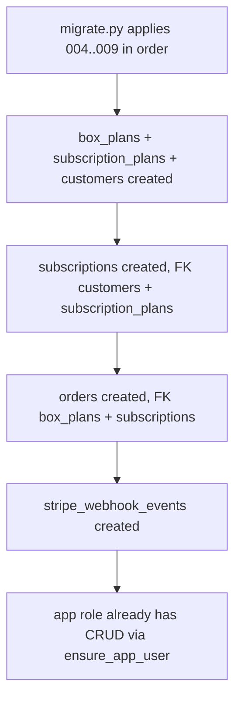
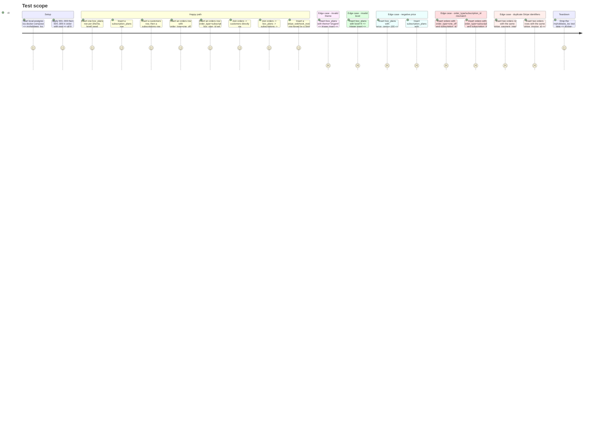

# Instruction: Create the 6 commerce migrations

## Architecture projection

> Tree of the final files. ✅ create · ✏️ modify · ❌ delete

```txt
.
└── code/database/migrations/
    ├── 004_create_box_plans.sql              ✅ create
    ├── 005_create_subscription_plans.sql     ✅ create
    ├── 006_create_customers.sql              ✅ create
    ├── 007_create_subscriptions.sql          ✅ create
    ├── 008_create_orders.sql                 ✅ create
    └── 009_create_stripe_webhook_events.sql  ✅ create
```

## User Journey



## Test Scope

<!-- No UI, no API: the channel is cli (local docker-compose Postgres + psql), per aidd_docs/memory/infra.md real stg/prd migrations never run from this machine. -->



## Tasks to do

### `1)` `004_create_box_plans.sql`

> Unit-purchase catalogue: fixed `(theme, level)` pairs, each with a one-time Stripe price.

1. `CREATE TABLE box_plans` with `id SERIAL PRIMARY KEY`, `theme TEXT NOT NULL CHECK (theme IN ('crochet','tricot','broderie','macrame'))`, `level SMALLINT NOT NULL CHECK (level BETWEEN 1 AND 3)`, `name TEXT NOT NULL`, `slug TEXT NOT NULL UNIQUE`, `description TEXT`, `price_cents INTEGER NOT NULL CHECK (price_cents >= 0)`, `stripe_product_id TEXT NOT NULL`, `stripe_price_id TEXT NOT NULL`, `active BOOLEAN NOT NULL DEFAULT TRUE`, `created_at TIMESTAMPTZ NOT NULL DEFAULT NOW()`, `updated_at TIMESTAMPTZ NOT NULL DEFAULT NOW()`.
2. Add `UNIQUE (theme, level)` — one catalogue row per pair.

### `2)` `005_create_subscription_plans.sql`

> The single recurring offer, modeled as a table (not a hardcoded value) in case a second tier/frequency is added.

1. `CREATE TABLE subscription_plans` with `id SERIAL PRIMARY KEY`, `name TEXT NOT NULL`, `frequency TEXT NOT NULL CHECK (frequency IN ('monthly'))`, `price_cents INTEGER NOT NULL CHECK (price_cents >= 0)`, `stripe_product_id TEXT NOT NULL`, `stripe_price_id TEXT NOT NULL`, `active BOOLEAN NOT NULL DEFAULT TRUE`, `created_at TIMESTAMPTZ NOT NULL DEFAULT NOW()`, `updated_at TIMESTAMPTZ NOT NULL DEFAULT NOW()`.

### `3)` `006_create_customers.sql`

> One row per paying customer.

1. `CREATE TABLE customers` with `id SERIAL PRIMARY KEY`, `email TEXT NOT NULL UNIQUE`, `stripe_customer_id TEXT NOT NULL UNIQUE`, `created_at TIMESTAMPTZ NOT NULL DEFAULT NOW()`.

### `4)` `007_create_subscriptions.sql`

> A subscriber's chosen mode (theme or découverte) and current progress — not FK'd to one fixed box, since which box ships varies monthly.

1. `CREATE TABLE subscriptions` with `id SERIAL PRIMARY KEY`, `customer_id INTEGER NOT NULL REFERENCES customers (id)`, `subscription_plan_id INTEGER NOT NULL REFERENCES subscription_plans (id)`, `stripe_subscription_id TEXT NOT NULL UNIQUE`, `status TEXT NOT NULL`, `theme TEXT CHECK (theme IS NULL OR theme IN ('crochet','tricot','broderie','macrame'))`, `current_level SMALLINT NOT NULL DEFAULT 1 CHECK (current_level BETWEEN 1 AND 3)`, `current_period_end TIMESTAMPTZ NOT NULL`, `created_at TIMESTAMPTZ NOT NULL DEFAULT NOW()`, `updated_at TIMESTAMPTZ NOT NULL DEFAULT NOW()`.
2. Add `CREATE INDEX subscriptions_customer_id_idx ON subscriptions (customer_id)`.

### `5)` `008_create_orders.sql`

> One row per shipment, from a one-off purchase or a subscription cycle.

1. `CREATE TABLE orders` with `id SERIAL PRIMARY KEY`, `box_plan_id INTEGER NOT NULL REFERENCES box_plans (id)`, `subscription_id INTEGER REFERENCES subscriptions (id)`, `customer_id INTEGER NOT NULL REFERENCES customers (id)`, `order_type TEXT NOT NULL CHECK (order_type IN ('one_off','subscription'))`, `stripe_payment_intent_id TEXT`, `stripe_invoice_id TEXT`, `easypost_shipment_id TEXT`, `tracking_code TEXT`, `tracking_url TEXT`, `label_url TEXT`, `shipped_at TIMESTAMPTZ`, `created_at TIMESTAMPTZ NOT NULL DEFAULT NOW()`.
2. Add `CHECK ((order_type = 'one_off' AND subscription_id IS NULL) OR (order_type = 'subscription' AND subscription_id IS NOT NULL))`.
3. Add `UNIQUE (stripe_payment_intent_id)` and `UNIQUE (stripe_invoice_id)` — both columns stay nullable, Postgres allows multiple `NULL`s under `UNIQUE`.
4. Add `CREATE INDEX orders_box_plan_id_idx ON orders (box_plan_id)`, `CREATE INDEX orders_subscription_id_idx ON orders (subscription_id)`, and `CREATE INDEX orders_customer_id_idx ON orders (customer_id)`.

> `customer_id` gives every order — one-off or subscription — a direct FK to its buyer. `subscription_id` is `NULL` for `order_type = 'one_off'`, so it cannot carry that link; without `customer_id` a one-off order's buyer is only resolvable by calling Stripe (ticket #23 AC3, needed by #29).

### `6)` `009_create_stripe_webhook_events.sql`

> Dedupe table for the webhook endpoint (ticket #29).

1. `CREATE TABLE stripe_webhook_events` with `id TEXT PRIMARY KEY`, `type TEXT NOT NULL`, `processed_at TIMESTAMPTZ NOT NULL DEFAULT NOW()`.

### `7)` Validate locally

> No `migrate.py` run against real stg/prd (no local `TF_*` credentials, and per `infra.md` those only run through the back-office trigger / CI pipeline).

1. `docker-compose up -d postgres`.
2. Apply `001`..`009` in order with `psql` against `myhobbees_loc`.
3. Run the inserts and joins from the Test Scope's happy path and edge cases above.
4. `docker-compose down -v`.

## Test acceptance criteria

| Task | Acceptance criteria              |
| ---- | -------------------------------- |
| 1 | `box_plans` rejects an unknown `theme`, a `level` outside 1-3, a negative `price_cents`, or a duplicate `(theme, level)` pair; accepts one row per valid pair |
| 2 | `subscription_plans` accepts a `monthly` row; rejects any other `frequency` or a negative `price_cents` |
| 3 | `customers` rejects a duplicate `email` or `stripe_customer_id` |
| 4 | `subscriptions` accepts `theme IS NULL` (découverte) or a valid theme; rejects `current_level` outside 1-3; FK to `customers`/`subscription_plans` enforced |
| 5 | `orders` rejects `order_type='one_off'` with a non-null `subscription_id`, and `order_type='subscription'` with a null `subscription_id`; rejects a duplicate `stripe_payment_intent_id` or `stripe_invoice_id`; FK to `box_plans` (required), `customer_id` (required) and `subscriptions` (optional) enforced |
| 6 | `stripe_webhook_events` rejects a second insert with the same `id` (dedupe) |
| 7 | All 9 migration files apply cleanly in order against a fresh local Postgres; every insert/rejection above is observed |

## Validation evidence

> Re-run after the review on `b9affa55` found AC3 unmet (`orders.customer_id` missing) plus the warning/minor findings below. Replayed against a fresh, fully isolated throwaway container — not the shared `docker-compose.yml` `postgres` service — so it doesn't collide with any other local container (e.g. `myhobbees-postgres-local`, which was found running on an unrelated port during this session).

Setup:

```
$ docker run --rm -d --name myhobbees-pg-validate -e POSTGRES_DB=myhobbees_loc -e POSTGRES_USER=myhobbees -e POSTGRES_PASSWORD=myhobbees -p 5490:5432 postgres:18
$ docker exec myhobbees-pg-validate pg_isready -U myhobbees -d myhobbees_loc
/var/run/postgresql:5432 - accepting connections
```

Applied `001`..`009` in order via `psql -f` — every file returned `CREATE TABLE`/`CREATE INDEX` with no error (full transcript below is representative, all 9 files applied cleanly):

```
=== Applying 001_create_leads.sql ===
CREATE TABLE
CREATE INDEX
...
=== Applying 008_create_orders.sql ===
CREATE TABLE
CREATE INDEX
CREATE INDEX
CREATE INDEX
=== Applying 009_create_stripe_webhook_events.sql ===
CREATE TABLE
```

Replayed `migrate.py`'s `ensure_app_user()` grant block for a local `myhobbees_app` role (`CREATE ROLE` + the `GRANT`/`ALTER DEFAULT PRIVILEGES` statements from `infrastructure/scripts/migrate.py:47-54`), then ran every check as that role.

Happy path (new `customer_id` join included):

```
-- join orders -> customers directly --
 id |  order_type  |       email
----+--------------+-------------------
  1 | one_off      | alice@example.com
  2 | subscription | alice@example.com

-- join orders -> box_plans -> subscriptions -> customers --
 id |  theme  | status |       email
----+---------+--------+-------------------
  1 | crochet |        | alice@example.com
  2 | crochet | active | alice@example.com
```

Rejection checks — every one fired on the expected constraint:

```
box_plans invalid theme          -> ERROR: violates check constraint "box_plans_theme_check"
box_plans invalid level          -> ERROR: violates check constraint "box_plans_level_check"
box_plans duplicate (theme,level)-> ERROR: duplicate key value violates unique constraint "box_plans_theme_level_key"
box_plans negative price_cents   -> ERROR: violates check constraint "box_plans_price_cents_check"
subscription_plans negative price_cents -> ERROR: violates check constraint "subscription_plans_price_cents_check"
subscription_plans invalid frequency    -> ERROR: violates check constraint "subscription_plans_frequency_check"
customers duplicate email        -> ERROR: duplicate key value violates unique constraint "customers_email_key"
customers duplicate stripe_customer_id -> ERROR: duplicate key value violates unique constraint "customers_stripe_customer_id_key"
subscriptions current_level=9    -> ERROR: violates check constraint "subscriptions_current_level_check"
orders one_off with subscription_id set      -> ERROR: violates check constraint "orders_check"
orders subscription with subscription_id NULL -> ERROR: violates check constraint "orders_check"
orders duplicate stripe_payment_intent_id -> ERROR: duplicate key value violates unique constraint "orders_stripe_payment_intent_id_key"
orders duplicate stripe_invoice_id        -> ERROR: duplicate key value violates unique constraint "orders_stripe_invoice_id_key"
orders customer_id NULL          -> ERROR: null value in column "customer_id" of relation "orders" violates not-null constraint
stripe_webhook_events duplicate id -> ERROR: duplicate key value violates unique constraint "stripe_webhook_events_pkey"
```

Teardown:

```
$ docker stop myhobbees-pg-validate   # --rm container + anonymous volume removed on stop
```
