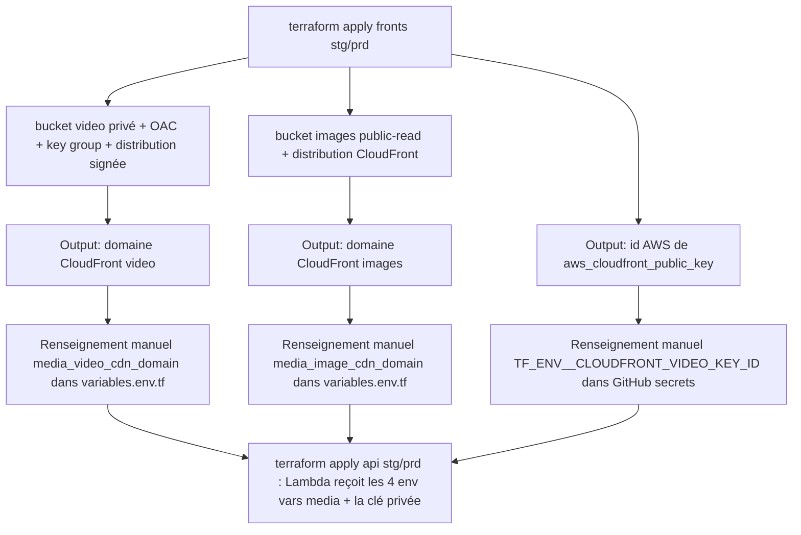
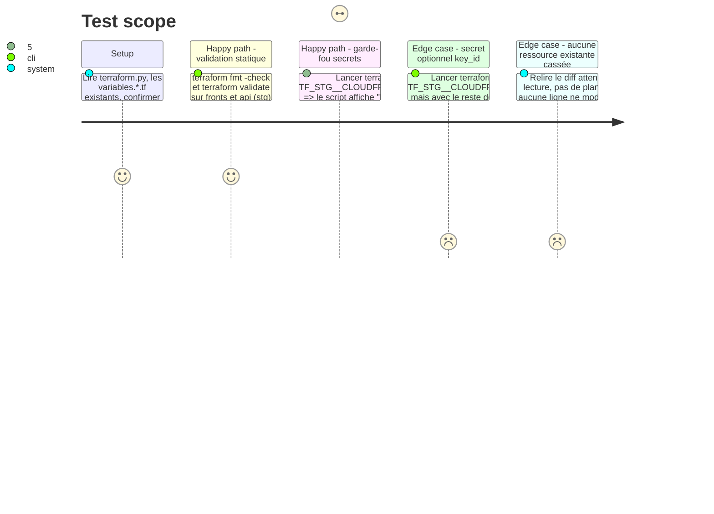

# Instruction: Infra Terraform (buckets, CloudFront, IAM, secrets)

## Architecture projection

> Tree of the final files. ✅ create · ✏️ modify · ❌ delete

```txt
infrastructure
├── scripts
│   └── terraform.py                    ✏️ SERVICE_SECRETS['fronts'] = ['cloudfront_video_public_key'] ; SERVICE_SECRETS['api'] += ['cloudfront_video_private_key', 'cloudfront_video_key_id'] ; OPTIONAL_SECRETS[('api','stg')] += ['cloudfront_video_key_id'] ; OPTIONAL_SECRETS[('api','prd')] += ['cloudfront_video_key_id']
└── terraform
    ├── fronts
    │   ├── s3_media_video.tf            ✅ bucket privé+chiffré, OAC, key group, distribution CloudFront avec trusted_key_groups
    │   ├── s3_media_images.tf           ✅ bucket public-read (via CloudFront uniquement), distribution CloudFront
    │   └── variables.tf                 ✏️ ajoute cloudfront_video_public_key (sensitive=false, pas de défaut) — fronts n'avait aucune variable propre avant la phase back-office-custom-domain, ce fichier existe déjà
    └── api
        ├── lambda.tf                    ✏️ ajoute MEDIA_VIDEO_BUCKET/MEDIA_IMAGE_BUCKET (interpolés) et MEDIA_VIDEO_CDN_DOMAIN/MEDIA_IMAGE_CDN_DOMAIN/CLOUDFRONT_VIDEO_KEY_ID/CLOUDFRONT_VIDEO_PRIVATE_KEY (variables) à environment.variables
        └── iam_media.tf                 ✅ policy inline sur aws_iam_role.LambdaApi : s3:PutObject/s3:GetObject sur les deux buckets (ARN construits par nom, pas de remote state)

environments
├── stg
│   └── variables.stg.tf                 ✏️ + cloudfront_video_public_key, cloudfront_video_private_key (sensitive, default="") ; + cloudfront_video_key_id, media_video_cdn_domain, media_image_cdn_domain (default="")
└── prd
    └── variables.prd.tf                 ✏️ idem stg
```

## User Journey



## Test Scope



## Tasks to do

### `1)` Bucket vidéo privé + CloudFront signé

> `infrastructure/terraform/fronts/s3_media_video.tf`, nouveau fichier.

1. `aws_s3_bucket.MediaVideo` : `bucket = "${var.app}-${var.env}-video"`.
2. `aws_s3_bucket_server_side_encryption_configuration.MediaVideo` : SSE-S3 (`AES256`).
3. `aws_s3_bucket_public_access_block.MediaVideo` : les 4 flags à `true` (bucket strictement privé, contrairement à `Assets`/`BackOffice`).
4. `aws_cloudfront_origin_access_control.MediaVideo` : `origin_access_control_origin_type = "s3"`, `signing_behavior = "always"`, `signing_protocol = "sigv4"`.
5. `aws_s3_bucket_policy.MediaVideoCloudFrontOnly` : autorise `s3:GetObject` uniquement pour le principal service `cloudfront.amazonaws.com` avec une condition `AWS:SourceArn` = l'ARN de la distribution créée au point 8 (pas de wildcard, pas d'accès public direct).
6. `aws_cloudfront_public_key.MediaVideo` : `encoded_key = var.cloudfront_video_public_key`.
7. `aws_cloudfront_key_group.MediaVideo` : contient l'id du point 6.
8. `aws_cloudfront_distribution.MediaVideo` : origin S3 via OAC (pas de `custom_origin_config`/website endpoint, contrairement à `Assets` — accès privé direct au bucket), `default_cache_behavior.trusted_key_groups = [aws_cloudfront_key_group.MediaVideo.id]`, `viewer_protocol_policy = "https-only"`, `viewer_certificate.cloudfront_default_certificate = true`.
9. `output "media_video_cdn_domain"` et `output "media_video_cloudfront_public_key_id"` (= `aws_cloudfront_public_key.MediaVideo.id`, à recopier à la main dans le secret `TF_{ENV}__CLOUDFRONT_VIDEO_KEY_ID`).
10. Pas de `aws_s3_bucket_cors_configuration` ici : les PUT pré-signés passent par le même mécanisme CORS que le bucket images (tâche 3), les deux buckets ont la même liste d'origines autorisées.

### `2)` Bucket images public (CloudFront uniquement)

> `infrastructure/terraform/fronts/s3_media_images.tf`, nouveau fichier.

1. `aws_s3_bucket.MediaImages` : `bucket = "${var.app}-${var.env}-images"`.
2. `aws_s3_bucket_public_access_block.MediaImages` : les 4 flags à `true` — la lecture publique passe uniquement par CloudFront (OAC), jamais par une ACL/policy S3 publique, contrairement à `Assets`/`BackOffice` qui servent un site statique directement depuis le bucket.
3. `aws_cloudfront_origin_access_control.MediaImages` : même config que la vidéo.
4. `aws_s3_bucket_policy.MediaImagesCloudFrontOnly` : même principe que `MediaVideoCloudFrontOnly` (accès `cloudfront.amazonaws.com` uniquement, scoping par `AWS:SourceArn`).
5. `aws_cloudfront_distribution.MediaImages` : origin S3 via OAC, **pas** de `trusted_key_groups` (lecture publique, pas de signature), `viewer_protocol_policy = "redirect-to-https"`, cache par défaut raisonnable (`default_ttl`/`max_ttl` non nuls, contrairement à `Assets` qui désactive le cache — ici on veut explicitement "cached delivery" par le ticket).
6. `output "media_image_cdn_domain"`.

### `3)` CORS pré-signé sur les deux buckets

> Dans chacun des deux fichiers de la tâche 1/2.

1. `aws_s3_bucket_cors_configuration` sur `MediaVideo` et `MediaImages` : `allowed_methods = ["PUT"]`, `allowed_origins = [var.back_office_endpoint, var.app_endpoint]` (ce sont les deux seuls frontends qui uploadent des médias — back-office admin et l'app mobile/web ; `www-shop` n'est pas concerné par ce ticket), `allowed_headers = ["*"]`, `expose_headers = ["ETag"]`, `max_age_seconds = 3000` (même valeur que `Assets`).

### `4)` IAM Lambda

> `infrastructure/terraform/api/iam_media.tf`, nouveau fichier.

1. `aws_iam_role_policy.LambdaMedia` sur `aws_iam_role.LambdaApi.id` : `s3:PutObject` et `s3:GetObject` sur `arn:aws:s3:::${var.app}-${var.env}-video/*` et `arn:aws:s3:::${var.app}-${var.env}-images/*` (ARN construits par nom, même convention que `iam_staging_control.tf` — pas de remote state vers le module `fronts`).

### `5)` Env vars Lambda

> `infrastructure/terraform/api/lambda.tf`, dans `environment.variables`.

1. Ajouter :
   ```hcl
   MEDIA_VIDEO_BUCKET      = "${var.app}-${var.env}-video"
   MEDIA_IMAGE_BUCKET      = "${var.app}-${var.env}-images"
   MEDIA_VIDEO_CDN_DOMAIN  = var.media_video_cdn_domain
   MEDIA_IMAGE_CDN_DOMAIN  = var.media_image_cdn_domain
   CLOUDFRONT_VIDEO_KEY_ID      = var.cloudfront_video_key_id
   CLOUDFRONT_VIDEO_PRIVATE_KEY = var.cloudfront_video_private_key
   ```

### `6)` Variables et secrets

1. `environments/stg/variables.stg.tf` et `environments/prd/variables.prd.tf` : ajouter `media_video_cdn_domain`, `media_image_cdn_domain`, `cloudfront_video_key_id` (défaut `""`, non sensible) et `cloudfront_video_private_key`, `cloudfront_video_public_key` (`sensitive = true`, défaut `""`).
2. `infrastructure/scripts/terraform.py` :
   - `SERVICE_SECRETS['fronts'] = ['cloudfront_video_public_key']` (clé absente aujourd'hui du dict pour ce service).
   - `SERVICE_SECRETS['api']` : ajouter `'cloudfront_video_private_key'`, `'cloudfront_video_key_id'`.
   - `OPTIONAL_SECRETS[('api', 'stg')]` et `OPTIONAL_SECRETS[('api', 'prd')]` : ajouter `'cloudfront_video_key_id'` (voir Decisions du plan — ne peut pas être connu avant le premier apply de `fronts`).
   - Ne PAS ajouter `cloudfront_video_public_key` ni `cloudfront_video_private_key` aux `OPTIONAL_SECRETS` : ils doivent bloquer `terraform.py fronts`/`terraform.py api` si absents (c'est le critère d'acceptation testé).

## Test acceptance criteria

| Task | Acceptance criteria |
| ---- | -------------------- |
| 1, 2 | `terraform validate` passe sur `fronts` avec les nouvelles variables fournies ; aucune ACL/policy publique n'existe sur `MediaVideo` (bucket strictement privé) |
| 3 | La configuration CORS des deux buckets n'autorise que `PUT` depuis `var.back_office_endpoint` et `var.app_endpoint`, pas `"*"` |
| 4 | La policy IAM ajoutée ne cible que les deux ARN de buckets media, jamais `s3:*` ni une ressource `*` |
| 5, 6 | `terraform validate` passe sur `api` ; `python3 infrastructure/scripts/terraform.py api stg` sans `TF_STG__CLOUDFRONT_VIDEO_PRIVATE_KEY` affiche `Missing environment variable: TF_STG__CLOUDFRONT_VIDEO_PRIVATE_KEY` et sort en erreur avant tout `terraform apply` ; le même appel sans `TF_STG__CLOUDFRONT_VIDEO_KEY_ID` seul ne bloque pas |
