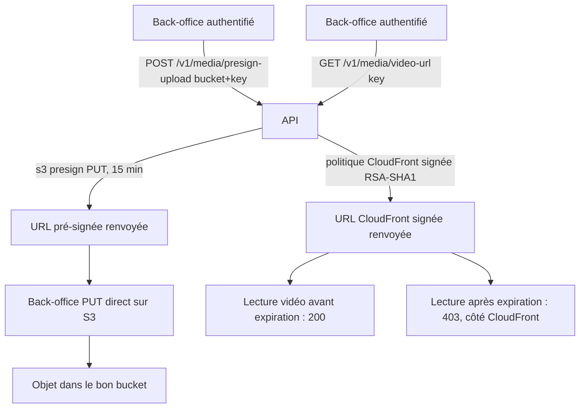
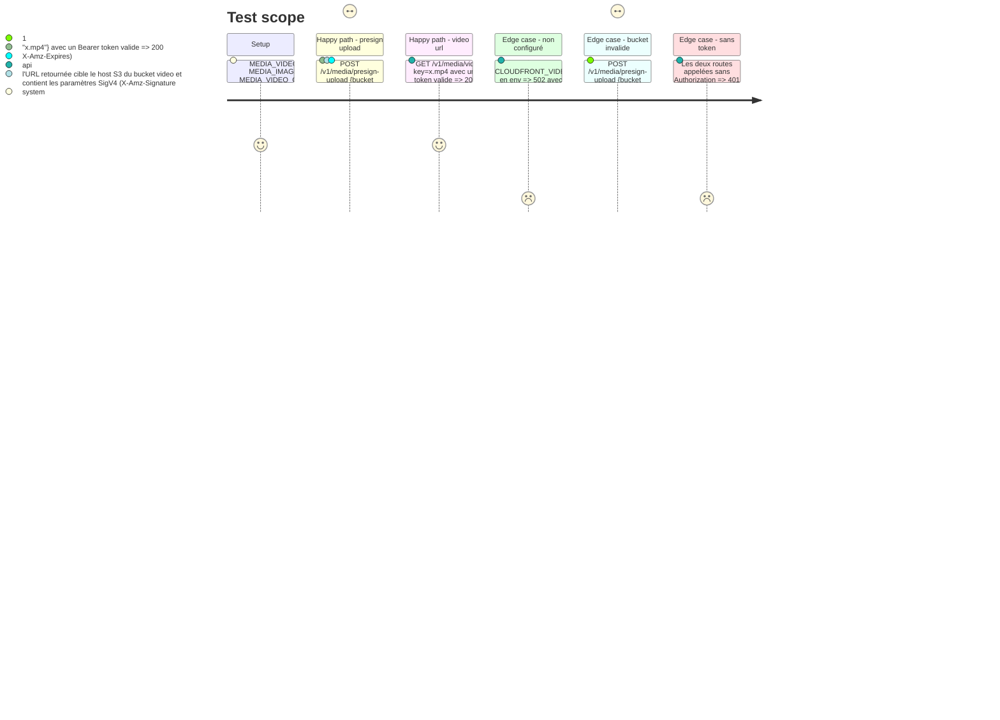

# Instruction: API Go (presign upload, URL vidéo signée)

## Architecture projection

> Tree of the final files. ✅ create · ✏️ modify · ❌ delete

```txt
code/api
├── go.mod                              ✏️ ajoute github.com/aws/aws-sdk-go-v2/service/s3 (presign PUT)
├── internal
│   ├── media
│   │   ├── client.go                   ✅ FromEnv(), ErrNotConfigured, PresignUpload(), SignVideoURL()
│   │   └── client_test.go              ✅ tests unitaires (pas d'appel AWS réel)
│   ├── routes
│   │   ├── media.go                    ✅ Media() chi.Router : POST /presign-upload, GET /video-url
│   │   └── media_test.go               ✅ tests httptest sur les deux routes
│   └── app
│       └── app.go                      ✏️ r.Mount("/media", routes.Media()) dans le groupe protégé (auth.Middleware)
```

## User Journey



## Test Scope



## Tasks to do

### `1)` Client média

> `code/api/internal/media/client.go`, nouveau package, même forme que `internal/shopify/client.go` et `internal/awsrds/client.go`.

1. `ErrNotConfigured = errors.New("media not configured")`.
2. `type Client struct` : `s3 *s3.Client`, `videoBucket`, `imageBucket`, `videoCDNDomain`, `keyPairID string`, `privateKey *rsa.PrivateKey`.
3. `FromEnv(ctx) (*Client, error)` : lit `MEDIA_VIDEO_BUCKET`, `MEDIA_IMAGE_BUCKET`, `MEDIA_VIDEO_CDN_DOMAIN`, `CLOUDFRONT_VIDEO_KEY_ID`, `CLOUDFRONT_VIDEO_PRIVATE_KEY` (PEM) ; si l'une des valeurs nécessaires à l'opération demandée est vide → `ErrNotConfigured` (tolérer que `PresignUpload` fonctionne même si les variables CloudFront sont vides, et vice versa, plutôt que tout exiger d'un coup — même esprit que `shopify.FromEnv` qui exige ses 3 valeurs ensemble parce qu'elles servent une seule capacité ; ici ce sont deux capacités indépendantes). Parser la clé privée PEM avec `encoding/pem` + `x509.ParsePKCS1PrivateKey` (ou `ParsePKCS8PrivateKey` en repli), erreur explicite si invalide.
4. `(c *Client) PresignUpload(ctx, bucketKind string, objectKey string) (string, time.Time, error)` : `bucketKind` vaut `"video"` ou `"image"` (sinon erreur) ; `s3.NewPresignClient(c.s3).PresignPutObject` avec `s3.WithPresignExpires(15*time.Minute)`.
5. `(c *Client) SignVideoURL(objectKey string, ttl time.Duration) (string, time.Time, error)` :
   - Construire l'URL non signée `https://{videoCDNDomain}/{objectKey}`.
   - Construire la politique canned CloudFront (`{"Statement":[{"Resource":"<url>","Condition":{"DateLessThan":{"AWS:EpochTime":<expiry>}}}]}`), sans espaces (format exact attendu par CloudFront).
   - Signer avec `rsa.SignPKCS1v15(nil, c.privateKey, crypto.SHA1, sha1Sum(policy))`.
   - Encoder signature et policy en base64 puis remplacer `+`→`-`, `=`→`_`, `/`→`~` (encodage CloudFront, différent du base64url standard).
   - Retourner `<url>?Expires=<epoch>&Signature=<sig>&Key-Pair-Id=<keyPairID>`.

### `2)` Routes média

> `code/api/internal/routes/media.go`, nouveau fichier, même forme que `internal/routes/shopify.go`.

1. `func Media() chi.Router` :
   - `POST /presign-upload` : body JSON `{bucket, key}` ; valide `bucket` ∈ {`video`,`image`} et `key` non vide ; appelle `media.FromEnv` + `PresignUpload` ; `media.ErrNotConfigured` → 502 `{"error":"not configured"}` (même pattern que `routes/shopify.go`) ; succès → `{"url":..., "expiresAt":...}`.
   - `GET /video-url` : query `key` non vide ; appelle `media.FromEnv` + `SignVideoURL` (TTL fixe 15 minutes) ; mêmes codes d'erreur.

### `3)` Montage

> `code/api/internal/app/app.go`.

1. Dans le groupe protégé (`r.Group` avec `auth.Middleware`, à côté de `routes.Shopify()`/`routes.Example()`) : `r.Mount("/media", routes.Media())`.

### `4)` Dépendance

1. `cd code/api && go get github.com/aws/aws-sdk-go-v2/service/s3 && go mod tidy`.

### `5)` Tests

1. `internal/media/client_test.go` : générer une paire RSA de test (`rsa.GenerateKey`), vérifier que `SignVideoURL` produit une URL avec `Expires`/`Signature`/`Key-Pair-Id`, que la signature vérifie (`rsa.VerifyPKCS1v15` avec la clé publique correspondante) sur la policy exacte construite, et qu'un TTL écoulé change l'`Expires` en conséquence. Vérifier `FromEnv` retourne `ErrNotConfigured` quand une variable nécessaire manque.
2. `internal/routes/media_test.go` : `httptest` sur les deux routes montées isolément (comme `shopify_test.go` si présent, sinon même schéma que `staging_test.go`), couvrant 200, 400 (bucket invalide), 502 (non configuré).

## Test acceptance criteria

| Task | Acceptance criteria |
| ---- | -------------------- |
| 1 | `go test ./internal/media/...` passe ; la signature produite vérifie avec la clé publique correspondante ; `FromEnv` renvoie `ErrNotConfigured` si une variable requise manque |
| 2, 3 | `go test ./internal/routes/...` passe ; `POST /v1/media/presign-upload` et `GET /v1/media/video-url` répondent 401 sans Bearer token (via le groupe protégé), 400/502 selon le cas, 200 sinon |
| 4 | `go build ./...` et `go vet ./...` passent sans erreur après l'ajout de la dépendance |
| 5 | Les deux fichiers de test couvrent au minimum les cas listés dans Test Scope (happy path + 3 edge cases) |
