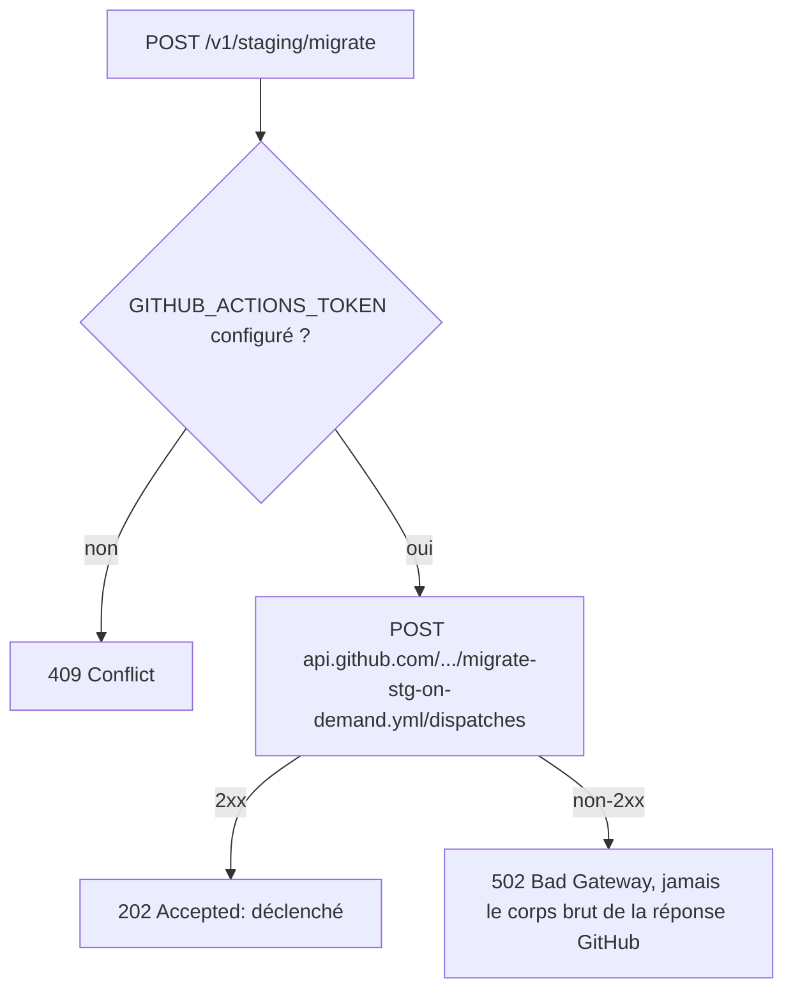
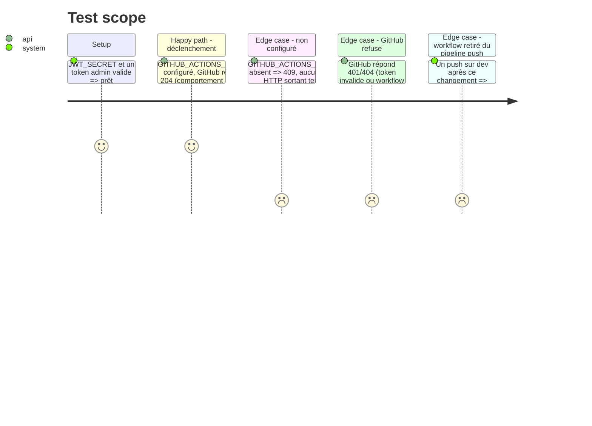

# Instruction: API + infra : déclenchement GitHub Actions, workflow dédié

## Architecture projection

> Tree of the final files. ✅ create · ✏️ modify · ❌ delete

```txt
.github/workflows
├── ci-cd.yml                                ✏️ retire le job migrate-database-stg (push-déclenché) en entier
└── migrate-stg-on-demand.yml                ✅ workflow_dispatch uniquement, le même job Migrate déplacé ici, secrets TF_STG__* seulement

code/api/internal/githubactions
├── githubactions.go                          ✅ TriggerWorkflow(ctx, token, owner, repo, workflowFile, ref) — un seul appel HTTP, pas de SDK
└── githubactions_test.go                     ✅ succès, token/réponse HTTP non-2xx, pas de token configuré

code/api/internal/routes
├── staging.go                                ✏️ ajoute POST /migrate : lit GITHUB_ACTIONS_TOKEN, appelle githubactions.TriggerWorkflow, répond 202/409/502
└── staging_test.go                           ✏️ ajoute les cas de /migrate (non configuré, succès simulé via un petit serveur de test)

infrastructure/terraform/api
├── lambda.tf                                 ✏️ GITHUB_ACTIONS_TOKEN dans l'environment, seulement si var.env == "prd" (même garde que STAGING_DB_IDENTIFIER)
└── variables.tf (ou fichiers par env)        ✏️ nouvelle variable github_actions_token (sensible, default vide)

environments/stg
└── variables.stg.tf                          ✏️ ajoute `variable "github_actions_token" { sensitive = true; default = "" }`

environments/prd
└── variables.prd.tf                          ✏️ idem

infrastructure/scripts
└── terraform.py                              ✏️ ajoute 'github_actions_token' à SERVICE_SECRETS['api'], optionnel pour stg ET prd (reste désactivé tant que le secret GitHub n'existe pas)
```

## User Journey



## Test Scope



## Tasks to do

### `1)` Package githubactions

> `code/api/internal/githubactions/githubactions.go`, calque du client `posthog` pour la forme (struct minimal, pas de SDK GitHub).

1. `func TriggerWorkflow(ctx context.Context, httpClient *http.Client, token, owner, repo, workflowFile, ref string) error` : `POST https://api.github.com/repos/{owner}/{repo}/actions/workflows/{workflowFile}/dispatches`, body `{"ref": ref}`, headers `Authorization: Bearer <token>`, `Accept: application/vnd.github+json`, `X-GitHub-Api-Version: 2022-11-28`.
2. Un seul client HTTP passé en paramètre (pas de champ global), pour rester testable contre un `httptest.Server` sans dépendre de `os.Getenv` à l'intérieur de la fonction elle-même — la lecture de `GITHUB_ACTIONS_TOKEN` reste dans `routes/staging.go`, pas dans ce package.
3. Réponse GitHub attendue en cas de succès : `204 No Content` (comportement réel de l'API `workflow_dispatch`, pas un `200`/`202`) — vérifier ce point précisément plutôt que de supposer, et accepter toute réponse `2xx` par robustesse plutôt que de coder en dur `204` uniquement.
4. `ErrDispatchFailed` : erreur générique exportée, ne jamais remonter le corps de la réponse GitHub telle quelle à l'appelant HTTP final (seulement dans un `log.Printf` serveur).
5. Tests : succès (`httptest.Server` renvoyant 204) ; échec HTTP (401/404) -> erreur ; jamais de panique si le corps de réponse est vide.

### `2)` Endpoint POST /v1/staging/migrate

> `code/api/internal/routes/staging.go`.

1. Constantes pour le repo cible (`owner = "MyHobbees"`, `repo = "app-myhobbees"`, `workflowFile = "migrate-stg-on-demand.yml"`, `ref = "dev"`) — valeurs fixes, pas de variable d'env pour ça (un seul repo, jamais configurable autrement).
2. `r.Post("/migrate", ...)` : lit `os.Getenv("GITHUB_ACTIONS_TOKEN")`, vide -> `409 "Déclenchement des migrations non configuré"`. Sinon `githubactions.TriggerWorkflow(...)` ; erreur -> `log.Printf` (jamais le token, jamais le corps de la réponse GitHub) + `502 "Impossible de déclencher les migrations"`. Succès -> `202 {"status": "triggered"}`.
3. Tests couvrant les 3 cas (non configuré, succès, échec GitHub) via le pattern déjà établi dans `staging_test.go` (serveur de test monté sur `Staging()` directement, pas `app.New()`).

### `3)` Nouveau workflow dédié

> `.github/workflows/migrate-stg-on-demand.yml`, nouveau fichier.

1. `on: workflow_dispatch:` uniquement — aucun autre déclencheur.
2. Un seul job, copie exacte du contenu actuel de `migrate-database-stg` dans `ci-cd.yml` (mêmes steps, mêmes 3 secrets `TF_STG__DB_USERNAME`/`DB_PASSWORD`/`DB_APP_PASSWORD`) — AUCUN autre secret dans ce fichier, en particulier aucun secret `TF_PRD__*`.
3. Retirer le job `migrate-database-stg` de `ci-cd.yml` en entier (le bloc actuellement après `deploy-api-stg`, avant la section PRD) — vérifier qu'aucun autre job ne le liste dans ses `needs` (déjà confirmé : seul `terraform-database-stg` est un prérequis EN AMONT de lui, rien n'en dépend EN AVAL).

### `4)` Terraform et secret

1. `environments/stg/variables.stg.tf` et `environments/prd/variables.prd.tf` : ajouter `variable "github_actions_token" { type = string; sensitive = true; default = "" }`.
2. `infrastructure/terraform/api/lambda.tf` : dans le bloc `environment.variables`, ajouter `GITHUB_ACTIONS_TOKEN = var.env == "prd" ? var.github_actions_token : ""` (même garde conditionnelle que `STAGING_DB_IDENTIFIER` juste au-dessus).
3. `infrastructure/scripts/terraform.py` : ajouter `'github_actions_token'` à `SERVICE_SECRETS['api']`, et l'ajouter à `OPTIONAL_SECRETS[('api', 'stg')]` ET `OPTIONAL_SECRETS[('api', 'prd')]` (reste désactivé, comme les secrets Shopify/PostHog, tant que `TF_PRD__GITHUB_ACTIONS_TOKEN` n'existe pas comme secret GitHub — sa création est une action humaine hors de ce PR, documentée dans le rapport final, pas un blocage).
4. `terraform validate` (stg et prd, en simulant la copie de `terraform.py`) doit passer.

## Test acceptance criteria

| Task | Acceptance criteria |
| ---- | -------------------- |
| 1... | `go test ./internal/githubactions/...` couvre succès, échec HTTP, et confirme le comportement 2xx réel (pas supposé) de l'API GitHub dispatch |
| 2... | `go test ./internal/routes/... -run StagingMigrate` couvre les 3 scénarios ; aucun token ni corps de réponse GitHub ne fuit dans une réponse HTTP ou un message d'erreur client |
| 3... | Le nouveau fichier workflow est syntaxiquement valide (`yamllint`/lecture manuelle) et ne référence que des secrets `TF_STG__*` ; `ci-cd.yml` ne contient plus `migrate-database-stg` |
| 4... | `terraform validate` passe pour `api` (stg et prd) avec la nouvelle variable |
| — | `go vet ./...` et `go test ./...` passent sur tout `code/api` |
