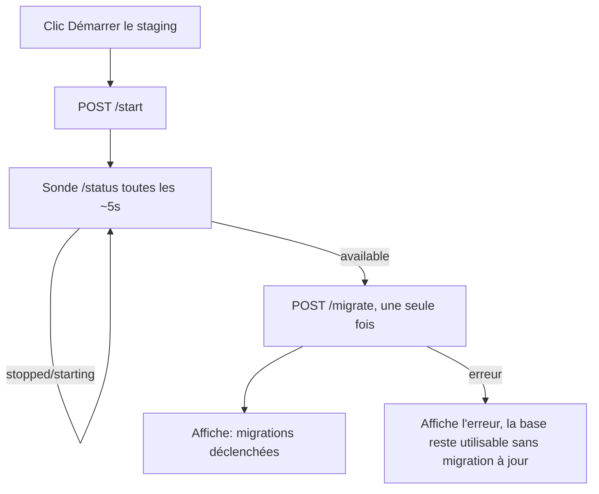
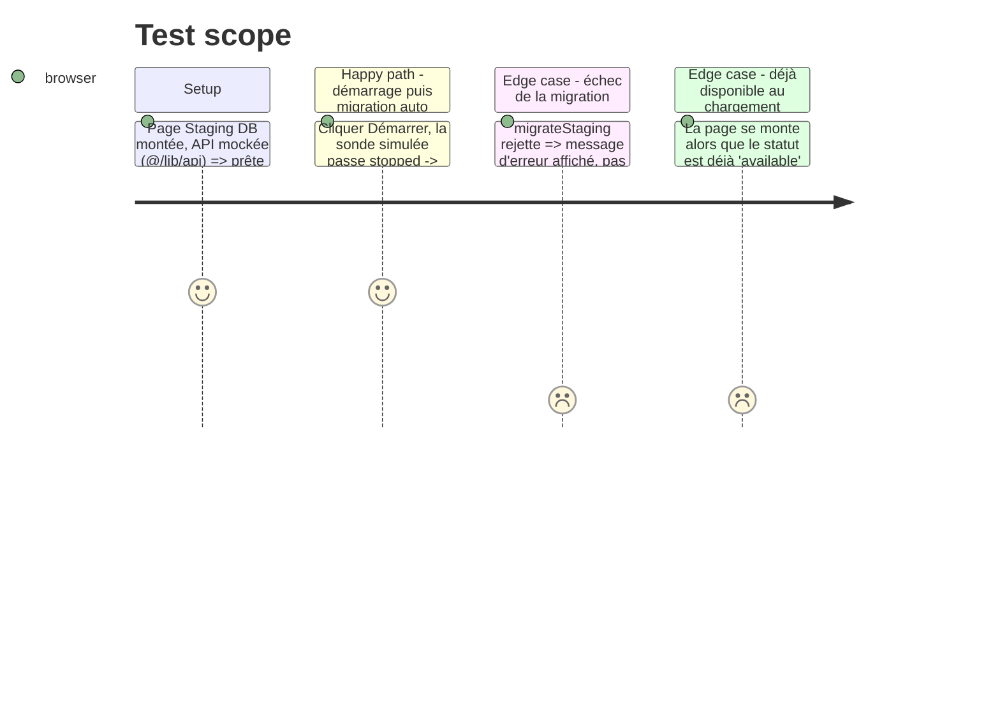

# Instruction: Back-office : auto-déclenchement après démarrage, mémoire

## Architecture projection

> Tree of the final files. ✅ create · ✏️ modify · ❌ delete

```txt
code/www-back-office
├── src/lib/api.ts                      ✏️ ajoute migrateStaging(): Promise<{status: string}>
├── src/pages/staging-db.tsx            ✏️ après un démarrage réussi, sonde /status jusqu'à 'available' puis déclenche migrateStaging() une fois, affiche le résultat
└── src/pages/staging-db.test.tsx       ✅ ou étend un test existant si trouvé : sonde jusqu'à disponible puis déclenche la migration une seule fois, jamais deux

aidd_docs/memory
├── infra.md                            ✏️ documente le nouveau flux (token GitHub, workflow dédié, plus de migration stg dans le pipeline push)
└── deployment.md                       ✏️ retire toute mention de migrate-database-stg comme étape du pipeline push ; ajoute le déclenchement à la demande
```

## User Journey



## Test Scope



## Tasks to do

### `1)` Client API

> `src/lib/api.ts`.

1. `migrateStaging()`: `apiFetch<{status: string}>('/v1/staging/migrate', {method: 'POST'})`.

### `2)` Sonde puis déclenchement unique

> `src/pages/staging-db.tsx`.

1. Après le succès de `handleStart()` (pas au montage de la page, voir l'edge case du Test Scope — un simple rafraîchissement de statut ne doit jamais déclencher de migration), démarrer un intervalle qui rappelle `getStagingStatus()` toutes les ~5 secondes.
2. Dès que `status.status === 'available'` est observé pour la première fois DANS CETTE séquence de démarrage : arrêter l'intervalle, appeler `migrateStaging()` une seule fois, afficher le résultat (succès ou erreur) dans un nouvel état dédié (ex. `migrateResult`/`migrateError`), distinct de `startError`.
3. Nettoyer l'intervalle si le composant est démonté pendant qu'il tourne (`useEffect` cleanup ou équivalent) pour ne pas sonder indéfiniment en arrière-plan.
4. Pas de limite de tentatives explicite requise par ce plan (le statut passera forcément à `available` sous quelques minutes en usage normal), mais l'exécutant peut en ajouter une raisonnable (ex. abandonner après 10 minutes avec un message) si cela reste simple — au choix, pas un critère d'acceptation bloquant.

### `3)` Mémoire projet

1. `aidd_docs/memory/infra.md` : section « Staging DB control exception » déjà présente — y ajouter que le démarrage déclenche désormais aussi les migrations via un token GitHub dédié et un workflow `workflow_dispatch` isolé (`migrate-stg-on-demand.yml`, secrets `TF_STG__*` uniquement) ; jamais de credentials DB master donnés au Lambda.
2. `aidd_docs/memory/deployment.md` : retirer toute mention de `migrate-database-stg` comme étape du pipeline déclenché par push ; documenter qu'elle est désormais déclenchée à la demande depuis le back-office.

## Test acceptance criteria

| Task | Acceptance criteria |
| ---- | -------------------- |
| 1... | `npm run build`/`typecheck` ne signale aucune erreur sur le nouveau type/fonction |
| 2... | Scénario manuel ou test Vitest : démarrer, observer la transition de statut, voir la migration se déclencher automatiquement une seule fois |
| 3... | `npm run lint`, `npm run test`, `npm run build` verts ; aucune mémoire ne décrit plus l'ancien comportement (migration au push) comme actif |
